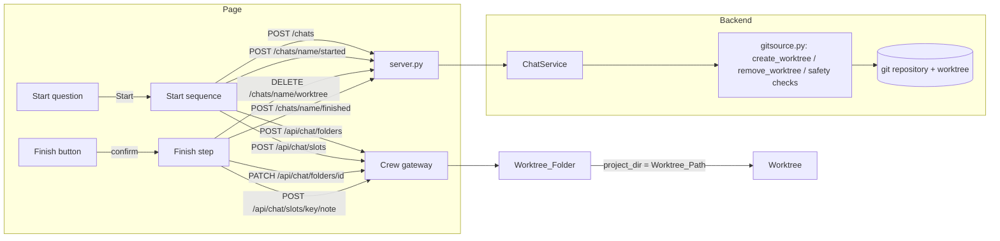

# Design Document

## Overview

This story gives each started story its own git worktree and opens the conductor's chat there. It builds on the start spec (`.kiro/specs/start-a-story/`), the set-up-projects spec (`.kiro/specs/set-up-projects/`) and the briefs spec (`.kiro/specs/briefs-that-hold-up-on-any-agent/`), and does not repeat them.

The changes touch five backend files and one page file. The backend gains git worktree operations, two new routes, a `worktree` field on Project and on `setup.json` entries, two new brief steps, git safety checks before a worktree is removed, and a `finished` Chat_Record state. The page's start flow creates a Crew subfolder for each worktree card, then creates the chat there; the Projects view gains a checkbox; a person-started Finish step removes the worktree and marks the chat finished. No new dependency is added, and `app.json` gains no new permission.

### Layout of the change

```
backend/gitsource.py        CHANGED  add create_worktree, remove_worktree; group 5 adds
                                     worktree_has_changes, worktree_has_unpushed
backend/chats.py            CHANGED  Chat_Record gains worktree_path and worktree_folder_id;
                                     build_brief gains worktree_path parameter; Setup_Step and Catch_Up_Step;
                                     group 5: state "finished", mark_finished, started() returns all fields
backend/setup.py            CHANGED  validate_setup_entry accepts worktree field
backend/projects.py         CHANGED  Project gains worktree field; GET /projects returns it
backend/server.py           CHANGED  reserve creates worktree; DELETE /chats/<name>/worktree route;
                                     started route accepts worktree_folder_id;
                                     group 5: safety checks in the worktree route, POST /chats/<name>/finished
ui/index.mjs                CHANGED  setupReduce gains worktree toggle; renderSetupView shows checkbox;
                                     start sequence creates Worktree_Folder, opens chat in it;
                                     start question shows mode; group 5: Finish step (replaces cleanup on PR merge/close)
tests/test_gitsource.py     CHANGED  tests for create_worktree, remove_worktree and the group 5 checks
tests/test_chats.py         CHANGED  brief with worktree_path; Setup_Step and Catch_Up_Step; record fields
tests/test_setup.py         CHANGED  validate_setup_entry accepts worktree field
tests/test_server.py        CHANGED  reserve creates worktree; worktree route; cleanup route; started with folder_id
tests/ui/setup.test.mjs     CHANGED  worktree checkbox in Projects view
tests/ui/start.test.mjs     CHANGED  start sequence: Worktree_Folder creation; mode in start question
tests/ui/board.test.mjs     CHANGED  Finish step; "Worktree kept" state; finished badge
```

## Architecture



## Components and Interfaces

### Git worktree operations (`gitsource.py`)

```python
def worktree_path(repository, name):
    """The Worktree_Path: <parent>/<basename>--<name>. Example:
      repository=/home/alice/my-project, name=epic-board-a3f2b1c4
      → /home/alice/my-project--epic-board-a3f2b1c4"""

def create_worktree(repository, path, main_branch):
    """Fetch origin and create a detached worktree at path at origin/main_branch.
    Returns (True, None) on success or (False, error_text) on failure.
    If path already exists as a worktree, returns (True, None) without re-creating.
    Runs: git fetch origin; git worktree add --detach path origin/main_branch.
    If the worktree add fails and the path was partially created, force-removes it."""

def remove_worktree(repository, path, force=False):
    """Remove the worktree at path. Returns (True, None) or (False, error_text).
    Runs: git worktree remove [--force] path."""
```

`create_worktree` uses the `run_git` helper already in `gitsource.py`. It runs two commands: `git fetch origin`, then `git worktree add --detach <path> origin/<main_branch>`. The worktree starts with a detached HEAD at the latest origin/main commit; the conductor creates its own branch inside as the brief says. On failure of `worktree add`, it attempts to clean up with `git worktree remove --force <path>`.

`worktree_path` is a pure function (no subprocess) so it can be used in tests and in `build_brief` without side effects.

### The Chat_Record (`chats.py`)

`RECORD_KEYS` gains two fields: `worktree_path` and `worktree_folder_id`. Both are nullable (the value may be `null` or a non-empty string). The validation in `_check_records` accepts `null` or a string matching `NAME_PATTERN` for `worktree_folder_id`, and `null` or a non-empty string of at most 1000 characters for `worktree_path`.

```python
RECORD_KEYS = {"card_id", "name", "key", "state", "created",
               "worktree_path", "worktree_folder_id"}
```

Group 5 adds a third state, `finished`: `STATES = ("reserved", "started", "finished")`. A state value, not a flag, because `reserve` already branches on `state` (a `started` record answers `chat_exists`) and a finished record must never answer that. A flag would leave `state == "started"` true for a finished chat and every existing check on it would need a second condition. `_check_records` treats a `finished` record like a `started` one: it needs a `key`.

`ChatStore.started()` today returns only `card_id`, `name`, `key` and `created`. So the page never receives `worktree_path` or `worktree_folder_id`, and no record could be cleaned up. Group 5 makes it return every field of each `started` or `finished` record, including `state`, `worktree_path` and `worktree_folder_id`.

`ChatStore.mark_finished(name)` sets `state` to `finished`. It refuses with 404 `chat_not_found` for an unknown name, 409 `chat_not_started` for a `reserved` record, and 409 `worktree_not_removed` while `worktree_path` is set. A record that is already `finished` answers the same as a success. `ChatStore.reserve(card_id)` skips `finished` records when it looks for the card's reserved or started record. `ChatStore.mark_started` removes the `finished` records of the card, so a card holds at most one finished record, and only until its next chat is started. `ChatService.reserve` refuses a Done card with `card_done` unless the card has a `finished` record.

Existing records (without these keys) are **not** treated as unreadable: `_check_records` treats missing keys as `null` and the writer always includes them. This keeps backward compatibility: an old `chats.json` without the new keys is still readable.

### The brief (`chats.py`)

`build_brief` gains a `worktree_path` keyword argument (default `None`).

```python
def build_brief(card, epic_file, branch, taken=(), instructions=None, worktree_path=None):
```

When `worktree_path` is a non-empty string:

1. **Setup_Step** is inserted as step 1, before every other numbered step in both variants (before "Read requirements.md..." or "Read the story's entry..."):

   > This story runs in its own worktree. Before anything else, run the project's setup (as AGENTS.md says — for example `npm ci`).

2. **Catch_Up_Step** is inserted after the work steps and before the name-check step, in both variants:

   > Before opening or updating the pull request, run `git fetch origin` and `git merge origin/<branch>` in the worktree. Resolve any conflicts, rerun the checks the project names and say so in this chat.

   where `<branch>` is the main branch name, inline-escaped.

When `worktree_path` is `None` or empty, neither step appears and the brief is identical to today's.

The existing callers that pass no `worktree_path` keep working.

### The reserve call (`server.py`)

The `ChatService.reserve` method gains worktree support:

```python
def reserve(self, card_id, project):
    ...
    # When project.worktree is True:
    wt_path = worktree_path(project.repository, record_name)   # record_name = generated chat name
    ok, err = create_worktree(project.repository, wt_path, branch)
    if not ok:
        raise ChatError("worktree_failed", 409, f"Could not create worktree: {err}")
    # brief includes wt_path
    brief = build_brief(card, epic_file, branch, taken=spec_folders(plan),
                        instructions=plan.get("instructions"), worktree_path=wt_path)
    record = {"card_id": ..., "name": ..., "key": None, "state": "reserved", "created": ...,
              "worktree_path": wt_path, "worktree_folder_id": None}
    ...
```

Non-worktree starts set both new fields to `null`.

### The worktree and finish routes (`server.py`)

```
DELETE /chats/<name>/worktree[?force=true]
POST   /chats/<name>/finished
```

`CHATS_ROUTE` gains the suffix `finished`. Both routes require a valid gateway signature.

**`DELETE .../worktree`** (`ChatService.remove_worktree_route`, exists). When `worktree_path` is `null` it answers 200 `{"ok": true}`. When the folder is gone from disk it sets `worktree_path` to `null` and answers 200. Without `force=true` it runs two checks first, in this order, and answers 409 on the first that fails:

1. `worktree_has_changes(path)`: `git -C <path> status --porcelain` prints anything (modified, staged or untracked files; ignored files are not listed). Code `worktree_has_changes`.
2. `worktree_has_unpushed(path, main_branch)`: when `git -C <path> rev-parse --abbrev-ref @{upstream}` succeeds, `git rev-list --count @{upstream}..HEAD` is above 0; otherwise (no upstream, or a detached HEAD) `git rev-list --count origin/<main_branch>..HEAD` is above 0. `main_branch` is `gitsource.main_branch(repository)`. Code `worktree_has_unpushed`.

With `force=true` it skips both and runs `git worktree remove --force`. Any other failure of `git worktree remove` answers 409 `worktree_remove_failed` with git's text. Today every failure is reported as `worktree_has_changes`, which is wrong for a path that is not a worktree. On success it sets `worktree_path` to `null`.

`worktree_has_changes` and `worktree_has_unpushed` are new functions in `gitsource.py` and use `run_git`. (`worktree_has_changes` exists today only as an error code in `server.py`, not as a function.) Each returns `(True|False, None)`, or `(None, error_text)` when git fails; an error counts as a refusal with the error as the reason. `shortcut: a squash-merged branch whose remote branch was deleted has commits that are not on origin/<main>, so it is refused; the person uses "Remove anyway". Upgrade only if that proves common.`

**`POST .../finished`** (new). No body. Calls `ChatStore.mark_finished` and answers 200 `{"card_id", "name", "key", "state": "finished"}`.

### The `started` route extension (`server.py`)

`POST /chats/<name>/started` body gains an optional `worktree_folder_id` field (the Crew subfolder id the page created). The backend stores it in the record. Validation: absent or matching `NAME_PATTERN`.

### Project and setup (`projects.py` and `setup.py`)

`Project` gains a `worktree` boolean field (default `True` when absent):

```python
Project = namedtuple("Project", ["id", "name", "repository", "folder", "folder_reason",
                                 "records_file", "worktree"])
```

`validate_setup_entry` accepts an optional `"worktree"` key. When present it must be a JSON boolean; when absent it is treated as `True`. An entry with `"worktree": "yes"` returns an error.

`GET .../projects` and `GET .../setup` include `"worktree": true|false` for each project so the page can pre-tick the checkbox.

### The Crew subfolder (`ui/index.mjs`)

The page creates the Worktree_Folder in the start sequence, between creating the worktree (via `POST .../chats/{card_id}`) and creating the Crew chat. The request is:

```
POST /api/chat/folders
{name: "<story-name> · <last-8-of-record-name>", project_dir: <worktree_path>, parent_id: <project-folder-id>}
```

The folder name is `<story name> · <last 8 characters of the Chat_Record's name>` (separator is ` · `, U+00B7). The whole name is capped at 100 characters by shortening the story name part to at most 89 characters. When the story name is empty, the name is just the 8-character suffix. This makes each reservation's folder name unique: a second start of the same card uses a new record name and therefore a new suffix, so Crew does not return the first card's folder (Crew 0.12.2, `chat_folders_records.py`, `refuse_duplicate_name`: same name under same parent returns `"reused": True`).

Crew sets `owner_app` automatically. The response includes the new folder's `id`. The page then creates the chat with `folder_id` set to this subfolder id (not the project's folder).

The subfolder id is saved in `POST /chats/<name>/started` as `worktree_folder_id`.

Confirmed from Crew 0.12.2's source: `POST /api/chat/folders` accepts `project_dir` from apps and Crew marks the folder `owner_app`. `POST /api/chat/slots` has no directory field, only `folder_id`. The subfolder-per-card approach is therefore the decided design.

### Finish in the page (`ui/index.mjs`)

Nothing runs by itself. The code of the old auto cleanup goes: the `prTerminated` flag set in `readChats`, the `cleanups` set and the loop over `byKey` in the poller's `onResult`, and `cleanupRecord`. `finishCleanup` is rewritten as the Finish sequence; `actions.removeWorktree` stays and becomes the "Remove anyway" action.

**State.** `uiReduce` gains `finish-ask` and `finish-cancel` (which card has its confirm step open) next to `ask`. The existing `worktree-kept` action carries the refusal `reason` as well as the path, and shows for both refusals.

**Card views.** `cardViewOf` picks the card's record: a `started` one when there is one, else a `finished` one. A finished record gives `{mode: 'finished', key, name, href}`. When the card is asking (`ui.asking`), a finished card shows the start question, as a startable card does. `renderChatPart` draws, for a card in mode `chat`, `restoring`, `not-open`, `resuming` or `resume-failed`, a "Finish session" button; in mode `finished` the badge "Session finished" (`STATE_WORDS.finished`, variant `muted`), the card name as the link to the ended chat and a "Restart session" button that calls `actions.ask(card.id)`. The `started` set for `columnsOf` holds only cards with a non-finished record, so a finished planned card stays in Planned. `readChats` does not read the state of a finished record: it sets `byKey[key] = {state: 'finished'}`.

**Confirm step.** A `group` named "Finish this session" with the text of Requirement 5, criterion 2, a "Finish session" button and a "Cancel" button. Escape cancels, as the start question does. The tasks warning reads `card.tasks`: shown when `done < total`.

**Finish sequence** (`actions.finish(name)`):

1. When the record has a `worktree_path`: `DELETE .../chats/<name>/worktree`. On 409 `worktree_has_changes` or `worktree_has_unpushed`: show "Worktree kept: `<reason>`" with "Remove anyway" and stop. On another failure: show the reason on the card and stop.
2. When the record has a `worktree_folder_id`: `PATCH /api/chat/folders/<id>` with `{"project_dir": ""}`. A failure is ignored. Crew's own cleanup of empty folders keeps any folder with `project_dir` set (`chat_folder_cleanup.py`, `_KEEP_FIELDS`), so clearing it lets the person remove the folder.
3. `POST .../chats/<name>/finished`. On failure: show the reason; "Finish session" works again, and step 1 is then skipped because `worktree_path` is `null`.
4. Update the record in the chats state to `finished`.
5. `gateway.post('/api/chat/slots/<key>/note', {content: <note>, source: 'epic-board'})`. The note is the same text every time: "This session is finished and its working folder was removed. For more work on this story, use Restart session on its card in Epic Board to open a new chat." A failure, including a 404 for a closed chat, skips the note; Finish carries on and the card shows "Session finished".

**The note is for the person, not the agent.** `POST /api/chat/slots/{slot}/note` (`chat_api/slot_note.py`, `api_chat_slot_note`) starts no agent turn. It writes a visible line in the transcript and a context entry that Crew prepends to the person's next message, once, and drops after 24 hours. Two things follow. The text is written as a statement of fact and asks for nothing, as that function's own documentation requires. And the design does not rely on the agent ignoring it: the board never posts it through `POST /api/chat`, the route that starts a turn. It does not use `sendBrief`. The agent may see the line with the person's next message; nothing in it is an instruction, and it must not act on it. The board posts it once, at Finish, because it cannot catch typing in a chat.

"Remove anyway" runs the same sequence with `?force=true`.

**Restart session.** The question and `startStory` are unchanged. `reserve` ignores the finished record and creates a new one; `mark_started` then deletes the finished one. `reduce('started')` already drops older records of the same card.

### The Projects view (`ui/index.mjs`)

The worktree checkbox is below the name field for each ticked folder. When a folder is unticked, the checkbox is hidden. When reticked, it restores the last value or defaults to `true`.

The start question line reads:
- Worktree on: "Works in its own worktree"
- Worktree off: "Works in the shared checkout"

## Correctness Properties

### Property 1: Worktree_Path is a pure function

For any `repository` path and `name` string, `worktree_path(repository, name)` returns a deterministic non-empty path under the same parent directory as the checkout, independent of filesystem state.

At least 50 iterations with the seed printed on failure.

**Validates: Requirement 2.3**

### Property 2: Brief setup and catch-up steps respect the worktree flag

For any card (both variants, with and without epic) and any non-null `worktree_path`, the brief contains the Setup_Step as step 1 and the Catch_Up_Step after the work steps, in that order. For `worktree_path=None`, neither step appears and the step numbers are unchanged.

At least 100 iterations with the seed printed on failure.

**Validates: Requirements 3.1–3.7**

## Error Handling

| Where | Failure | What the person sees |
|---|---|---|
| Reserve | `git fetch` fails | "Could not create worktree: fetch failed — `<reason>`." Question offered again |
| Reserve | `git worktree add` fails | "Could not create worktree: `<reason>`." Question offered again |
| Reserve | Worktree already at path | Reused silently; start proceeds |
| Start seq | `POST /api/chat/folders` fails | Worktree removed via backend route; "Could not create worktree folder: `<reason>`." |
| Finish | Worktree has uncommitted changes | "Worktree kept: " and the reason, with "Remove anyway" |
| Finish | Worktree has commits that are not pushed | Same, with that reason |
| Finish | Git cannot remove the worktree for another reason | The reason on the card; nothing is changed |
| Finish | Subfolder PATCH fails | Silently skipped; the chat is still marked finished |
| Finish | Marking finished fails | The reason on the card; "Finish session" works again and skips the removal |
| Finish | Note into the chat fails | Silently skipped; the card is finished |
| Record | Old record without new fields | Fields treated as `null`; backward compatible |

## Edits to earlier specs

| Where | Change |
|---|---|
| Epic page (`docs/epics/epic-board.md`) | Story line links to `.kiro/specs/a-worktree-per-card/` and is set to in progress; "Not in this epic" updated to allow one app-owned subfolder per started card |
| Start spec (`start-a-story`), Requirement 4 | A card with a finished record can be started again, including a Done card; reserve response may include `worktree_path`; `started` body may include `worktree_folder_id`; start sequence creates Worktree_Folder when setting is on |

The earlier "no finished" comment on `STATE_WORDS` in `ui/index.mjs` stops being true and is changed in group 5. The old group 3 tests of the auto cleanup are replaced by the Finish tests (task 5.5 and 5.7); they test behaviour this group removes. No other earlier test stops being true. `build_brief` with no `worktree_path` argument is unchanged. Old `chats.json` records without the new fields are readable.

## Testing Strategy

### Backend tests

- **`tests/test_gitsource.py`**: `worktree_path` pure-function cases; `create_worktree` succeeds on a fake repo (using `git init` in a temp dir and a mock `run_git`); `create_worktree` returns `(False, error)` on fetch failure and on `worktree add` failure; `create_worktree` does not re-create an existing worktree; `remove_worktree` without and with `--force`. Group 5: `worktree_has_changes` (clean, modified, untracked, ignored-only) and `worktree_has_unpushed` (upstream ahead, upstream equal, no upstream with and without commits, detached HEAD) on a real temporary repository.
- **`tests/test_chats.py`**: `build_brief` with `worktree_path` set: Setup_Step is step 1; Catch_Up_Step appears before the name-check step; both variants (no-spec, with-spec); `worktree_path=None` leaves the brief unchanged. Property 2 as a seeded test with at least 100 iterations. Record validation: new fields accepted; missing fields treated as null; bad `worktree_folder_id` rejected.
- **`tests/test_setup.py`**: `validate_setup_entry` accepts `true` and `false` for `worktree`; rejects non-boolean; treats absent as `true`.
- **`tests/test_server.py`**: Reserve with worktree on calls `create_worktree` and stores `worktree_path`; reserve with worktree off stores `null`; `DELETE .../worktree` route calls `remove_worktree`; `?force=true` passes through; 409 `worktree_has_changes` on uncommitted changes; `started` route stores `worktree_folder_id`. Group 5: `GET /chats` returns the worktree fields and `state`; the worktree route refuses with `worktree_has_unpushed`, and `force` skips both checks; `POST .../finished` marks, is idempotent, and refuses while `worktree_path` is set; reserve skips finished records and accepts a Done card that has one; `mark_started` removes the card's finished records.

### Page tests

- **`tests/ui/setup.test.mjs`**: Worktree checkbox shown per ticked folder; default ticked; value persists across untick/retick.
- **`tests/ui/start.test.mjs`**: Start question shows "Works in its own worktree" vs "Works in the shared checkout" based on project setting; start sequence calls `POST /api/chat/folders` before `POST /api/chat/slots` when worktree on; `folder_id` in slots call is the subfolder id; `started` body includes `worktree_folder_id`.
- **`tests/ui/board.test.mjs`**: "Finish session" button on a started card with and without a worktree; the confirm step names the path and the ignored-files line, and the tasks warning shows only when tasks are not all ticked; nothing is called before the person confirms; "Worktree kept" with the reason for both refusals; "Remove anyway" force-removes; the sequence order (worktree, folder PATCH, finished, note); a failed note does not undo it; the badge "Session finished"; "Restart session" on a finished card in every column including Done; no automatic removal when a PR link is merged.

| Req | Backend | Page | Manual |
|---|---|---|---|
| 1 | setup, server | setup view | Save and reload; Projects view shows saved value |
| 2 | gitsource, server | start | Worktree created beside checkout; conductor opens in it |
| 3 | chats (brief) | — | Brief in conductor chat has setup and catch-up steps |
| 4 | — | — | Reopen card; worktree reused |
| 5 | server, gitsource (finish, safety checks) | board | Finish removes the worktree and shows "Session finished"; Restart session starts clean |
| 6 | server (error paths) | start | Error shown; retry starts fresh |

## Design Decisions

- **Worktree beside the checkout, not in the data folder.** git worktrees should live outside the checkout tree. A sibling path keeps the layout predictable, matches what the terminal user would expect, and makes manual cleanup straightforward.
- **Subfolder per worktree, confirmed approach.** `POST /api/chat/folders` accepts `project_dir` from apps (Crew 0.12.2, `chat_folders_routes.py`); `POST /api/chat/slots` has no directory field. The page creates one `owner_app` Crew subfolder per started card with `project_dir = Worktree_Path`, opens the chat there, and removes the subfolder on cleanup.
- **Worktree creation in the reserve step.** Reserve is the backend step that runs before any Crew call. Creating the worktree there means: if it fails, nothing is orphaned in Crew. If it succeeds and the Crew calls fail, the worktree is reused on the next retry (criterion 2.4).
- **Old records without new fields stay readable.** `_check_records` treats missing `worktree_path` and `worktree_folder_id` as `null`. Adding these fields to the writer always ensures the file stays in a known form after any write.
- **Default `worktree: true`.** The story says the setting is "on by default". Existing installations that have no `worktree` key in `setup.json` get the new behaviour automatically, which matches the epic's intent.
- **Worktree named after the record, not the branch.** Using the chat record's name (`epic-board-xxxxxxxx`) as the path component avoids the failure where `git worktree add -b story/<spec>` fails because that branch already exists after the spec PR merged. The conductor creates its branch inside the detached worktree as the brief says. The record name is unique per start, so each retry and each new group gets its own path.
- **Finish is the person's step, not an automatic cleanup.** Found on the host check of group 4. Crew 0.12.2 gives an app no pull request state: `GET /api/chat/slots` answers an app token with source links without their `state` (`slot_detail.py`; `ws_event_scope.py`, `_SOURCE_LINK_STATUS_KEYS`). And a story chat opens one pull request per group, so "a pull request is merged and none is open" also holds between two groups, and the folder of a chat that is still working would go. Reading the state with `gh` was tried and dropped: it is not on every machine and it is GitHub only.
- **The safety check is plain git, in the backend.** It cannot know the pull request state, but it can know whether anything would be lost: uncommitted work, or commits that exist nowhere else. "Remove anyway" stays for the person who knows better.
- **`finished` is a state value, not a flag.** See "The Chat_Record". The chat is not closed or deleted; it stays in Crew and the person can still talk to it.
- **Worktree_Path as a pure function.** `worktree_path(repository, name)` does no filesystem access. This lets the brief builder and the page compute the path without subprocess cost, and makes it easy to test.

## Open Questions

**A. Resolved.** `POST /api/chat/folders` accepts `project_dir` from apps (confirmed from Crew 0.12.2, `chat_folders_routes.py`). Crew marks the folder `owner_app`. `POST /api/chat/slots` has no directory field. The subfolder-per-card approach is the decided design.

**B. Resolved.** `DELETE /api/chat/folders/<id>` returns 403 `folder_delete_forbidden` for apps (Crew 0.12.2, `chat_folders_routes.py` ~line 1241: `if request_app: return 403`), and each refusal is written to the person's access log. Instead, cleanup sends `PATCH /api/chat/folders/<worktree_folder_id>` with `{"project_dir": ""}` — allowed for an app's own folder (`api_chat_folder_update`). Clearing `project_dir` lets Crew's own cleanup remove the folder once it is empty. Requirement 5, criterion 3 updated accordingly.

**C. Resolved.** `/api/chat/folders` in `app.json` covers `POST` requests (apps can create folders). No separate entry is needed. The board creates one `owner_app` subfolder per started card. `DELETE /api/chat/folders/<id>` is refused for apps (see Open Question B), so no delete permission is exercised.

**D. Resolved.** The note after Finish is posted with `POST /api/chat/slots/<key>/note` (`chat_api/slot_note.py`, `api_chat_slot_note`), which starts no agent turn. The board already holds the grant: `permissions.api` in `app.json` lists `/api/chat/slots`, the prefix the board's `.../resume` call uses. The slot is one the board created, which is what Crew's ownership check for app callers looks for (`deny_app_slot_session_access`). The function looks the slot up in `state._slots` and answers `slot_not_found` (404) when it is missing, so a chat the person has closed gets no note and nothing is written. When the chat is open but a turn is running, the note is held durably and written at the end of that turn (`visibleDeferred` true in the answer). The board treats a 404, and any other failure, the same way: it skips the note and Finish carries on. The card still shows "Session finished".
