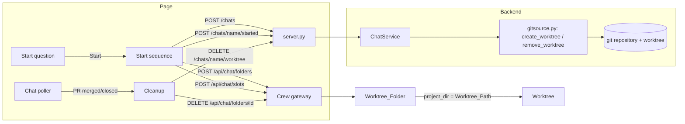

# Design Document

## Overview

This story gives each started story its own git worktree and opens the conductor's chat there. It builds on the start spec (`.kiro/specs/start-a-story/`), the set-up-projects spec (`.kiro/specs/set-up-projects/`) and the briefs spec (`.kiro/specs/briefs-that-hold-up-on-any-agent/`), and does not repeat them.

The changes touch five backend files and one page file. The backend gains git worktree operations, two new routes, a `worktree` field on Project and on `setup.json` entries, and two new brief steps. The page's start flow creates a Crew subfolder for each worktree card, then creates the chat there; the Projects view gains a checkbox; the cleanup flow removes the worktree and subfolder. No new dependency is added, and `app.json` gains no new permission.

### Layout of the change

```
backend/gitsource.py        CHANGED  add create_worktree, remove_worktree
backend/chats.py            CHANGED  Chat_Record gains worktree_path and worktree_folder_id;
                                     build_brief gains worktree_path parameter; Setup_Step and Catch_Up_Step
backend/setup.py            CHANGED  validate_setup_entry accepts worktree field
backend/projects.py         CHANGED  Project gains worktree field; GET /projects returns it
backend/server.py           CHANGED  reserve creates worktree; POST /chats/<name>/worktree route;
                                     DELETE /chats/<name>/worktree route; started route accepts worktree_folder_id
ui/index.mjs                CHANGED  setupReduce gains worktree toggle; renderSetupView shows checkbox;
                                     start sequence creates Worktree_Folder, opens chat in it;
                                     start question shows mode; cleanup on PR merge/close
tests/test_gitsource.py     CHANGED  tests for create_worktree and remove_worktree
tests/test_chats.py         CHANGED  brief with worktree_path; Setup_Step and Catch_Up_Step; record fields
tests/test_setup.py         CHANGED  validate_setup_entry accepts worktree field
tests/test_server.py        CHANGED  reserve creates worktree; worktree route; cleanup route; started with folder_id
tests/ui/setup.test.mjs     CHANGED  worktree checkbox in Projects view
tests/ui/start.test.mjs     CHANGED  start sequence: Worktree_Folder creation; mode in start question
tests/ui/board.test.mjs     CHANGED  cleanup on PR merge/close; "Worktree kept" state
```

## Architecture



## Components and Interfaces

### Git worktree operations (`gitsource.py`)

```python
def worktree_path(repository, name):
    """The Worktree_Path: <parent>/<basename>--<name>. Example:
      repository=/home/alice/my-project, name=epic-board-a3f2b1c4
      → /home/alice/my-project--epic-board-a3f2b1c4"""

def create_worktree(repository, path, main_branch):
    """Fetch origin and create a detached worktree at path at origin/main_branch.
    Returns (True, None) on success or (False, error_text) on failure.
    If path already exists as a worktree, returns (True, None) without re-creating.
    Runs: git fetch origin; git worktree add --detach path origin/main_branch.
    If the worktree add fails and the path was partially created, force-removes it."""

def remove_worktree(repository, path, force=False):
    """Remove the worktree at path. Returns (True, None) or (False, error_text).
    Runs: git worktree remove [--force] path."""
```

`create_worktree` uses the `run_git` helper already in `gitsource.py`. It runs two commands: `git fetch origin`, then `git worktree add --detach <path> origin/<main_branch>`. The worktree starts with a detached HEAD at the latest origin/main commit; the conductor creates its own branch inside as the brief says. On failure of `worktree add`, it attempts to clean up with `git worktree remove --force <path>`.

`worktree_path` is a pure function (no subprocess) so it can be used in tests and in `build_brief` without side effects.

### The Chat_Record (`chats.py`)

`RECORD_KEYS` gains two fields: `worktree_path` and `worktree_folder_id`. Both are nullable (the value may be `null` or a non-empty string). The validation in `_check_records` accepts `null` or a string matching `NAME_PATTERN` for `worktree_folder_id`, and `null` or a non-empty string of at most 1000 characters for `worktree_path`.

```python
RECORD_KEYS = {"card_id", "name", "key", "state", "created",
               "worktree_path", "worktree_folder_id"}
```

Existing records (without these keys) are **not** treated as unreadable: `_check_records` treats missing keys as `null` and the writer always includes them. This keeps backward compatibility: an old `chats.json` without the new keys is still readable.

### The brief (`chats.py`)

`build_brief` gains a `worktree_path` keyword argument (default `None`).

```python
def build_brief(card, epic_file, branch, taken=(), instructions=None, worktree_path=None):
```

When `worktree_path` is a non-empty string:

1. **Setup_Step** is inserted as step 1, before every other numbered step in both variants (before "Read requirements.md..." or "Read the story's entry..."):

   > This story runs in its own worktree. Before anything else, run the project's setup (as AGENTS.md says — for example `npm ci`).

2. **Catch_Up_Step** is inserted after the work steps and before the name-check step, in both variants:

   > Before opening or updating the pull request, run `git fetch origin` and `git merge origin/<branch>` in the worktree. Resolve any conflicts, rerun the checks the project names and say so in this chat.

   where `<branch>` is the main branch name, inline-escaped.

When `worktree_path` is `None` or empty, neither step appears and the brief is identical to today's.

The existing callers that pass no `worktree_path` keep working.

### The reserve call (`server.py`)

The `ChatService.reserve` method gains worktree support:

```python
def reserve(self, card_id, project):
    ...
    # When project.worktree is True:
    wt_path = worktree_path(project.repository, record_name)   # record_name = generated chat name
    ok, err = create_worktree(project.repository, wt_path, branch)
    if not ok:
        raise ChatError("worktree_failed", 409, f"Could not create worktree: {err}")
    # brief includes wt_path
    brief = build_brief(card, epic_file, branch, taken=spec_folders(plan),
                        instructions=plan.get("instructions"), worktree_path=wt_path)
    record = {"card_id": ..., "name": ..., "key": None, "state": "reserved", "created": ...,
              "worktree_path": wt_path, "worktree_folder_id": None}
    ...
```

Non-worktree starts set both new fields to `null`.

### The worktree and cleanup routes (`server.py`)

```
DELETE /chats/<name>/worktree
```

Removes the worktree for the record named `<name>`. Requires a valid gateway signature. The backend runs `git worktree remove <path>` (or `--force` when `?force=true`). On success (or when `worktree_path` is null) answers 200 `{"ok": true}`. On failure (uncommitted changes) answers 409 `{"code": "worktree_has_changes", "path": "<path>", "message": "..."}`.

The page calls this route when a PR is merged or closed, and when "Remove anyway" is activated.

### The pull request state route (`prstate.py`, `server.py`)

```
POST /pr-states   {"urls": ["https://github.com/<owner>/<repo>/pull/<n>", ...]}
                  -> 200 {"states": {"<url>": "open" | "draft" | "merged" | "closed" | null}}
```

Requires a valid gateway signature. At most 10 addresses, each matching `https://github.com/<owner>/<repo>/pull/<n>`; any other address, a non-list or an extra body key answers 400 `invalid_request` for the whole call. Each address is read with `gh pr view <url> --json state,isDraft` (an argument list, no shell, 8-second timeout, read in parallel). `OPEN` with `isDraft` is `draft`. A missing gh, no sign-in, a timeout, a failed exit or unreadable JSON gives `null` for that address only. Each answer, `null` included, is kept in memory for 60 seconds, so the 30-second poll does not run gh on every read. Python standard library only. The route belongs to the app's own backend, so `app.json` needs no change.

### The `started` route extension (`server.py`)

`POST /chats/<name>/started` body gains an optional `worktree_folder_id` field (the Crew subfolder id the page created). The backend stores it in the record. Validation: absent or matching `NAME_PATTERN`.

### Project and setup (`projects.py` and `setup.py`)

`Project` gains a `worktree` boolean field (default `True` when absent):

```python
Project = namedtuple("Project", ["id", "name", "repository", "folder", "folder_reason",
                                 "records_file", "worktree"])
```

`validate_setup_entry` accepts an optional `"worktree"` key. When present it must be a JSON boolean; when absent it is treated as `True`. An entry with `"worktree": "yes"` returns an error.

`GET .../projects` and `GET .../setup` include `"worktree": true|false` for each project so the page can pre-tick the checkbox.

### The Crew subfolder (`ui/index.mjs`)

The page creates the Worktree_Folder in the start sequence, between creating the worktree (via `POST .../chats/{card_id}`) and creating the Crew chat. The request is:

```
POST /api/chat/folders
{name: "<story-name> · <last-8-of-record-name>", project_dir: <worktree_path>, parent_id: <project-folder-id>}
```

The folder name is `<story name> · <last 8 characters of the Chat_Record's name>` (separator is ` · `, U+00B7). The whole name is capped at 100 characters by shortening the story name part to at most 89 characters. When the story name is empty, the name is just the 8-character suffix. This makes each reservation's folder name unique: a second start of the same card uses a new record name and therefore a new suffix, so Crew does not return the first card's folder (Crew 0.12.2, `chat_folders_records.py`, `refuse_duplicate_name`: same name under same parent returns `"reused": True`).

Crew sets `owner_app` automatically. The response includes the new folder's `id`. The page then creates the chat with `folder_id` set to this subfolder id (not the project's folder).

The subfolder id is saved in `POST /chats/<name>/started` as `worktree_folder_id`.

Confirmed from Crew 0.12.2's source: `POST /api/chat/folders` accepts `project_dir` from apps and Crew marks the folder `owner_app`. `POST /api/chat/slots` has no directory field, only `folder_id`. The subfolder-per-card approach is therefore the decided design.

### Cleanup in the page (`ui/index.mjs`)

The chat poller reads a pull request's state from the backend, not from `source_links`. Crew 0.12.2 never sends a pull request's `state` to apps: `GET /api/chat/slots` gives an app-token caller its source links without the cached status (`dashboard/chat_api/slot_detail.py`), and `_SOURCE_LINK_STATUS_KEYS` in `ws_event_scope.py` strips `ci`, `ciPending`, `state`, `mergeable` and `mergeStateStatus`. Found on the host check: a closed pull request kept its worktree because `state` was always missing.

For each started record with a `worktree_path`, `readChats` collects the pull request addresses from its `source_links` (kind change, matching `https://github.com/<owner>/<repo>/pull/<n>`), asks `POST /pr-states`, and sets `prTerminated` when every state is known, at least one is `merged` or `closed` and none is `open` or `draft`. A `null`, a failed call or a missing answer means not finished, so nothing is removed and the next read tries again. A record without a `worktree_path` makes no call. The poller still fires cleanup at most once per record key per page load. When a `merged` or `closed` pull request is found, the page calls `DELETE .../chats/<name>/worktree`. On success (or when the response is 200 with `{ok: true}`), the page then calls `DELETE /api/chat/folders/<worktree_folder_id>` if one is recorded. After both, it deletes the Chat_Record via `DELETE .../chats/<name>` and re-renders the card.

On `worktree_has_changes`, the card shows "Worktree kept: uncommitted changes at `<path>`." and a "Remove anyway" button. Activating it calls `DELETE .../chats/<name>/worktree?force=true`.

After the worktree is removed and before the Chat_Record is deleted, the page sends `PATCH /api/chat/folders/<worktree_folder_id>` with `{"project_dir": ""}` to clear the working directory. This is allowed for an app's own folder (Crew 0.12.2, `chat_folders_routes.py`, `api_chat_folder_update`). Crew's "clean up empty folders" keeps any folder with `project_dir` set (`chat_folder_cleanup.py`, `_KEEP_FIELDS`), so clearing it lets the person's own cleanup remove the folder once its chat is closed. If the PATCH fails, the board silently ignores it and proceeds to delete the Chat_Record.

### The Projects view (`ui/index.mjs`)

The worktree checkbox is below the name field for each ticked folder. When a folder is unticked, the checkbox is hidden. When reticked, it restores the last value or defaults to `true`.

The start question line reads:
- Worktree on: "Works in its own worktree"
- Worktree off: "Works in the shared checkout"

## Correctness Properties

### Property 1: Worktree_Path is a pure function

For any `repository` path and `name` string, `worktree_path(repository, name)` returns a deterministic non-empty path under the same parent directory as the checkout, independent of filesystem state.

At least 50 iterations with the seed printed on failure.

**Validates: Requirement 2.3**

### Property 2: Brief setup and catch-up steps respect the worktree flag

For any card (both variants, with and without epic) and any non-null `worktree_path`, the brief contains the Setup_Step as step 1 and the Catch_Up_Step after the work steps, in that order. For `worktree_path=None`, neither step appears and the step numbers are unchanged.

At least 100 iterations with the seed printed on failure.

**Validates: Requirements 3.1–3.7**

## Error Handling

| Where | Failure | What the person sees |
|---|---|---|
| Reserve | `git fetch` fails | "Could not create worktree: fetch failed — `<reason>`." Question offered again |
| Reserve | `git worktree add` fails | "Could not create worktree: `<reason>`." Question offered again |
| Reserve | Worktree already at path | Reused silently; start proceeds |
| Start seq | `POST /api/chat/folders` fails | Worktree removed via backend route; "Could not create worktree folder: `<reason>`." |
| Cleanup | Worktree has uncommitted changes | "Worktree kept: uncommitted changes at `<path>`." with "Remove anyway" |
| Cleanup | `gh` missing, not signed in or slow | State is `null`; the worktree is kept and the next read tries again |
| Cleanup | Subfolder PATCH fails | Silently skipped; record still removed |
| Record | Old record without new fields | Fields treated as `null`; backward compatible |

## Edits to earlier specs

| Where | Change |
|---|---|
| Epic page (`docs/epics/epic-board.md`) | Story line links to `.kiro/specs/a-worktree-per-card/` and is set to in progress; "Not in this epic" updated to allow one app-owned subfolder per started card |
| Start spec (`start-a-story`), Requirement 4 | Reserve response may include `worktree_path`; `started` body may include `worktree_folder_id`; start sequence creates Worktree_Folder when setting is on |

No earlier test stops being true. `build_brief` with no `worktree_path` argument is unchanged. Old `chats.json` records without the new fields are readable.

## Testing Strategy

### Backend tests

- **`tests/test_gitsource.py`**: `worktree_path` pure-function cases; `create_worktree` succeeds on a fake repo (using `git init` in a temp dir and a mock `run_git`); `create_worktree` returns `(False, error)` on fetch failure and on `worktree add` failure; `create_worktree` does not re-create an existing worktree; `remove_worktree` without and with `--force`.
- **`tests/test_chats.py`**: `build_brief` with `worktree_path` set: Setup_Step is step 1; Catch_Up_Step appears before the name-check step; both variants (no-spec, with-spec); `worktree_path=None` leaves the brief unchanged. Property 2 as a seeded test with at least 100 iterations. Record validation: new fields accepted; missing fields treated as null; bad `worktree_folder_id` rejected.
- **`tests/test_setup.py`**: `validate_setup_entry` accepts `true` and `false` for `worktree`; rejects non-boolean; treats absent as `true`.
- **`tests/test_prstate.py`**: each state (open, draft, merged, closed); gh failure, timeout and bad output give `null`; a bad address is refused; the 60-second cache; the signed route.
- **`tests/test_server.py`**: Reserve with worktree on calls `create_worktree` and stores `worktree_path`; reserve with worktree off stores `null`; `DELETE .../worktree` route calls `remove_worktree`; `?force=true` passes through; 409 `worktree_has_changes` on uncommitted changes; `started` route stores `worktree_folder_id`.

### Page tests

- **`tests/ui/setup.test.mjs`**: Worktree checkbox shown per ticked folder; default ticked; value persists across untick/retick.
- **`tests/ui/start.test.mjs`**: Start question shows "Works in its own worktree" vs "Works in the shared checkout" based on project setting; start sequence calls `POST /api/chat/folders` before `POST /api/chat/slots` when worktree on; `folder_id` in slots call is the subfolder id; `started` body includes `worktree_folder_id`.
- **`tests/ui/board.test.mjs`**: cleanup runs when the route says closed although `source_links` has no state; no cleanup when the route gives `null`; a record without a worktree never calls the route; "Worktree kept" state shown when cleanup route returns `worktree_has_changes`; "Remove anyway" triggers force-remove; card rendered without worktree fields for non-worktree chats.

| Req | Backend | Page | Manual |
|---|---|---|---|
| 1 | setup, server | setup view | Save and reload; Projects view shows saved value |
| 2 | gitsource, server | start | Worktree created beside checkout; conductor opens in it |
| 3 | chats (brief) | — | Brief in conductor chat has setup and catch-up steps |
| 4 | — | — | Reopen card; worktree reused |
| 5 | server (cleanup route, pr-states route) | board | PR merged → worktree removed; card resets |
| 6 | server (error paths) | start | Error shown; retry starts fresh |

## Design Decisions

- **Worktree beside the checkout, not in the data folder.** git worktrees should live outside the checkout tree. A sibling path keeps the layout predictable, matches what the terminal user would expect, and makes manual cleanup straightforward.
- **Subfolder per worktree, confirmed approach.** `POST /api/chat/folders` accepts `project_dir` from apps (Crew 0.12.2, `chat_folders_routes.py`); `POST /api/chat/slots` has no directory field. The page creates one `owner_app` Crew subfolder per started card with `project_dir = Worktree_Path`, opens the chat there, and removes the subfolder on cleanup.
- **Worktree creation in the reserve step.** Reserve is the backend step that runs before any Crew call. Creating the worktree there means: if it fails, nothing is orphaned in Crew. If it succeeds and the Crew calls fail, the worktree is reused on the next retry (criterion 2.4).
- **Old records without new fields stay readable.** `_check_records` treats missing `worktree_path` and `worktree_folder_id` as `null`. Adding these fields to the writer always ensures the file stays in a known form after any write.
- **Default `worktree: true`.** The story says the setting is "on by default". Existing installations that have no `worktree` key in `setup.json` get the new behaviour automatically, which matches the epic's intent.
- **Worktree named after the record, not the branch.** Using the chat record's name (`epic-board-xxxxxxxx`) as the path component avoids the failure where `git worktree add -b story/<spec>` fails because that branch already exists after the spec PR merged. The conductor creates its branch inside the detached worktree as the brief says. The record name is unique per start, so each retry and each new group gets its own path.
- **Worktree_Path as a pure function.** `worktree_path(repository, name)` does no filesystem access. This lets the brief builder and the page compute the path without subprocess cost, and makes it easy to test.

## Open Questions

**A. Resolved.** `POST /api/chat/folders` accepts `project_dir` from apps (confirmed from Crew 0.12.2, `chat_folders_routes.py`). Crew marks the folder `owner_app`. `POST /api/chat/slots` has no directory field. The subfolder-per-card approach is the decided design.

**B. Resolved.** `DELETE /api/chat/folders/<id>` returns 403 `folder_delete_forbidden` for apps (Crew 0.12.2, `chat_folders_routes.py` ~line 1241: `if request_app: return 403`), and each refusal is written to the person's access log. Instead, cleanup sends `PATCH /api/chat/folders/<worktree_folder_id>` with `{"project_dir": ""}` — allowed for an app's own folder (`api_chat_folder_update`). Clearing `project_dir` lets Crew's own cleanup remove the folder once it is empty. Requirement 5, criterion 3 updated accordingly.

**C. Resolved.** `/api/chat/folders` in `app.json` covers `POST` requests (apps can create folders). No separate entry is needed. The board creates one `owner_app` subfolder per started card. `DELETE /api/chat/folders/<id>` is refused for apps (see Open Question B), so no delete permission is exercised.
