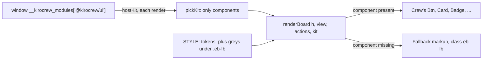

# Design Document

## Overview

This story makes the board look like part of Kiro Crew. It builds on the board design (`.kiro/specs/show-the-board/`), the start design (`.kiro/specs/start-a-story/`) and the chat design (`.kiro/specs/work-in-the-chat/`), and does not repeat them. It changes `ui/index.mjs` and its tests, and no backend file, route, request or poll.

Facts about Crew come from the Kiro Crew source at tag `v0.12.2` (`kirodotdev/KiroCrew`): `website/src/kirocrew-ui/index.ts`, `website/src/components/ui.tsx`, `website/src/components/ErrorNotice.tsx`, `website/src/pages/chat-sidebar/boardLane.tsx` and `website/src/pages/chat/sessionLane.ts`. Each is named where it is used. Nothing here was run on a host: what only a host can show is in "Open Questions" and in the manual check of the last task group.

### What the host offers

- `website/src/app-sdk/shared-modules.ts` registers `window.__kirocrew_modules['@kirocrew/ui']` beside `react` and `@kirocrew/app-sdk`. Its exports are in `kirocrew-ui/index.ts`: `Card`, `CardTitle`, `Btn`, `Badge`, `EmptyState`, `PageHeader`, `ErrorNotice` and others. The page reads it like React.
- The components are written with Tailwind utility classes and Crew's theme tokens. The host's style sheet holds only the utilities Crew's own source uses, so **the page cannot add a utility class of its own** and relies on its own style sheet (`STYLE`) and on the tokens for anything it draws itself. The tokens (`--border`, `--card`, `--bg-elevated`, `--bg-hover`, `--muted`, `--text-strong`, `--accent`, `--ok`, `--warn`, `--danger`, `--info`, `--mono`, `--radius-md`) are defined for every theme in `styles/design-tokens.css` and `styles/theme-palettes.css`. The app documentation does not list them as an interface for apps; see "Open Questions".
- **The Sessions board** is not a component. It is the `board` lane of the chat sidebar, in `boardLane.tsx`. Its column is a box (`bg-card border border-border rounded-md overflow-hidden`); its header is a bar (`p-2 border-b border-border bg-bg-elevated`) holding a drag handle, a dot (`w-2 h-2 rounded-full`), the name (`text-[11px] font-semibold uppercase tracking-wider`) and the count (`text-[11px] text-muted`); its body is padded `p-1.5`. The dot and the name take the lane's colour, `var(--warn)`, `var(--info)`, `var(--accent)` or `var(--muted)` (`sessionLane.ts`). Crew's capitals are `text-transform: uppercase` with wide tracking, not the `small-caps` font variant. This story matches that look and takes nothing from the sidebar's code.
- `Card` is a `div` with `border border-border bg-card rounded-lg px-2 md:px-5 py-5 mb-4 animate-rise shadow-sm`, and takes `className`, `style` and other props. `CardTitle` is an **`h3`** with `text-sm font-semibold tracking-tight text-text-strong mb-3.5`. `Btn` takes `primary`, `danger` and `busy`. `Badge` takes `variant`: `ok`, `err`, `warn`, `aim` or `muted`, and is `text-[13px] font-medium font-mono rounded-full px-2 py-[2px]`. `PageHeader` takes `title`, `subtitle` (a string) and `actions`, and draws the title in a `div`. `EmptyState` takes `icon`, `title`, `subtitle` and `action`. `ErrorNotice` takes `message`, `title`, `footer` and more, has the role `alert` and, only when `askAgent` is true, hands the error to an agent chat. `askAgent` is false by default and stays so.
- **For the projects parts** (read at `v0.12.2` for this edit). `website/src/kirocrew-ui/` holds only `index.ts` and `Select.tsx`; the components `index.ts` re-exports are defined in `components/ui.tsx`. `Select` (`kirocrew-ui/Select.tsx`, `SelectProps`) takes `options: string[]`, `optionLabels?: string[]`, `value`, `onChange(value)`, `clearLabel?`, `disabled?`, `'aria-label'?`, `title?` and `className?`; the Project dropdown passes `aria-label`, `value`, `options`, `optionLabels` and `onChange`, as the epic dropdown does. `Btn` is a `forwardRef` of a `button` that takes every button attribute (`type`, `disabled`, `aria-expanded` and `data-*` reach the element) and `danger`, `primary` and `busy`; the page uses `primary` and none of the others. `ErrorNotice`'s block form is `rounded-lg border border-danger/40 bg-danger/10 px-3 py-2 text-[13px] text-danger-text`. Crew 0.12.2 exports no neutral notice: the one info line of the sessions sidebar (`boardLane.tsx`) uses `bg-info-subtle`, and `--info-subtle` is not a CSS variable (`--info` and `--info-text` are). `Input` is exported; `Checkbox` is defined in `ui.tsx` (`accentColor: 'var(--accent)'`, `margin: 0`) and is not exported, so the page's checkbox is native. `PanelSectionHeader` and `boardLane.tsx` space a row of controls with `gap-2`.

### Layout of the change

```
ui/index.mjs     CHANGED  isComponent, pickKit, hostKit (pure and lookup); renderBoard takes a fourth
                          argument, the kit; each part of the page has a kit path and a fallback path;
                          STYLE is rewritten as the table below says; createBoard reads the kit
tests/ui/kit.test.mjs     NEW      the lookup, Properties 1 and 2
tests/ui/render.test.mjs, board.test.mjs, chats.test.mjs   updated
.kiro/specs/...           the edits listed under "Edits to earlier specs and checks"
```

`app.json`, the backend and every request are unchanged.

## Architecture



### The lookup

```js
// A value React can mount as a component: a function, or an object with a $$typeof (memo, forwardRef).
export function isComponent(value) {
  return typeof value === 'function' || (typeof value === 'object' && value !== null && '$$typeof' in value)
}

const KIT_NAMES = ['Btn', 'Card', 'CardTitle', 'Badge', 'PageHeader', 'EmptyState', 'ErrorNotice']

// The components of `module` that are components, by name. Anything else is left out. Never throws.
export function pickKit(module) {
  const kit = {}
  if (typeof module !== 'object' || module === null) return kit
  for (const name of KIT_NAMES) if (isComponent(module[name])) kit[name] = module[name]
  return kit
}

function hostKit() {
  return pickKit(typeof window !== 'undefined' ? window.__kirocrew_modules?.['@kirocrew/ui'] : undefined)
}
```

`isComponent` is the test the chat design's `isChatPanel` uses, and the implementation has one function for both. The Filter by epic story (`.kiro/specs/filter-by-epic/`) already looks up `Select` in the same module, in its own `try`, with a native `select` as the fallback (its Requirement 1, criterion 5). That rule stays in that spec. The implementation makes its lookup go through `isComponent` and `hostKit`, so the page reads the module in one place, and `Select` is not one of this story's seven names. `createBoard` reads `env.kit ?? hostKit()` inside the component on every render, as it reads `useAppApi` and `ChatPanel`, so importing the module needs no `window`. A `Btn` is a `forwardRef` object, which is why an object with `$$typeof` counts.

`renderBoard(h, view, actions, kit = {})` stays pure: it takes the kit as an argument, calls no hook, and with an empty kit draws exactly what the earlier specs draw, so the existing page tests keep testing the fallback path unchanged. The one icon, for the empty state, is looked up in `createBoard` as `window.__kirocrew_modules['lucide-react']?.Kanban` and passed in `view.icon` (`h(Kanban, {size: 40, 'aria-hidden': 'true'})`, the 40 pixels of `EmptyState`'s own icon box), or left out.

## Components and Interfaces

### Each part, with a kit and without

A fallback element carries the class `eb-fb`. Every grey of the page's own sits in a rule scoped to `.eb-fb`.

| Part | With the component | Fallback (today's markup) |
|---|---|---|
| Header | `h(PageHeader, {title: h('h1', {className: 'eb-title'}, 'Epic Board'), subtitle: "<branch> · <commit7> · <age text>", actions: [h('span', {key: 'checking', className: 'eb-checking', style: {visibility}}, 'Checking for updates…'), <the Projects button, below>]})`. The `h1` is inside the title because `PageHeader` draws its title in a `div`, and the level is `TITLE_LEVEL` as before | the `h1` and `div.eb-header` with three spans and the Projects button |
| Projects button | `h(Btn, {key: 'projects', type: 'button', 'aria-expanded', 'data-eb-setup-btn': 'true', onClick}, 'Projects')`, plain. `PageHeader` lays the actions out with its own gap, so no wrapper is added. `Btn` passes `aria-expanded` and `data-*` to its `button`, so the focus return to `[data-eb-setup-btn]` still finds it | `button.eb-fb[data-eb-setup-btn]` in `div.eb-header` |
| Filter row | `div.eb-filters` holding, in order, `div.eb-filter` > `h(Select, {'aria-label': 'Project', value, options, optionLabels, onChange})` when the switch spec shows it, then `div.eb-filter` > `h(Select, {'aria-label': 'Epic', value, options, optionLabels, onChange})` when the filter spec shows it. Both `Select`s come from the same place (`parts.Select`) and get the same five props and no `className` | the same row with the native `select.eb-fb` in each `div.eb-filter` |
| First-run notice | `div.eb-notice[role=status]` > `p` "Choose your projects" and `h(Btn, {type: 'button', primary: true, 'aria-label': 'Set up projects', 'aria-expanded', onClick}, 'Set up projects')` | the same, with `button.eb-fb` |
| Projects panel | `renderPanel` as the chat design gives it, with the Projects view as its content; its "Close" is a `Btn` (the row "Buttons") | as today |
| Folder row | `li.eb-folder` > `label.eb-folder-label` (native `input[type=checkbox]`, then the name), `div.eb-folder-dir` (the directory, Meta_Style) and, when ticked, the native `input.eb-folder-name[type=text]`. No component | the same elements |
| Save and Cancel | `div.eb-setup-actions` > `h(Btn, {type: 'button', primary: true, disabled, onClick}, 'Save' \| 'Saving…')` and, when not saving, `h(Btn, {type: 'button', onClick}, 'Cancel')`. Never `busy` | the same `div` with `button.eb-fb` |
| "Try again" and the view's "Close" | `h(Btn, {type: 'button', onClick}, …)`, plain | `button.eb-fb` |
| Projects notices | The config line, the load error and the save error keep their `p[role=status]` and take the classes `eb-notice` (all three) and `eb-notice-error` (the two errors). No component | the same |
| Column | `div.eb-column` as a box; its header `h2.eb-column-title` holds `span.eb-dot[aria-hidden]` and `span.eb-column-name`, then `span.eb-count`. No component | the same elements; the box and bar greys under `.eb-fb` |
| Group heading | `h3.eb-group-title`. No component | same |
| Card | `li.eb-item` > `h(Card, {className: 'eb-card', 'data-mode', 'data-open'})` | `li.eb-card.eb-fb[data-mode][data-open]` |
| Card name | `h(CardTitle, {className: 'eb-card-name', role: 'presentation'}, <button, link or text>)` | `div.eb-card-name` |
| Progress | `h(Badge, {variant: 'muted' \| 'ok', className: 'eb-progress'}, text)` and the bar | `div.eb-card-progress` and the bar |
| Chat state | `h(Badge, {variant, className: 'eb-chat-state', 'data-state'}, word)` | `span.eb-chat-state` |
| Buttons | `h(Btn, {type: 'button', primary?, onClick}, text)` | `button.eb-fb` |
| Empty plan | `h(EmptyState, {icon, title, subtitle})` | `div.eb-empty` with two `p` |
| Backend error | `h(ErrorNotice, {message, footer})`, `footer` holding the code and the `settings` list as `code` text | `div.eb-error[role=alert]` |
| Unreachable | `h(ErrorNotice, {message: 'Could not reach the backend.'})` | `p.eb-error[role=alert]` |

Nothing else is passed to a component, except the attributes of the rows above that a `Btn` or `Select` hands to its element (`aria-expanded`, `aria-label`, `data-eb-setup-btn`, `disabled`). `Btn` is `primary` for "Start" on a card, "Save" in the Projects view and "Set up projects" in the first-run notice, and plain everywhere else. It is never `busy` (the board's own "Starting…" text already replaces the buttons while a start runs, and "Saving…" does the same for "Save"). "Set up projects" has no cards beside it, and "Save" is in the panel, so no two primaries compete in one place. `ErrorNotice` gets no `askAgent`, so no hand-off appears (the hand-off would leave the board).

### Kept as the page's own markup

- **The notices with the role `status`**: the failed fetch, the unreachable backend, the chat status, the start and resume failures, the brief's notes, the question and "Loading…". `ErrorNotice` always carries `role="alert"` unless `announce` is false, and `announce: false` gives it no role at all, so it cannot say `status`. They keep their markup and are drawn in Notice_Style (see "Styles"), which the first-run notice and the notices of the Projects view share.
- **The progress bar**: Crew has a progress component, but `@kirocrew/ui` does not export it. The bar stays, drawn with `var(--border)` for the track and `var(--accent)` for the fill, and stays `aria-hidden`.
- **The card's main control** (`button` or `a` with `data-card-id`), the stretched link, the question, the problems disclosure and the panel's container.

### The card's heading

`CardTitle` is an `h3`. Under the board's heading rules (title `h1`, columns `h2`, groups `h3`, no level skipped, no heading in a card) a card heading would sit beside the group's. `role="presentation"` on the `h3` removes its heading role and keeps its look, and its children (the button or link) stay exposed. The start spec and the chat spec each say that their story adds no heading, and this keeps that true. See "Open Questions" for the other choice.

### Styles

`STYLE` is rewritten in three layers, and every rule says which. Colours are `currentColor`, `inherit` or `var(--token, currentColor)`; only the `.eb-fb` rules hold `rgba(128, 128, 128, a)`.

| Thing | Look | Where it comes from |
|---|---|---|
| Title | `PageHeader`'s own | `ui.tsx` `PageHeader`: `text-2xl font-bold tracking-tight text-text-strong` |
| Subtitle | `PageHeader`'s own | `text-muted text-sm` |
| Page gutter | 16px, and 24px from a 768px window | `PageHeader`'s `px-4 md:px-6`; the body takes the same, in a `@media (min-width: 768px)` as Tailwind's `md` is |
| Column box | border `1px solid var(--border)`, radius `var(--radius-md)`, background `var(--card)`, `overflow: hidden` | `boardLane.tsx` column |
| Column header bar | padding 8px, `border-bottom: 1px solid var(--border)`, background `var(--bg-elevated)`, a row with a 4px gap | `p-2 border-b border-border bg-bg-elevated`, `gap-1` |
| Column dot | 8px circle, 6px before the name; colour `var(--muted)` Planned, `var(--accent)` In progress, `var(--ok)` Done | `w-2 h-2 rounded-full`, `gap-1.5`; lane colours of `sessionLane.ts` |
| Column name | 11px, 600, `text-transform: uppercase`, `letter-spacing: 0.05em`; the dot's colour | `text-[11px] font-semibold uppercase tracking-wider` |
| Column count | 11px, `var(--muted)`, at the right | `text-[11px] text-muted` |
| Column body | padding 6px | `p-1.5` |
| Group heading | 11.5px, 600, `var(--muted)` | `PanelSectionHeader` label, `text-[11.5px] font-semibold text-muted` |
| Card | `Card`'s own: border, radius, background, shadow and inset; `margin-bottom: 0` inside the list | `ui.tsx` `Card` |
| Card name | `CardTitle`'s own: 14px, 600, strong text colour | `text-sm font-semibold text-text-strong` |
| Description | 13px, text colour as the host sets it, cut to 3 lines with `-webkit-line-clamp: 3` (and `line-clamp: 3`) and `overflow: hidden` | 13px is the size `Btn`, `Badge` and `EmptyState` use for text (`text-[13px]`) |
| Meta lines | 12px, `var(--muted)`; the spec folder in `var(--mono)` | `text-[12px] text-muted` of `boardLane.tsx`; `Badge`'s `font-mono` |
| State and progress | `Badge`'s own | `ui.tsx` `Badge` |
| Buttons | `Btn`'s own | `ui.tsx` `Btn` |
| Hover of a startable card | `background: var(--bg-hover)` | the token `Btn` uses for hover |
| Open card | `border-color: currentColor` and `box-shadow: 0 0 0 1px currentColor`, no padding change | work-in-the-chat Requirement 2, criterion 4 |
| Filter row | `display: flex; flex-wrap: wrap; align-items: center`, 8px gap, 16px below, inside the body's gutter | the switch design's row; `gap-2` of `PanelSectionHeader` and `boardLane.tsx`; `mb-4` of `Card` |
| Notice, both tones | 1px border, `var(--radius-lg)`, padding 8px 12px, 13px, 16px below | `ErrorNotice`'s block: `border rounded-lg px-3 py-2 text-[13px]`; `mb-4` of `Card` |
| Notice, neutral | border `var(--border)`, background `var(--bg-elevated)`, text colour as the host sets it | the colours of `Card`'s border and of the column header bar; Crew has no neutral notice (Open Question 9) |
| Notice, error | border `var(--danger)`, background `var(--danger-subtle)`, text `var(--danger-text)` | `ErrorNotice`'s block: `border-danger/40 bg-danger/10 text-danger-text` (Open Question 9) |
| Projects view body | padding 8px 12px | the panel head's own padding, so the content shares its left edge |
| Folder row | list style and margin removed; padding 8px 0; `border-bottom: 1px solid var(--border)` | `p-2` and `border-b border-border` of the column header bar |
| Folder label | a row, 6px between the checkbox and the name; the name takes the text colour | `gap-1.5` of the column header's dot and name |
| Folder checkbox | `margin: 0; accent-color: var(--accent)` | `Checkbox` in `ui.tsx` |
| Folder directory | Meta_Style: 12px, `var(--muted)`, `font-family: var(--mono)`, `overflow-wrap: anywhere`. One rule with the card's spec-folder line | the meta line row of this table |
| Folder name field | `font: inherit`, `margin-top: 6px`, the width of the row | the row `gap-1.5`; the field is native (Open Question 10) |
| Save and Cancel row | `display: flex; gap: 8px`, `margin-top: 12px` | `gap-2` as the filter row; `pb-3` of `PageHeader` |

Where the table gives no source, the page sets nothing. The stretched link keeps `position: relative` on `.eb-card` and `position: absolute; inset: 0` on `.eb-card-main::after`, and the controls of a card stay `position: relative` with a `z-index` above it, as the start design says.

The existing `@container (min-width: 720px)` rule keeps its place, so the three columns still appear at 720 pixels of the page's width (board spec, Requirement 2, criterion 4). The panel rules of the chat design are unchanged except the two named under "Edits".

## Correctness Properties

As in the earlier designs, these are checked with seeded generators written in the project's own test helpers (`tests/ui/support.mjs`), at least 100 iterations, with the seed printed on failure.

### Property 1: The kit changes the look, never the words or the structure

*For any* subset of the seven components, given as fakes that draw one predictable element each, and any view and `ui` the page can have (every card mode, every column, every state, with and without a panel, with and without the project dropdown, the Unconfigured state, and the Projects view in each of its phases), the tree has the same heading elements in the same order and at the same levels as the tree drawn with no kit, the same elements with a role and the same roles (apart from the `presentation` on `CardTitle`), the same interactive elements with the same labels and handlers, every text of the no-kit tree appears in the tree (as a whole text or as a part of the header's one subtitle line), the card has no heading, and a missing component's element is the fallback's and a present one's is the fake.

**Validates: Requirements 1.2, 1.3, 1.6, 2.4, 3.1, 3.2, 3.7, 4.1, 4.4, 4.5, 6.1, 6.4, 6.6, 6.7, 6.8**

### Property 2: A kit lookup never throws and keeps only components

*For any* value of `window.__kirocrew_modules['@kirocrew/ui']` (missing, `null`, a string, a plain object, an object whose entries are functions, memo-like objects, `null`, numbers and strings, or an object with a throwing getter) `pickKit` returns an object whose entries are exactly the named entries that `isComponent` accepts, and `hostKit` does not throw without `window`.

**Validates: Requirements 1.1, 1.2**

## Error Handling

| Where | Failure | What the person sees |
|---|---|---|
| Page | The host has no `@kirocrew/ui`, or a component of it is missing or not a component | That part is drawn as it is today |
| Page | The host has no theme token | The token's `currentColor` second argument is used; the element is still drawn |
| Page | The host has no `lucide-react` or no `Kanban` | The empty state has no icon |
| Component | A Crew component throws while drawing | The host's own error handling, as for any component (Requirement 5, criterion 6) |
| Page | A theme where the card and the column share a background | The card's border and shadow tell them apart |

## Edits to earlier specs and checks

Edited in place, as the earlier stories did, because the rule moved. A requirement lives in one spec, so this story's rules are here and the rules that were already elsewhere were changed where they stand.

| Where | Change |
|---|---|
| Board spec, Requirement 3, criterion 1 | The description is cut to three lines |
| Board spec, Requirement 8, criterion 3 | "Checking for updates…" is in the header with the plan age, not "next to" it |
| Board spec, Requirement 10, criterion 1 | Colours are `currentColor`, `inherit` or a theme token, and the page's own greys live only in the fallbacks |
| Board design, "Layout and theme", and the start design's paragraph on `STYLE` | The colour sentences say that the greys belong to the fallbacks and that colours are `currentColor` and theme tokens (task 3.5) |
| Filter by epic spec, Requirement 1, criterion 1 | The dropdown is placed between the header and the columns, because the header is now `PageHeader` and no longer a "header line" |
| Chat design, "Drawing" and "Styles" | The panel's "Close" is a `Btn` when the page has one, and the rule `.eb-panel-head button` applies only to the fallback; the mark of the open card is a ring and no padding change, because `Card`'s inset is in Tailwind classes the page cannot override |
| Epic page | The story's line, linked, with its new description |

Checks that other stories wrote and that stop being true (the tasks bring them in line):

| File | Assumes | Change |
|---|---|---|
| `tests/ui/render.test.mjs` (the colour and outline scans of `STYLE`) | no `var(` and no colour but `currentColor` and greys with an alpha | greys only in `.eb-fb` rules, and `var(--token, currentColor)` allowed; no hex, `rgb()`, `hsl()`, `color-mix()` or name |
| `tests/ui/render.test.mjs` (`renderBoard(h, view)`) | no fourth argument | unchanged, because an empty kit is the fallback; new cases pass a fake kit |
| `tests/ui/render.test.mjs`, `board.test.mjs` (a card is `li.eb-card`) | the card's `li` carries the class, `data-mode` and `data-open` | with a `Card` they are on the `Card`; the tests find the card by `data-card-id` or `data-mode` |
| `tests/ui/render.test.mjs` (the interactive-element check) | buttons are `button` elements | with `Btn` they are the fake's element; the check counts elements with a click handler and a label |
| `tests/ui/setup.test.mjs` (`buttons(tree)` finds `n.type === 'button'`; the status checks find `p` and `div` by `role`) | the Projects view's buttons are `button` elements | with `Btn` they are the fake's element, so `buttons()` also takes a component `type` that carries a click handler; the status checks do not change, because the role stays on the same element |
| `tests/ui/board.test.mjs` (`buttonNamed(page, 'Set up projects')`, the `[data-eb-setup-btn]` lookup of the fake document) | the Projects and "Set up projects" buttons are `button` elements | found by label and by the `data-eb-setup-btn` prop, with and without a kit |
| `tests/ui/projects.test.mjs`, `render.test.mjs` (the `Project` dropdown found by `aria-label`) | `Select` is the `h(Select, …)` of the switch design | unchanged: the dropdown is still found by `aria-label`, and with no kit it is the native `select` |

## Testing Strategy

The page's pure functions and `renderBoard` are tested with Node's built-in runner, as `AGENTS.md` and the board design say. Nothing is added to the backend's tests.

- **`tests/ui/kit.test.mjs`** (new): `isComponent`, `pickKit` and `hostKit` (each kind of value, the throwing getter, no `window`), and Properties 1 and 2.
- **`tests/ui/render.test.mjs`**: each part with a fake component and with none (the table's rows), the props each component gets and none other, `role="presentation"` on `CardTitle`, the heading levels with every combination of a kit, the header's single subtitle line and its always-present "Checking for updates…" with `visibility`, the state variants, the description's `-webkit-line-clamp` rule and the absence of a control to show more, the column header's order, `aria-hidden` on the dot, `STYLE` scans (no colour literal outside `.eb-fb` rules; no `outline: none`; no size outside the table), and the updated scans of "Edits".
- **`tests/ui/board.test.mjs`**: `createBoard` with a fake kit passed through `env.kit`: the kit is read on every render and a late-arriving component is picked up, a card's click, keyboard and focus behaviour is the same with and without it, Start is `primary`, and the panel's "Close" is a `Btn`.
- **The projects parts**, in `render.test.mjs`, `setup.test.mjs` and `board.test.mjs`: both dropdowns get the same five props (and no `className`) in one `div.eb-filters`, project first; the native fallbacks carry `eb-fb`; the header's "Projects" is a plain `Btn` in the `actions` with `aria-expanded` and `data-eb-setup-btn`, and focus returns to it when the view closes; "Set up projects" is `primary` and the notice keeps `status` and has no `alert`; the Projects view's folder row has its parts in order, the directory in the meta class and as literal text, and the name field only when ticked; "Save" is `primary`, `disabled` as before and never `busy`, "Cancel" is plain, and both sit in one `div.eb-setup-actions`; "Try again" and "Close" are plain; the config line and the two errors keep `status` and take `eb-notice` (and `eb-notice-error` for the errors) and no `ErrorNotice` is drawn for them; every case once with no kit.

| Req | Page tests | Manual, on the host |
|---|---|---|
| 1 | Property 2; the lookup; props; fallbacks | The page draws with Crew's components; with `@kirocrew/ui` hidden in the console before load, today's page |
| 2 | Column header order, dot, roles, headings; `STYLE` scan | Side by side with the Sessions board: dot, capitals, count, bar, box |
| 3 | Property 1; card, title, meta, description, badge, buttons, mark | A long description is cut at three lines; Start, Cancel and the other buttons look like Crew's; the open card is marked |
| 4 | Header, empty and error trees | The header's left edge lines up with the columns; the empty plan and an error look like Crew's |
| 5 | `STYLE` scans | **Light and dark themes**, a host with a different palette, focus rings on every control |
| 6 | Property 1; the rows of the projects parts above; `STYLE` scans | Both dropdowns look alike in one row; the panel looks like the chat's; "Save" is the accent button and "Cancel" is plain with space between; the notices look alike in both themes |

## Design Decisions

- **A fourth argument, not a global.** `renderBoard` stays pure, and the page tests keep testing the fallback with no change.
- **A marker class on every fallback.** One selector, `.eb-fb`, holds every colour of the page's own, so a scan can prove that Crew's components are never drawn over a grey.
- **Tokens with a `currentColor` second argument.** A host without a token still draws the element. A token is not a colour of the page's own.
- **`role="presentation"` on `CardTitle`.** It keeps the look of Crew's card title and the heading structure of three specs. The cost is that a screen reader's heading list has no card names, as today.
- **`status` notices stay the page's own.** Using `ErrorNotice` for them would turn a polite status into an alert, which the start spec forbids.
- **The header's subtitle is one string.** `PageHeader`'s `subtitle` is a string, so the bold branch and the monospace commit become one line of muted text. The words are the same.
- **The description is cut by CSS only.** The text and the screen reader keep all of it, and there is no "show more", as asked. The full text is not reachable by a sighted person, which the owner asked for.
- **All buttons are `Btn`.** The request names Start and Cancel. The board has six kinds of button, and one of them in Crew's style beside five in another would look unfinished. The Projects view's buttons follow the same rule: "Save" is `primary`, and "Cancel", "Try again", "Close" and the header's "Projects" are plain.
- **One notice look, two tones, no `ErrorNotice`.** The Projects view's errors, the config line and the first-run notice have the role `status`, and `ErrorNotice` always has `alert`. So they are the page's own `p` and `div`, with the geometry of `ErrorNotice`'s block, and the one rule `.eb-notice` serves all of them. The tone of an error borrows `ErrorNotice`'s danger tokens.
- **The project dropdown is the epic dropdown's twin.** Same component, same five props, same wrapper, one row. The only difference is the `aria-label`.

## Open Questions

For the owner, with the choice made in this spec for each.

1. **The card's inset.** `Card`'s own inset is `py-5` and `px-5` (20px) from a 768px window. Inside a column that is wide for a card with three lines of meta. This spec keeps it, because the request says to take sizes from Crew's components. A smaller inset would need a class of the page's own, which the host's style sheet may lack, or an inline style with a size not in Crew's source.
2. **`CardTitle` is an `h3`.** `role="presentation"` keeps the heading rules. The other choice is a real heading per card, which needs the group headings one level up and an edit of the heading rules of three specs.
3. **The dot colours.** Planned `--muted`, In progress `--accent` and Done `--ok`. Crew's lanes are Needs approval `--warn`, Waiting `--info`, Working `--accent` and Idle `--muted` (the lane names are Crew's own; the card's chat state words are Your turn and the others of the start spec), so "Done" has no counterpart.
4. **The state badges.** Needs you `warn` matches the lane. Stalled is `warn`, Review is `muted` and Checks failed `err`, and Your turn is `muted`. Working is `ok` because `Badge` has no accent variant, and Interrupted is `err` where the lane colour is `--info`, which `Badge` also lacks. The task progress badge is `muted`, or `ok` when every task is ticked.
5. **"Small capitals".** Crew's column names are uppercase, not the `small-caps` font variant, and this spec follows Crew.
6. **The page gutter.** `PageHeader` carries a 16px (24px) gutter of its own. The body takes the same, so the root loses its own padding when the page has `PageHeader`.
7. **The column and the card share a background** (`--card`). Crew's own column holds rows, not cards. The card's border and shadow tell them apart, to be seen on the host.
8. **The theme tokens are not a documented interface for apps.** The components use them and they are defined for every theme, but a future Crew could rename one. Every use has a `currentColor` second argument.
9. **The notice look.** Crew 0.12.2 exports no neutral notice, so the neutral tone is the page's own: `--border` and `--bg-elevated`, in the geometry of `ErrorNotice`. The error tone uses `--danger` for the border, where `ErrorNotice` has `border-danger/40`, because the style sheet may not use `color-mix()` or an alpha of its own. The border may read stronger than Crew's. To be seen on the host.
10. **The name field is native.** `Input` is exported by `@kirocrew/ui` and would make the Projects view's name field look like Crew's own fields. The request names `Btn` and does not name `Input`, so this spec leaves the field native (Requirement 6, criterion 3). Using `Input` would add it as an eighth Kit_Component with a fallback.
