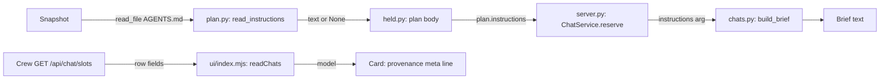

# Design Document

## Overview

This story changes the brief that the board sends to a conductor, and the card that shows the conductor's chat. It builds on the start spec (`.kiro/specs/start-a-story/`) and the board spec (`.kiro/specs/show-the-board/`), and does not repeat them.

The changes touch five backend files and one page file. The backend reads `AGENTS.md` from the git snapshot, includes it in the held plan and passes it to `build_brief`, which carries the instructions, a name-check step, honest-reporting rules and provenance rules. The page reads the model from the chat slot and shows it on the card. No dependency is added, `app.json` is unchanged, and the page adds no request.

### Layout of the change

```
backend/plan.py       CHANGED  read_instructions(source), extract_headings(text)
backend/held.py       CHANGED  _plan_body includes instructions in the plan dict
backend/server.py     CHANGED  ChatService.reserve passes instructions to build_brief; plan_response excludes instructions
backend/chats.py      CHANGED  build_brief gains instructions parameter; new sections and rules
ui/index.mjs          CHANGED  readChats extracts model from served_model/model; renderCard shows provenance meta line
tests/test_plan.py    CHANGED  tests for read_instructions and extract_headings
tests/test_chats.py   CHANGED  tests for the new brief sections, rules and length
tests/test_held.py    CHANGED  plan body includes instructions; plan route response excludes it
tests/ui/render.test.mjs  CHANGED  tests for the provenance meta line
tests/ui/board.test.mjs   CHANGED  tests for provenance in createBoard
```

## Architecture



## Components and Interfaces

### Reading the instructions (`plan.py`)

```python
AGENTS_FILE = "AGENTS.md"
INSTRUCTIONS_THRESHOLD = 3000


def read_instructions(source):
    """Read AGENTS.md from the source. Return the text, or None when the file
    does not exist or cannot be read. Never raises and never adds a problem."""
    try:
        return source.read_file(AGENTS_FILE)
    except Exception:
        return None


def extract_headings(text):
    """The Markdown headings of the text: lines that start with one or more #
    followed by a space. Returns a list of strings, each a heading line."""
    headings = []
    for line in text.splitlines():
        stripped = line.lstrip()
        if stripped and stripped[0] == '#':
            rest = stripped.lstrip('#')
            if rest and rest[0] == ' ':
                headings.append(stripped)
    return headings
```

`read_instructions` is called in `held.py` when the plan body is built, so it runs once per refresh and adds no git operation to a reserve request. `extract_headings` is called in `build_brief` when the instructions are above the threshold.

### The plan body (`held.py`)

`_plan_body` gains the `instructions` field:

```python
def _plan_body(self, snapshot, fetch, groups, problems):
    from plan import read_instructions
    return {"repository": self._repository, "branch": snapshot.branch, "ref": snapshot.ref,
            "commit": snapshot.commit, "fetch": fetch, "groups": groups, "problems": problems,
            "instructions": read_instructions(snapshot)}
```

The import is local because `held.py` imports nothing from `plan.py` today. The plan body gains the `instructions` key, but `plan_response` strips it before sending to the page, so the page never sees it. Tests that check the exact key set of the plan body are updated to include `instructions`; tests that check the plan route response are updated to confirm `instructions` is absent.

### The reserve call and the plan response (`server.py`)

`ChatService.reserve` passes the instructions from the plan to `build_brief`:

```python
return {"card_id": card_id, "name": record["name"], "folder_id": self.folder,
        "brief": build_brief(card, epic_file, plan["branch"], spec_folders(plan),
                              instructions=plan.get("instructions"))}
```

No other change to `reserve`.

`plan_response` strips `instructions` from the plan before returning it to the page, so the page never receives the file's text:

```python
if kind == "plan":
    body = {k: v for k, v in value.items() if k != "instructions"}
    return 200, body
```

### The brief (`chats.py`)

`build_brief` gains an `instructions` keyword argument (default `None`). The existing callers that pass no instructions keep working.

```python
def build_brief(card, epic_file, branch, taken=(), instructions=None):
```

The brief gains four pieces:

1. **The "Project instructions" section**, between the opening lines and the numbered steps. When `instructions` is a non-empty string:
   - If `len(instructions) <= INSTRUCTIONS_THRESHOLD`: the section is headed `"Project instructions (from AGENTS.md on main):"` and carries the full text.
   - If `len(instructions) > INSTRUCTIONS_THRESHOLD`: the section is headed `"Project instructions (from AGENTS.md on main — read the full file before anything else):"` and carries the headings returned by `extract_headings(instructions)`, one per line. When there are no headings, only the header line appears.
   - When `instructions` is `None` or empty: no section.

2. **Step 1, with a confirmation.** When the instructions section is present, step 1 drops the pointer to AGENTS.md (the instructions are already in the brief) and ends with "Confirm in this chat which project files you read." When absent, step 1 keeps the current pointer and appends the same sentence. The reading targets of each variant:

   | Variant | Instructions present | Step 1 |
   |---|---|---|
   | No spec, with epic | yes | "Read the story's entry in the epic page. Confirm in this chat which project files you read." |
   | No spec, no epic | yes | "Confirm in this chat which project files you read." |
   | With spec, with epic | yes | "Read requirements.md, design.md and tasks.md in .kiro/specs/\<spec>/, and the epic page. Confirm in this chat which project files you read." |
   | With spec, no epic | yes | "Read requirements.md, design.md and tasks.md in .kiro/specs/\<spec>/. Confirm in this chat which project files you read." |
   | No spec, with epic | no | "Read the story's entry in the epic page, and the project's AGENTS.md and steering files. Follow them for how specs, branches and checks work. Confirm in this chat which project files you read." |
   | No spec, no epic | no | "Read the project's AGENTS.md and steering files. Follow them for how specs, branches and checks work. Confirm in this chat which project files you read." |
   | With spec, with epic | no | "Read the project's AGENTS.md and steering files, then requirements.md, design.md and tasks.md in .kiro/specs/\<spec>/, and the epic page. Confirm in this chat which project files you read." |
   | With spec, no epic | no | "Read the project's AGENTS.md and steering files, then requirements.md, design.md and tasks.md in .kiro/specs/\<spec>/. Confirm in this chat which project files you read." |

3. **The name-check step.** A new numbered step, after the work steps and before the commit step, in both variants:

   > Before opening the pull request, list every table, column, function, file, setting, endpoint and command your change adds or relies on. Mark each as existing (with the file where you found it) or new (with the task that creates it). Fix anything that is neither found nor created. Put the list in the PR description.

4. **The commit step, with trailer and footer.** The last numbered step (commit, push, open PR) gains two sentences:

   > End each commit message with the trailer: Built-with: Kiro Crew, Epic Board (story: \<story name>). End the PR description with: Built with Kiro Crew, started from Epic Board · Story: \<story name> · \<your harness>, \<your model>. Write "unknown" for harness or model unless the brief or Crew states them.

   `<story name>` is the story's name as a safe one-line string (`_inline(card.get("name", ""), limit=BRIEF_NAME_MAX_CHARS)`), not the JSON-quoted form the opening line uses.

5. **The rules section** gains two lines after the existing three:

   > \- Report the exact commands you ran and their results, including how many tests ran, how many passed and how many were skipped. Never claim a check you did not run.
   > \- If a check was skipped, say so.

The total brief length with instructions at the threshold (3000 characters), worst-case names and the new sections is under 10 000 characters. The length test is updated accordingly.

### The card's provenance meta line (`ui/index.mjs`) — removed

Removed by the owner on 2026-11-16, after the check on the board: Crew's model values are inconsistent ("default", "sonnet", a full Bedrock id, "unknown") and add noise to the card. The PR footer of Requirement 4.2 records the model instead. Group 2 built it (PR #49) and it was taken out again; the page reads no model.


The `readChats` function already reads the chat list from `GET /api/chat/slots?crew=all`. Each row is an object. The model is read from two fields, preferring the one the session actually ran on:

```javascript
const model = typeof row.served_model === 'string' ? row.served_model
            : typeof row.model === 'string' ? row.model
            : null
```

`served_model` is the model the session ran on (set by Crew after the session starts). `model` is the hand-picked model from the session's settings (often empty). The row has no harness field — `agent` and `effective_agent` name the agent, not the harness — so the card shows the model only.

The field is stored in the entry's record alongside `state`, `key` and the other fields, and passed through to the card's view as `view.model`.

The card renders the provenance meta line after the chat state badge, in the card's meta style (the same 12px, `var(--muted)` of the spec folder name):

```javascript
const provenance = view.model || 'unknown'
```

The line is shown only when `view.state` is not null (the chat's state has been read) and `view.key` is present (the card has a started chat). It is a `span` or `p` in meta style, as literal text.

## Correctness Properties

### Property 1: Instructions in the brief follow the threshold

*For any* non-null string `text` of length 0 to 10 000 and any card (both variants, with and without an epic), when `text` is passed as `instructions`:
- If `len(text) <= 3000`, the brief contains the full text between a header and the first numbered step.
- If `len(text) > 3000`, the brief contains the headings returned by `extract_headings(text)` but not the full text.
- When `instructions` is `None`, the brief contains no "Project instructions" section and step 1 keeps the AGENTS.md pointer.

At least 100 iterations with the seed printed on failure.

**Validates: Requirements 1.2, 1.3, 1.4, 1.5**

### Property 2: A missing or hostile AGENTS.md never breaks the plan or the brief

*For any* source that raises `SourceError`, `OSError` or `ValueError` on `read_file("AGENTS.md")`, `read_instructions(source)` returns `None`. *For any* `instructions` value (None, empty string, a string of 10 000 `\x00` bytes, a string with no headings above the threshold), `build_brief` returns a string that starts with the opening lines and ends with the rules, with no `None` or `NaN` in it.

At least 100 iterations with the seed printed on failure.

**Validates: Requirements 1.1, 1.4**

## Error Handling

| Where | Failure | What the person sees |
|---|---|---|
| Plan | `AGENTS.md` does not exist | No error, no "Project instructions" section; the brief keeps the AGENTS.md pointer |
| Plan | `AGENTS.md` cannot be read (binary, corrupt, SourceError) | Same as missing |
| Plan | `AGENTS.md` is empty | Same as missing (an empty string is treated as absent) |
| Brief | Instructions above the threshold with no Markdown headings | The section header says "read the full file before anything else" with no headings listed |
| Card | `served_model` and `model` are both absent or non-string | The provenance meta line shows "unknown" |
| Card | The chat slot row is malformed or missing the fields | Same as absent: "unknown" |
| Card | The chat has not been started or its state has not been read | No provenance meta line |

## Edits to earlier specs

| Where | Change |
|---|---|
| Epic page (`docs/epics/epic-board.md`) | The story's line links to `.kiro/specs/briefs-that-hold-up-on-any-agent/` and is set to in progress |

No test of an earlier spec stops being true. The existing brief tests pass no `instructions` argument, and the default `None` keeps them unchanged except for the new rules in the "Rules" section and the confirmation sentence appended to step 1.

## Testing Strategy

The backend's pure functions are tested with `unittest`, the held plan's thread-safe state with the existing `test_held.py` pattern, and the page with Node's built-in runner. Nothing is added to `app.json`.

### Backend tests

- **`tests/test_plan.py`**: `read_instructions` returns the text for an existing file, `None` for a missing file, `None` for an unreadable file (each kind of exception), and `None` for a source with no `read_file`; `extract_headings` for text with headings at several levels, text with no headings, empty text and text whose lines look like headings but lack the space after `#`.
- **`tests/test_chats.py`**: `build_brief` with instructions (full text within the threshold, headings summary above it, `None`, empty string); the "Project instructions" section is present or absent as expected; step 1 keeps or drops the AGENTS.md pointer and always ends with the confirmation; the name-check step appears in both variants; the honest-reporting rules appear; the commit-trailer and PR-footer rules appear with the story's name as plain text; the existing rules are unchanged; the `story_name` in the trailer has no control characters; the length test is updated to < 10 000; the existing tests pass unchanged (the new `instructions` default is `None`). Properties 1 and 2 as seeded tests with at least 100 iterations.
- **`tests/test_held.py`**: the plan body includes `instructions` when `AGENTS.md` exists and `None` when it does not; the plan route response (`plan_response`) does not include `instructions`.

### Page tests

- **`tests/ui/render.test.mjs`**: the provenance meta line in the card's tree: present with both fields, present with one, "unknown" with neither, absent when the chat has no state.
- **`tests/ui/board.test.mjs`**: `createBoard` reads the model from `served_model` (falling back to `model`) in the chat slot row and shows it on the card; a row without either field shows "unknown"; a card with no chat shows no provenance.

| Req | Backend tests | Page tests | Manual, on the host |
|---|---|---|---|
| 1 | Property 1, Property 2; section present/absent; step 1 variants | — | Start a story and see the "Project instructions" section in the brief |
| 2 | The name-check step in both variants | — | The conductor's PR description includes the name check |
| 3 | The honest-reporting rules in both variants | — | The conductor reports exact commands and counts |
| 4 | The trailer and footer rules with the story name | Provenance meta line | The card shows the model; the PR has the footer |
| 5 | No project-specific check in the brief; the rules are unchanged | — | The conductor follows the project's AGENTS.md checks, not the board's |

## Design Decisions

- **Instructions in the plan body, not read on each reserve.** The plan is built once and held in memory. Reading AGENTS.md at build time adds no git operation to the reserve handler and keeps the same content for every card started from the same plan.
- **3000 characters as the threshold.** A typical AGENTS.md (this project's is about 900 characters) fits in full. Above 3000, the headings summary keeps the brief under about 7000 characters for a worst-case card, which is well within any chat message limit.
- **Headings, not a truncation.** The headings tell the conductor what sections to read. A truncated text would end mid-sentence and leave the conductor with partial rules.
- **One file, defaulting to AGENTS.md.** The story says "from AGENTS.md or another file the project names". This spec reads `AGENTS.md`. A project that names a different file is a future extension (see Open Question 1). The design keeps the file path as a constant (`AGENTS_FILE`) so that changing it is a one-line edit.
- **The confirmation is in the brief, not enforced.** The board cannot check what the conductor read. The instruction "Confirm in this chat which project files you read" is for the person reading the chat.
- **The trailer uses the unquoted name.** The opening line's `Story: "Filter by epic"` is JSON-quoted so that quotes and newlines in the name cannot break the line. The trailer is a git trailer, where a name with no special characters is clearer without quotes. `_inline` replaces control characters, so the name is always one line.
- **The provenance meta line shows the model only.** Crew's slot row has `served_model` (what the session ran on) and `model` (the hand-picked setting, often empty), but no harness field. `agent`/`effective_agent` name the agent, not the harness, so the card shows the model and leaves harness to the PR footer, where the conductor knows its own harness.
- **"unknown" instead of absent.** When the model is absent, showing "unknown" makes the absence visible. Hiding the line entirely would leave the person wondering whether the board reads the information at all.

## Open Questions

1. **Another file the project names.** The story says "from AGENTS.md or another file the project names". This spec reads `AGENTS.md` only. A project could name a different file through a field in the board's project settings (for example `agents_file` in `config.json` or in the saved setup). That is a one-line change to `AGENTS_FILE` and a small addition to `load_projects`. It is left for a later story unless the owner asks for it now.
2. ~~**The exact field names for harness and model.**~~ Resolved: `served_model` (the model the session ran on), falling back to `model` (the hand-picked one). The row has no harness field; the card shows the model only.
3. **When the model is absent.** The spec says "unknown". The owner may prefer to hide the line entirely. Confirmed on the host in task 3.1.
4. **The name-check step for spec writing.** A spec names tables, functions and files that don't exist yet — they are "new (with the task that creates it)". The conductor still checks that every name it relies on (an existing file, an existing function) does exist. The step applies to both spec and build work, as the story decides.
5. **The "Project instructions" section in the brief may duplicate what the harness already loaded.** A Claude Code harness that loads AGENTS.md on its own will see the instructions twice: once from the harness and once from the brief. This is harmless (the instructions are the same text) and avoids the case where the harness does not load them. The story prefers consistency over deduplication.
