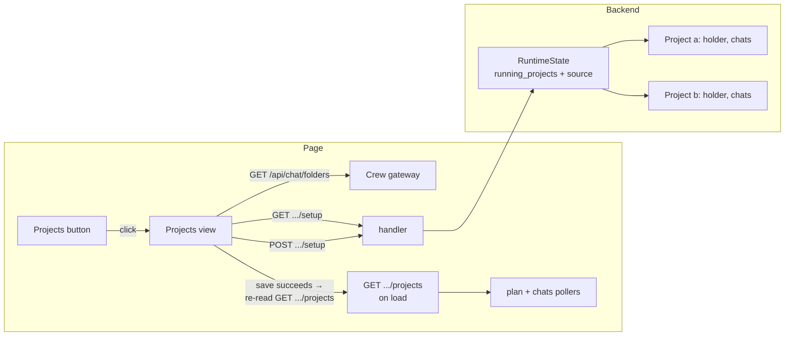

# Design Document

## Overview

This story adds a Projects view that lets the person pick which Crew folders the board shows, without editing `config.json` by hand. It builds on "Read the plan from main", "Show the board", "Start a story" and "Switch projects", and does not repeat them.

**Build order.** Build this story after "Switch projects" (pull request 33, merged) and after "Start a story" is complete. Both must have landed on main.

The work splits in three:

- **The backend** gains `backend/setup.py` (validation and file I/O for `setup.json`), `load_projects` gains a new read path that checks `setup.json` first, `server.py` gains a `RuntimeState` for thread-safe live reload, `POST .../setup` to validate and save, and `GET .../setup` to tell the page the active source and the full project list including folder IDs.
- **The page** gains a Projects view (always-visible button, panel with checkboxes, pre-fill from current list, config.json notice), and an Unconfigured state ("Choose your projects") when the project list is empty.
- **`app.json`** gains `/api/chat/folders` in `permissions.api`, and the start-a-story spec's Requirement 1, criterion 3 is edited in place to match.

### Facts about Crew this design relies on

From the Kiro Crew source at tag `v0.12.2`, confirmed in `src/kiro_crew/dashboard/chat_folders_routes.py:100` and `website/src/types/index.chat.ts:400`.

`GET /api/chat/folders` returns a JSON list. Each item is `{id, name, project_dir?, parent_id?, hidden?, owner_app?, mate_home?, ...}`. All fields except `id` and `name` are optional.

The page applies three rules to build the list of folders to show:

1. **Nearest-wins directory:** a folder's directory is its own `project_dir` when non-empty, or the nearest ancestor's (following `parent_id` through the same list) whose `project_dir` is non-empty.
2. **System folders excluded:** omit folders with a non-empty `owner_app`, with `mate_home: true`, or with `hidden: true`. These tests run before the directory is resolved; a hidden folder is never an ancestor source either.
3. **No directory excluded:** omit folders whose directory is still empty after rule 1.

A **Selectable_Folder** is `{id, name, project_dir}` where `project_dir` is the resolved (non-empty) directory. The page sends `project_dir` as `repository` to `POST .../setup`.

### Layout of the change

```
app.json                               CHANGED  add /api/chat/folders
backend/setup.py                       NEW      is_git_checkout, validate_setup_entry, load_setup, save_setup
backend/projects.py                    CHANGED  load_projects: check setup.json first; new data_dir param
backend/server.py                      CHANGED  RuntimeState, POST .../setup, GET .../setup, threading import
ui/index.mjs                           CHANGED  setupReduce, renderSetupView, Unconfigured state, always-visible button
tests/test_setup.py                    NEW      validation, file I/O, startup
tests/test_server.py                   CHANGED  POST /setup, GET /setup, RuntimeState
tests/ui/setup.test.mjs                NEW      setupReduce and renderSetupView pure tests
tests/ui/board.test.mjs                CHANGED  Unconfigured state, Projects button in every state
.kiro/specs/start-a-story/requirements.md  CHANGED  Req 1.3: add /api/chat/folders
```

`chats.py`, `gitsource.py`, `held.py`, `plan.py`, `proxyauth.py`, the existing `projects.py` loading logic for config.json, and all existing `switch-projects` page code are **not changed** beyond the targeted additions below.

## Architecture



## Components and Interfaces

### Backend: `backend/setup.py` (new)

```python
SETUP_FILE = 'setup.json'  # name only; caller joins with data_dir

def is_git_checkout(path):
    """Return True when path exists as a directory and contains a .git entry.
    Does not expand symlinks; uses os.path.isdir and os.path.exists on the join."""

def validate_setup_entry(entry, i):
    """Return None on success or a human-readable error string.
    entry must be a dict; checks folder_id (str, 1-200 chars),
    name (str, 1-100 chars, not only whitespace),
    repository (str, expands via os.path.abspath/expanduser to an is_git_checkout path)."""

def load_setup(data_dir):
    """Return (entries, error_text). entries is a list of dicts {folder_id, name, repository}
    if setup.json exists and is valid; [] with error_text=None if the file is missing;
    [] with error_text set for any parse or I/O failure. Never raises."""

def save_setup(data_dir, entries):
    """Write setup.json atomically to data_dir. entries is a validated list of dicts.
    Uses write-to-temp-then-rename as chat records do. Raises OSError on failure."""
```

### Backend: `backend/projects.py` changes

`load_projects` gains a `data_dir` keyword argument (default `None`). When `data_dir` is supplied and `setup.json` exists and is valid there, the function returns the projects from it, skipping config.json and env vars for the Project_List. The existing logic (config.json `projects` key, legacy single-project, error paths) runs only when `setup.json` is absent or empty.

```python
def load_projects(environ=None, app_dir=None, data_dir=None):
    """Return (projects, error, source, config_has_projects).
    source is 'saved' | 'config' | 'legacy' | 'unconfigured'.
    config_has_projects is True when config.json has a valid 'projects' key, regardless of source.
    projects is [] and error is set when the active source is invalid."""
```

The return value gains two new fields (`source`, `config_has_projects`) only for `server.py` to store; callers that only use `(projects, error)` are updated.

### Backend: `backend/server.py` changes

**`RuntimeState`** — thread-safe container for the running project list and metadata:

```python
import threading

class RuntimeState:
    def __init__(self, running_projects, error, source, config_has_projects, config_path, data_dir, secret):
        self._lock = threading.Lock()
        self._running = running_projects   # list of RunningProject, or [] on error
        self.error = error                 # config error body or None
        self.source = source               # 'saved' | 'config' | 'legacy' | 'unconfigured'
        self.config_has_projects = config_has_projects
        self.config_path = config_path
        self.data_dir = data_dir
        self.secret = secret               # KIROCREW_PROXY_SECRET for POST /setup verification

    def snapshot(self):
        with self._lock:
            return list(self._running)     # a copy; callers hold no reference into the list

    def rebuild(self, new_running, new_source):
        """Swap the running list atomically; return the old list."""
        with self._lock:
            old = self._running
            self._running = new_running
            self.source = new_source
            return old
```

`make_handler` takes `state: RuntimeState` instead of `(running_projects, error, config_path)`. Each request method calls `state.snapshot()` once at its start and uses that snapshot for the whole request.

**New routes:**

`GET .../setup` — no signature required; runs no git; reads no file beyond what `RuntimeState` already holds:

```python
# Returns:
{
    "source": state.source,              # 'saved' | 'config' | 'legacy' | 'unconfigured'
    "config_has_projects": state.config_has_projects,
    "projects": [{"id": rp.id, "name": rp.name, "folder_id": rp.settings.folder or None}
                 for rp in running]
}
```

`POST .../setup` — requires gateway signature; validates; saves; rebuilds:

```python
# 1. Verify signature (same as chat routes, start spec Req 5.7).
# 2. Parse body: {projects: [{folder_id, name, repository}, ...]}; 400 on any body error.
# 3. validate_setup_entry for each entry; 400 naming the bad entry on first failure.
# 4. save_setup(state.data_dir, entries); 500 on I/O failure.
# 5. load_projects(data_dir=state.data_dir) to build new Project list from the new file.
# 6. Build new RunningProjects: start holders for new projects; mark old-only holders for stop.
# 7. state.rebuild(new_running, new_source).
# 8. Stop old holders that are not in new_running (call holder.stop() or equivalent).
# 9. Return 200 {"projects": [{id, name}], "source": new_source}.
```

A `Holder` that is stopped is simply not referenced further; it finishes its current poll and exits. `Holder.stop()` is called if the class already supports it; otherwise the holder is dereferenced and GC'd.

**`do_POST` routing:** Matches `/setup` path end for `POST .../setup` before the existing chats routing. A `GET .../setup` branch is added to `do_GET` before the `/projects` branch.

### Page: `ui/index.mjs` changes

The existing `projectsReduce` and `createBoard` are changed in four targeted places. No existing exports are renamed or removed.

#### New state: `setupReduce`

```js
// phase: 'closed' | 'opening' | 'ready' | 'saving' | 'error'
// folders: null | Selectable_Folder[]  (from GET /api/chat/folders)
// setupInfo: null | {source, config_has_projects, projects}  (from GET .../setup)
// checks: {[folderId]: bool}  (whether each folder is ticked)
// names: {[folderId]: string}  (the name field for each ticked folder)
// saveError: null | string
export const initialSetup = Object.freeze({ phase: 'closed', folders: null, setupInfo: null, checks: {}, names: {}, saveError: null })

export function setupReduce(state, action) {
  switch (action?.kind) {
    case 'setup-open':  return { ...initialSetup, phase: 'opening' }
    case 'setup-loaded': { /* folders + setupInfo received; pre-fill checks/names */ }
    case 'setup-load-failed': return { ...state, phase: 'error', saveError: action.message }
    case 'setup-check': { /* toggle one folder's checkbox */ }
    case 'setup-name': { /* update one folder's name field */ }
    case 'setup-saving': return { ...state, phase: 'saving', saveError: null }
    case 'setup-save-failed': return { ...state, phase: 'ready', saveError: action.message }
    case 'setup-close': return initialSetup
    default: return state
  }
}
```

**Pre-fill logic** in `'setup-loaded'`: for each Selectable_Folder, tick it and set its name if the folder's `id` matches a `folder_id` in `setupInfo.projects`; use that project's `name` as the name field default; otherwise untick and use the folder's `name` as the name placeholder.

#### New pure: `readFolders(body)`

```js
// Returns a Selectable_Folder[] from GET /api/chat/folders, or null when body is not an array.
// Applies the three rules from the design facts:
//   1. Resolve each folder's directory by nearest-wins (own project_dir, then parent chain).
//      Hidden/owner_app/mate_home folders are excluded as sources for rule 1 too.
//   2. Exclude hidden, owner_app and mate_home folders.
//   3. Exclude folders with no resolved directory.
// A Selectable_Folder is {id: string, name: string, project_dir: string} (non-empty project_dir).
export function readFolders(body) { ... }
```

The implementation: build a `Map(id → folder)` from `body`; for each non-excluded folder, walk `parent_id` up to the first ancestor with a non-empty `project_dir`, stopping if the ancestor is itself excluded (hidden/owner_app/mate_home). Collect into a `Selectable_Folder[]` in the order they appear in `body`.

#### New render: `renderSetupView(h, state, actions, hasConfigNotice)`

Renders the Projects view panel as a modal/overlay. `hasConfigNotice` is `state.setupInfo?.source === 'saved' && state.setupInfo?.config_has_projects`. The panel is always rendered by `renderBoard` when `setupState.phase !== 'closed'`. It is not a heading-level container.

#### Changes to `createBoard`

**Setup button:** `renderBoard` always receives a `showSetupButton: true` prop and renders the button in the header row, to the right of the epic filter. The button does not depend on the source or Unconfigured state.

**Unconfigured state:** When `projectsPhase === 'ready' && projects?.length === 0`, `renderBoard` shows the first-run notice ("Choose your projects" + "Set up projects" button) instead of the plan columns. The plan and chats pollers do not start in this state.

**After a successful save:** The save handler inside `createBoard`:
1. Dispatches `setup-close`
2. Re-reads `GET .../projects` (using the same `makeBackend` as the page load)
3. Dispatches `{kind: 'projects-read', projects: list, savedId: loadProject(storage)}`
4. This triggers the existing switch-project reset logic (plan poller restarts, state clears, filter resets to 'all')

The save handler calls `GET /api/chat/folders` (via `api.get(...)`) and `GET .../setup` in parallel when the Projects view opens (both promises settled before dispatching `'setup-loaded'`).

### `app.json` change

```json
"permissions": {
  "api": ["/api/chat", "/api/chat/slots", "/api/chat/folders"]
}
```

### Edit to start-a-story Requirement 1, criterion 3

The criterion currently reads: "THE `permissions.api` of `app.json` SHALL list exactly `/api/chat` and `/api/chat/slots`". It is replaced in full by the set-up-projects spec's Requirement 1, criterion 1 (which lists all three paths). This story edits that criterion in place in `.kiro/specs/start-a-story/requirements.md`.

## Open Questions

None. All design decisions are resolved.

## Manual check (task 5)

Things that must be verified on a Crew host:

1. That `POST .../setup` signed by the host gateway is accepted (the target, same check as the switch spec's group 5).
2. End-to-end: open the Projects view, see real Crew folders (with owner_app/mate_home/hidden ones absent), tick one folder, name it, save, board shows that project's plan.
3. Config.json override: with `config.json` having a `projects` key, open the view after saving; the notice appears.
4. Restart: `setup.json` survives a backend restart; the same project loads.
