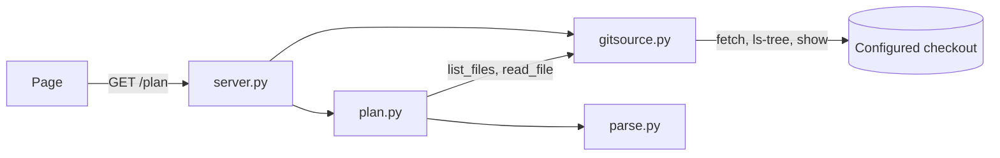

# Design Document

## Overview

This story builds the app's foundation: the Kiro Crew app package, and a backend process that answers one question, "what is the plan on the main branch?". The answer is a JSON document of groups of cards. The board that draws it is the next story.

The design follows the spike in `docs/spike/`, which worked in Kiro Crew: a Python standard-library HTTP server started by the host on an automatic port, with a health route, reading files from git with `git show`. It changes three things the spike left open or got wrong for this story:

- The repository comes from configuration only. The spike also accepted `?repo=`, which let any caller make the backend read any path.
- The spike read `origin/main` by name. This design reads the branch `origin/HEAD` points to.
- The spike parsed git output by whitespace and ran one `git` process per file. This design lists the tree once, uses NUL-separated output, and reads every file from one commit.

### Layout

The repository root is the app, as in the spike (`app.json` at the root, `ui/` and `backend/` beside it).

```
app.json
config.json      optional, one person's repository path, listed in .gitignore, never committed
.gitignore
backend/
  server.py      HTTP routes, configuration, error responses
  gitsource.py   git access: main branch, fetch, tree listing, file reads
  plan.py        builds the plan from a source; no git, no HTTP
  parse.py       parses tasks.md and epic pages; no git, no HTTP
ui/
  index.mjs      placeholder page, replaced by the "Show the board" story
```

`backend/server.py` runs as a script, as the spike's did, so the modules import each other by plain name (`from plan import build_plan`).

## Architecture



The split keeps the rules (what is a card, what is its status) in `plan.py` and `parse.py`, which take a small source interface instead of calling git. They can be checked with an in-memory source and no repository.

### Request flow for `GET .../plan`

1. `server.py` uses the repository that `load_repository()` found at startup. If there is none, or it is not a git checkout, it answers with an error (Requirement 1.4).
2. `gitsource.open_snapshot(repo)` finds the main branch, fetches it, and resolves `refs/remotes/origin/<branch>` to one commit (Requirement 2).
3. `plan.build_plan(snapshot)` lists the files once, parses what it needs, and builds the groups. It reads every file from that commit, so a fetch from a second request cannot mix two commits into one plan.
4. `server.py` adds the repository, branch, ref, commit and fetch result, and answers.

The request's query string and body are never read (Requirement 1.3).

**Every plan request fetches.** There is no cache in this story, so a page refresh always shows the latest main, and each request costs one network round trip to `origin`. The "Show the board" story can add a short-lived cache in front of `open_snapshot` if the cost matters. The fetch lock and the single-commit snapshot already make that a change in one place.

## Components and Interfaces

### `gitsource.py`

```python
class Snapshot:
    repository: str          # the configured path
    branch: str              # "main", or what origin/HEAD names
    ref: str                 # "origin/<branch>"
    commit: str              # full SHA the files are read from
    fetch_error: str | None  # reason, when the fetch failed but a ref existed

    def list_files(self, *prefixes: str) -> list[str]   # repo-relative paths, files only
    def read_file(self, path: str) -> str                # raises SourceError

class SourceError(Exception):
    code: str      # "not_a_checkout" | "ref_unreadable" | "read_failed"
    message: str

def open_snapshot(repository: str) -> Snapshot
```

`open_snapshot` runs these git commands, each with the repository as `git -C <repository>`:

| Step | Command | Notes |
|---|---|---|
| Checkout check | `rev-parse --git-dir` | Fails: `not_a_checkout`. The path must also be an existing directory. |
| Main branch | `symbolic-ref --quiet --short refs/remotes/origin/HEAD` | Output `origin/<branch>` gives `<branch>`. Missing, empty or not starting with `origin/`: use `main` (Requirement 2.1). |
| Fetch | `fetch --quiet origin +refs/heads/<branch>:refs/remotes/origin/<branch>` | The explicit refspec makes the ref update independent of the remote's configured refspec. The leading `+` means the value can never be read as an option. |
| Resolve | `rev-parse --verify --quiet refs/remotes/origin/<branch>^{commit}` | If it fails, raise `ref_unreadable` (Requirement 2.5). That happens when the fetch failed and no earlier copy exists. |

A failed fetch with a resolvable ref gives a `Snapshot` with `fetch_error` set (Requirement 2.4).

`list_files` runs `ls-tree -r -z --name-only <commit> -- <prefixes>` and splits on NUL. `read_file` runs `show <commit>:<path>`. Reading from a commit SHA and never the working tree satisfies Requirement 2.3.

**Running git safely and bounded** (Requirement 9). Every call goes through one function:

- The command is a list of arguments, with no shell. The repository path and branch are arguments, never part of a string that is parsed.
- The child is started with `start_new_session=True`, `stdin=DEVNULL` and `GIT_TERMINAL_PROMPT=0`. A child in a new session has no controlling terminal, so an `ssh` host-key or password prompt fails instead of waiting. I expect this from how `ssh` opens `/dev/tty`, and I have not tested it here.
- A fixed limit of 30 seconds, as in the spike. On timeout the whole process group is killed with `os.killpg`, because the `ssh` that `git fetch` starts would otherwise outlive `git`. A timeout is a failed command.
- A lock serializes the fetch. Requests that arrive together each wait their turn, so two fetches never fight over git's lock files.

Only the fetch writes, and it writes only what Requirement 9.1 allows.

Platform: `start_new_session` and `os.killpg` exist on macOS and Linux only. The manifest declares those two platforms.

### `parse.py`

```python
def parse_tasks(text: str) -> TaskCounts        # done, under_way, total
def parse_epic(text: str, file: str) -> Epic    # name, stories
def parse_stories(text: str, whole_file: bool) -> list[Story]

class Story:  name: str; link: str | None; status: str | None   # status is already normalized
```

**Tasks.** Each line is matched with `^\s*[-*+]\s+\[([ xX-])\](\*)?`. A match with `*` is an optional task and is skipped. Otherwise it adds one to `total`, and `x` or `X` adds one to `done` and `-` adds one to `under_way`. `X` counts as done because markdown task lists treat it as ticked; Requirement 4.2 names `[x]`.

**Epics.** The name is the first line matching `^# (.+)$`, or the file name. Stories are read from the `## Stories` section, which ends at the next line starting with `# ` or `## `. In `standalone.md`, when there is no `## Stories` heading, the whole file is read, and only list items that start at the first column count, so notes nested under an item are not mistaken for stories (Requirement 5.9).

**A story line** is a list item `- ` or `* ` followed by either `[Name](link)` or a plain name, then a space, an em dash (`—`), and the status text. For a plain name the split happens at the first ` — `. A line that does not fit is skipped without a problem (Requirement 7.3). The status text is trimmed, lowercased, and loses one trailing full stop. Only `planned`, `in progress` and `done` survive; anything else, including empty text, becomes `None` (Requirement 5.4).

**Link to spec folder.** The spec folder is the first match of `\.kiro/specs/([^/)#?\s]+)` in the link, as in the spike. The link is not resolved relative to the epic file.

### `plan.py`

```python
def build_plan(snapshot) -> tuple[list[Group], list[Problem]]
```

The algorithm:

1. `files = snapshot.list_files(".kiro/specs", "docs/epics")`.
2. **Specs.** A path `.kiro/specs/<folder>/<anything>` makes `<folder>` a spec. A spec has a `tasks.md` if `.kiro/specs/<folder>/tasks.md` is in `files`. For each spec: no `tasks.md` gives status `planned` and counts 0 of 0 (Requirement 3.2). Otherwise read and parse it. If the read fails, add a problem and give the spec `planned` with no counts (Requirement 4.6). From the counts: `done` if `total > 0` and `done == total`; else `in progress` if `done + under_way > 0`; else `planned` (Requirement 4).
3. **Epics.** The files directly in `docs/epics/` ending in `.md`, except `README.md` and `standalone.md`, sorted by file name. Each is read and parsed. A read failure adds a problem and skips that epic (Requirement 7).
4. **Cards under an epic.** For each story in order:
   - If its spec folder exists: a card named after the story, with the spec's counts. The status is `done` if the story's epic status is `done`, otherwise the spec's status from its tasks (Requirement 6).
   - Otherwise: a card with no spec and no counts, whose status is the epic status or `planned`.
   Every spec folder used is added to `claimed`.
5. **No epic.** If `standalone.md` exists, it is read and parsed, and its stories become cards as in step 4, except that a story whose spec folder is in `claimed` is dropped (Requirement 5.10) and a spec folder is used at most once. Then every spec folder not in `claimed` and not already used gets a card named after the folder. These cards are sorted by name, ignoring case. If there are none, there is no group (Requirement 8.3).

The groups are the epics in file-name order, with an epic that has no stories as a group with no cards, then "No epic" last.

### `server.py`

- Reads the repository setting once at startup, through one function, `load_repository()` (Requirement 1.2). It returns the path or a configuration error:
  1. If `EPIC_BOARD_REPOSITORY` is set and not empty, that is the answer.
  2. Otherwise, if `config.json` exists in the app's own folder (the parent of `backend/`, found from `__file__`), it must be a JSON object with a text `repository` value, and that is the answer. A file that cannot be read, is not JSON, or has no such value is an error and is not skipped.
  3. Otherwise there is no repository.

  The first source that is present wins, so a bad environment variable is not hidden by a good file. The path gets `~` expanded and is made absolute. The error message names `EPIC_BOARD_REPOSITORY` and the full path where `config.json` is looked for, and says which one was found and what is wrong with it.
- `ThreadingHTTPServer` on `127.0.0.1` and `PORT` from the environment, as in the spike.
- Routes match on the end of the path, as the spike's did: `.../health` and `.../plan`. GET only. Anything else is a 404.
- `/health` answers `{"ok": true}` whatever the configuration, so the host's check passes before the repository is set up (Requirement 1.1).

### App package

`app.json`, in the spike's form:

| Field | Value |
|---|---|
| `name`, `displayName` | `epic-board`, `Epic Board` |
| `backend` | `entryPoint: backend/server.py`, `type: python`, `port: auto`, `healthCheck: /health`, `routes: /api/apps/epic-board` |
| `ui` | `entry: index.mjs`, one page at `/apps/epic-board`, icon `Kanban` |
| `platform.os` | `macos`, `linux` |
| `permissions.api` | none. The page calls the app's own backend without an entry, as the spike's page did. The chat entries are added by the story that starts a story |

`ui/index.mjs` is a placeholder. It fetches `/apps/epic-board/api/plan` as the spike's page did, and prints the repository, branch, commit, the number of cards per group, and any problems or error. It exists so the app can be installed and the backend can be seen working. The "Show the board" story replaces it.

## Data Models

### Plan response, `200`

```json
{
  "repository": "/Users/me/projects/example",
  "branch": "main",
  "ref": "origin/main",
  "commit": "9f2c…",
  "fetch": { "ok": true },
  "groups": [
    {
      "epic": { "name": "Epic Board", "file": "epic-board.md" },
      "cards": [
        {
          "name": "Read the plan from main",
          "status": "in progress",
          "spec": "read-the-plan-from-main",
          "tasks": { "done": 2, "total": 9 },
          "epic": "Epic Board"
        },
        { "name": "Show the board", "status": "planned", "spec": null, "tasks": null, "epic": "Epic Board" }
      ]
    },
    { "epic": null, "cards": [] }
  ],
  "problems": [ { "file": "docs/epics/broken.md", "reason": "…" } ]
}
```

- `fetch` is `{"ok": false, "reason": "…"}` when the fetch failed and an earlier copy was read.
- `epic` is `null` only for the "No epic" group. That group is left out when it has no cards.
- `tasks` is `{done, total}` for a spec whose `tasks.md` was read, or is absent (0 of 0), and `null` for a card with no spec or a `tasks.md` that could not be read.
- `problems` is `[]` when there are none.

### Error response, no plan

```json
{
  "error": {
    "code": "repository_not_configured",
    "message": "…",
    "settings": ["EPIC_BOARD_REPOSITORY", "config.json"]
  }
}
```

`settings` is present on the two configuration errors and names both sources.

| Code | HTTP | When |
|---|---|---|
| `repository_not_configured` | 409 | No repository from either source, or `config.json` is unreadable or has no `repository` text. |
| `repository_not_a_checkout` | 409 | The path is not a directory or not a git checkout. |
| `ref_unreadable` | 502 | No `origin/<branch>` after a failed fetch. |
| `read_failed` | 502 | A git command failed or timed out while listing the tree. |

## Error Handling

- A failure on one file never fails the plan; it becomes an entry in `problems` (Requirement 7).
- A failed fetch with an earlier copy still answers, with `fetch.ok` false. The page can tell the person the board may be out of date.
- An unexpected exception in a handler answers `500` with `{"error": {"code": "internal", "message": "…"}}`, and the message does not include the repository path.
- Messages come from git's own stderr, trimmed to 300 characters.

## Requirements coverage

| Requirement | Where |
|---|---|
| 1 | `app.json`, `server.py` (`/health`, `load_repository()`, query ignored, error codes), `.gitignore` |
| 2 | `gitsource.open_snapshot`, `Snapshot` |
| 3, 4 | `plan.py` step 2, `parse_tasks` |
| 5, 6 | `parse_stories`, `plan.py` steps 3 to 5 |
| 7 | `plan.py` problems, `parse_stories` skipping |
| 8 | `plan.py` group order and No epic rules, card shape |
| 9 | the single git runner in `gitsource.py` |

## Testing Strategy

- `parse.py` and `plan.py` take a source interface, so the status, grouping and standalone rules can be checked with an in-memory source and no git.
- `gitsource.py` is checked against throwaway repositories made in a temporary directory with a bare `origin`: branch discovery with and without `origin/HEAD`, a failed fetch with and without an earlier ref, files read from the commit while the working tree differs, and a timeout.
- The remaining check is on the host: install the app in Kiro Crew with a real repository and see the placeholder page show the plan.

## Decisions

- **Configuration.** Kiro Crew has no settings mechanism for a separate-process backend, so the repository comes from `EPIC_BOARD_REPOSITORY` first and `config.json` in the app's own folder second. `config.json` holds `{"repository": "<path>"}` and is not committed. Both sources are read in `load_repository()`, so the mechanism can change without touching anything else.
- **Route paths and page.** Copied from the spike, which worked: the manifest declares `routes: /api/apps/epic-board`, the page fetches `/apps/epic-board/api/plan`, and the backend matches on the end of the path. The placeholder page stays. The app declares no permission for its own backend.
- **Platforms.** macOS and Linux only. The timeout and prompt handling use POSIX process groups, and the crew runs on Linux.
