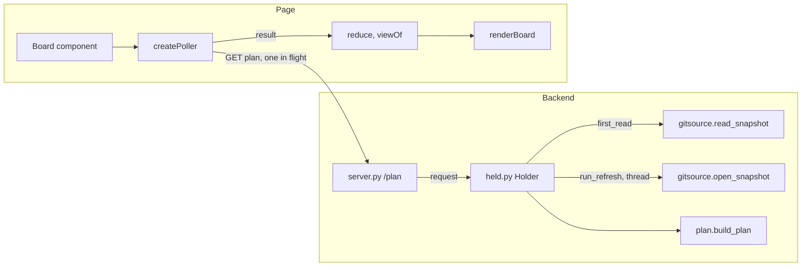

# Design Document

## Overview

This story replaces the placeholder page with a read-only board and changes the backend so that the page never waits on git. It builds on "Read the plan from main" (`.kiro/specs/read-the-plan-from-main/`, called "the earlier design" below) and does not repeat it. Its `description` field, its plan builder, its git runner and its configuration loader stay as they are, except where "Bringing the first story in line" says otherwise.

Two things change on the backend:

- A new module, `backend/held.py`, keeps the last plan in memory and refreshes it from a background thread. A plan request is answered from memory and never runs git (Requirements 5, 6).
- Cards gain a `description` taken from the story line (Requirement 4).

One thing is new on the page: `ui/index.mjs` draws the board, polls the backend, and shows the states of Requirement 9. It uses the host's React with `createElement`, as the spike's page and the placeholder do.

### Layout

```
backend/
  held.py        NEW   the held plan, the refresh rule, the refresh thread
  gitsource.py         gains read_snapshot (no fetch) and Snapshot.fetched
  plan.py              cards gain description
  server.py            plan_response answers from the holder; starts the holder
ui/
  index.mjs      REPLACED  pure functions (named exports), renderBoard, poller, component
tests/
  test_held.py   NEW   the holder with a fake clock, fake opener, queued spawn
  test_ui.py     NEW   runs the page tests with node when it is installed; checks app.json
  ui/            NEW   *.test.mjs run by node --test (see "Testing Strategy")
```

`app.json` does not change (Requirement 1.1).

## Architecture



The backend keeps the earlier design's split: `plan.py` and `parse.py` know no git, `gitsource.py` knows no plan rules. `held.py` is the only module that owns state and threads. On the page, everything that decides something is a pure function with no `window` and no React in it. The component only connects them to React, the timers and the DOM.

### Request flow for `GET .../plan`

1. If no repository is configured, `server.py` answers the configuration error and starts nothing (Requirement 5.6).
2. Otherwise `Holder.request()` takes the lock, decides whether a refresh is due, and if so marks it running. It copies one state object, releases the lock, and only then starts the refresh thread. The answer is built from the copied state.
3. `server.py` turns the state into 202 (nothing held), the held error's status, or 200 with the plan plus `age_seconds` and `refreshing`.

No step waits for git. The lock is held only to read and replace state, never across a git command.

## Components and Interfaces

### `plan.py` (Requirement 4)

Three places change, and no other:

- `card(name, status, spec, tasks, epic, description)` gains `description` and puts it in the dict.
- `story_card(story, specs, epic_name)` passes `story.description` in both of its branches (spec exists, spec missing).
- In `build_plan`, the card made for a spec folder that no story lists passes `""`.

`parse.py` already returns `Story.description`, trimmed by `split_status`, and needs no change. The epic loop calls `story_card` once per story line, so each epic card carries its own line's description (4.3). The standalone loop already skips a later line for a spec in `used` before it builds a card, so the first line wins and a line for a spec an epic claimed never produces a card (4.2, 4.3).

### `gitsource.py` (Requirement 5.4)

`open_snapshot` is split into one shared function and two entry points. Ref resolution, the fetch lock, the 30-second limit and `fetch_error` behave as in the earlier design.

```python
def read_snapshot(repository) -> Snapshot   # first read: no fetch
def open_snapshot(repository) -> Snapshot   # refresh: fetch, then read (as before)

class Snapshot:
    fetched: bool | None   # True fetched, False fetch failed, None not attempted
    fetch_error: str | None  # set only when fetched is False (as before)
```

Both call `_open(repository, fetch)`. With `fetch=False` it skips the fetch step and sets `fetched=None`. If the ref does not resolve, it raises `ref_unreadable`, with the fetch reason when a fetch failed and without one when none was tried. A path that is not a directory or not a checkout raises `not_a_checkout` in both.

### `held.py` (Requirements 5 and 6)

```python
class Holder:
    def __init__(self, repository, read_snapshot, open_snapshot, build_plan,
                 clock=time.monotonic, spawn=spawn_thread, interval=60): ...
    def start(self)           # spawn(first read, then the first refresh)
    def first_read(self)      # no fetch; sets first_read_ended
    def request(self)         # -> ("pending", None) | ("error", {code, message}) | ("plan", body)
    def run_refresh(self)     # runs one claimed refresh; never raises
```

`spawn_thread(fn)` starts a daemon thread. Tests pass a `spawn` that queues the job, so they decide when a refresh runs and need no sleeping and no git. The module does not import git code. It receives `read_snapshot`, `open_snapshot` and `build_plan` from `server.py` and imports only `SourceError`.

State is one immutable `State` namedtuple, replaced as a whole under a lock:

| Field | Meaning |
|---|---|
| `plan` | The plan body without `age_seconds` and `refreshing`, or none. Never changed after it is stored. |
| `error` | `{code, message}` or none. |
| `fetched_at` | `clock()` taken when the last successful fetch ended, or none. |
| `refreshing` | True from the moment a refresh is claimed until it ends. |
| `last_refresh_ended` | `clock()` when the last refresh ended, or none. |
| `first_read_ended` | True once the first read has ended, whatever its result. |

**A refresh is due** when `first_read_ended` and not `refreshing` and (`last_refresh_ended` is none or `clock() - last_refresh_ended >= interval`). `last_refresh_ended` is none only before the first refresh has ended, and a running refresh has `refreshing` set, so no separate "started" flag is needed. The check and the claim (`refreshing = True`) happen in one locked step, which is what keeps two refreshes from running (6.2).

**Transitions.** Every refresh ends by setting `refreshing = False` and `last_refresh_ended = clock()`. "Failure" below is any `SourceError`, or any other exception, which becomes code `internal` with the message "The plan could not be built." and a traceback on stderr. A `SourceError` code `not_a_checkout` is held as `repository_not_a_checkout`; other `SourceError` codes are held as they are.

| Event | `plan` | `error` | `fetched_at` |
|---|---|---|---|
| No repository configured | no holder exists, no thread, no git (5.6) | the configuration error is answered by `server.py` | none |
| First read succeeds | the plan, `fetch` = `{"ok": null}` (5.4) | none | none |
| First read fails, not a checkout | none | `repository_not_a_checkout` (5.5) | none |
| First read fails, any other reason | none | none (5.5) | none |
| First refresh claimed | unchanged | unchanged | unchanged |
| Refresh, fetch succeeded | new plan, `fetch` = `{"ok": true}` (6.3) | none | `clock()` after the fetch |
| Refresh, fetch failed, earlier copy readable | new plan, `fetch` = `{"ok": false, "reason": fetch_error}` (6.4) | none | unchanged |
| Refresh fails, a plan is held | same plan with `fetch` = `{"ok": false, "reason": message}` (6.5) | none | unchanged |
| Refresh fails, no plan is held | none | the failure, replacing any held error (6.5) | unchanged |

The first refresh is claimed by the startup thread when the first read ends, in the same thread, so it starts "when that read ends" in every row of the first-read lines. A request that arrives between the end of the first read and that claim claims it instead, and the startup thread then finds a refresh running and does nothing.

**Answering.** `request()` copies the state once. Nothing held gives `("pending", None)`. An error gives `("error", error)`. A plan gives a new dict made from the stored plan plus `age_seconds` and `refreshing`. `age_seconds` is `max(0, int(clock() - fetched_at))` computed at that moment, or none when `fetched_at` is none (5.2). A state never holds a plan and an error together: each transition above sets one and clears the other.

**When `fetched_at` is stamped.** The holder reads the clock when `open_snapshot` returns, not when the plan is built. `open_snapshot` does only one `rev-parse` after the fetch, so this is within milliseconds of the fetch's end, and building the plan can take seconds. A clock inside `gitsource.py` would make the fakes in tests depend on it.

### `server.py` (Requirement 5)

- `plan_response(holder, error, config_path)` replaces `plan_response(repository, error, config_path)`. It returns `(STATUS[error["code"]], {"error": error})` for a configuration error. Otherwise it calls `holder.request()` and returns 202 with `{"pending": true}`, the held error as the earlier design's table gives it, or 200 with the plan. The held `repository_not_a_checkout` message gets the same "Check EPIC_BOARD_REPOSITORY or ..." ending and `settings` that the earlier code adds today, now at answer time. An exception in this function answers 500 `internal`.
- `make_handler` and `make_server(port, holder, error, config_path)` take the holder (none when `error` is set). `make_server` starts no thread and runs no git, so tests build servers freely.
- `__main__` loads the repository, builds the server and binds the port, then builds `Holder(repo, read_snapshot, open_snapshot, build_plan)` and calls `start()`, then `serve_forever()`. `/health` therefore answers before the first read ends.
- `STATUS` keeps its codes: 409 for the two configuration codes, 502 for `ref_unreadable` and `read_failed`, 500 for `internal`. `/health`, the 404 and the ignoring of the query and body do not change.

### Concurrency

Request threads and the refresh thread share one `Holder`. Only `State` is shared. It is replaced as a whole under the lock, and the plan dict inside it is never changed after it is stored (a "fetch failed" update stores a copy with a new `fetch` value). A request copies the `State` reference under the lock and builds its whole answer from that copy, so a response cannot mix two plans. The refresh thread reads no shared state while it runs git or builds the plan. `run_refresh` catches every exception from the open and build step and turns it into a failure outcome, then applies the outcome in a `try`/`finally` that always clears `refreshing`, so an exception cannot leave the holder stuck "refreshing" or kill the thread silently. Threads are daemons. The fetch lock in `gitsource.py` stays. With one refresh at a time it is no longer contended, and it still protects any other caller of `open_snapshot`.

### The page: `ui/index.mjs`

One ES module, no imports, no build step. The host's React is read when the component first renders and not at import time, so the pure exports can be imported under Node, where `window` does not exist.

```js
// pure, exported by name
export const STYLE              // the one style sheet, a string
export function columnsOf(plan)           // [{key, title, count, groups: [{key, name|null, cards}]}] x3
export function progressOf(card)          // {text, fraction|null}
export function ageText(seconds)          // string
export function nextDelay(result)         // 2000 | 15000
export function classify(status, body)    // {kind: 'pending'|'plan'|'error'|'failure', ...}
export const initialState, reduce(state, result)
export function viewOf(state)             // see "View state"
export function renderBoard(h, view)      // element tree built with h = createElement
export function createPoller(deps)        // see "Polling"
// the default export is the page component
export default function EpicBoardPage(props)
```

The default export reads `window.__kirocrew_modules.react` on first call, builds the component once with `createBoard(React)`, and returns `createElement(Board, props)`. `createBoard` is the only function that uses hooks (`useReducer`, `useEffect`). I expect the host to use the default export and ignore the named ones. That is how the spike and the placeholder load, but I have not seen the host's loader, so the manual check on the host confirms it.

#### View state

The reducer state is `{content, unreachable}`: `content` is none, `{type: 'plan', plan}` or `{type: 'error', error}`, and `unreachable` is a boolean. `classify` maps an answer to a result: status 202 with body `{"pending": true}` is `pending`; a body with an `error` object is `error`; a body with a `groups` array is `plan`; anything else is `failure`, the same as a connection failure, a timeout or invalid JSON.

| Result | New state |
|---|---|
| `plan` | `content` = that plan, `unreachable` = false |
| `error` | `content` = that error, `unreachable` = false |
| `pending` | `content` unchanged, `unreachable` = false |
| `failure` | `content` unchanged, `unreachable` = true |

Each result is one `dispatch`, so the old error, notice or board is replaced in the same update (9.3, 9.4, 9.5). `viewOf(state)` derives what is shown:

| State | View | What is shown |
|---|---|---|
| no content, not unreachable | `loading` | Title, "Loading…" (`status`), no columns (9.1) |
| no content, unreachable | `unreachable` | Title, "Could not reach the backend." (`alert`), no code (9.5) |
| content is an error, not unreachable | `error` | Title, the message and code as text, each `settings` entry as `code` text in a list (`alert`) (9.3) |
| content is an error, unreachable | `unreachable` | As the row above. No plan has been shown, so 9.5 applies |
| content is a plan | `plan` | Title, header (branch, 7-character commit, age text, the "Checking for updates…" slot), then the overlays and the body below |

For a `plan` view the overlays and body are, in order: the failed-fetch notice when `fetch.ok === false` (`status`; says the fetch failed and an earlier copy is shown, gives the reason when there is one and the age text); the unreachable notice when `unreachable` (`status`; "Could not reach the backend. Showing the plan from the last update."); the three columns, or when no group has a card, "No specs or epics were found on `<branch>`." and a line saying specs are read from `.kiro/specs/` and epics from `docs/epics/`; and last the problems disclosure when `problems` is not empty. A `plan` view with `fetch.ok === null` (the first read) shows no notice and the age text "Not yet updated from origin".

"Loading…" cannot come back once content exists, because `pending` leaves `content` alone. The "Could not reach" error state does not count as content, so a `pending` answer after it removes that text and shows "Loading…" again.

#### Polling

`createPoller({request, hidden, setTimer, clearTimer, onResult})` holds the loop. `request(signal)` resolves with `{status, body}` and rejects on a connection failure or invalid JSON. The component supplies `fetch` of `/apps/epic-board/api/plan` (GET, same-origin, no cache), `() => document.hidden`, and `setTimeout`/`clearTimeout`. Tests supply fakes.

- `start()` sends a request at once unless the page is hidden.
- At most one request is in flight. A request has an `AbortController`, aborted by a 10-second timer; an abort is a failure.
- When a request settles, the poller calls `onResult` and sets one timer for `nextDelay(result)`: 2000 ms for `pending` or a plan with `refreshing === true`, otherwise 15000 ms. A failure sets 15000 ms.
- When the timer fires and the page is hidden, nothing is sent and no timer is set. When it fires and the page is visible and nothing is in flight, a request is sent.
- `visible()` (called on `visibilitychange` when `document.hidden` is false) clears the running timer and sends at once, unless a request is in flight, in which case the settling request sets the next timer as usual.
- `stop()` clears the timer, aborts a request in flight and makes later results be ignored. The effect's cleanup calls it and removes the listener, so unmounting leaves nothing running.

The age is the one the backend computed when it answered, so the page's text can lag by up to the poll interval. The page keeps no timer of its own for it.

#### Layout and theme

The page renders one `<style>` element with `STYLE` inside its root element. Inline styles cannot hold a media query, and class names (all prefixed `eb-`) keep the sheet from touching the host.

- The root is a size container (`container-type: inline-size`). The columns are one grid column by default and three equal columns inside `@container (min-width: 720px)` (2.4, 2.5). A container query measures the page's own box, which is what "the page is 720 pixels wide" means inside the host's frame; a media query would measure the whole window. An `@supports not (container-type: inline-size)` block repeats the rule as a media query. Grid items have `min-width: 0`, and card text has `overflow-wrap: anywhere` (3.1).
- Text and background colours are never set, so they come from the host. Borders, bar tracks, bar fills and card tints use `currentColor` or `rgba(128, 128, 128, a)` with `a` between 0 and 1. No named colour, hex colour or `rgb()` appears (10.1). The notices and the error state are told apart by their words and a border, not by colour.
- No rule removes the focus outline (10.4).
- The "Checking for updates…" text is always in the tree, with `visibility: hidden` unless refreshing, so its space is kept and screen readers skip it while hidden (8.3).

Markup, all built with `h(...)`: the title is `h1` and column headings `h2` (name plus the count in a `span`), group headings `h3`. A single constant sets the title's level and the others follow from it, so a host that already owns an `h1` can shift all three with one edit. Each group's cards are one `ul` of `li`. A card shows its name, its description when not empty, then the spec folder, the progress text, and a bar `div` with `aria-hidden="true"` when there is a progress fraction. The problems disclosure is a native `details` with a `summary`, so Enter and Space work with no script (10.4). The only elements that react to a click are that `summary`. Every text from the plan is passed as a React child; nothing uses `dangerouslySetInnerHTML` (1.4).

#### Pure functions

- `columnsOf(plan)` returns the columns Planned, In progress, Done. For each column it walks the plan's groups in order and keeps a group only if it has a card with that status, with those cards in the group's order. A group with `epic: null` is named "No epic". A column's `count` is the number of cards in its groups; a card in two epic groups is in two groups and counts twice (2.1, 2.2).
- `progressOf(card)` gives "No spec yet" and no fraction for a card with no spec; "Tasks could not be read" when `tasks` is none; "No tasks yet" when the total is 0; otherwise `"<done> of <total> tasks"` (`task` when the total is 1) with the fraction `done / total` clamped to 0..1 (3.3 to 3.5).
- `ageText(seconds)`: none gives "Not yet updated from origin". Under 60 gives "Updated less than a minute ago". From 60 to under 3600 gives "Updated N minutes ago" with N = floor(seconds / 60); from 3600 to under 86400, hours; from 86400, days. N of 1 uses "minute", "hour" or "day" (8.2).

## Data Models

The plan response (earlier design, "Data Models") gains these fields.

```json
{
  "repository": "/Users/me/projects/example", "branch": "main", "ref": "origin/main", "commit": "9f2c…",
  "fetch": { "ok": null },
  "groups": [ { "epic": { "name": "Epic Board", "file": "epic-board.md" },
    "cards": [ { "name": "Show the board", "status": "in progress", "spec": "show-the-board",
                 "tasks": { "done": 2, "total": 9 }, "epic": "Epic Board",
                 "description": "Replaces the placeholder page." } ] } ],
  "problems": [],
  "age_seconds": null,
  "refreshing": true
}
```

- `fetch.ok` is `null` for a plan read before any fetch, `true`, or `false` with `reason`.
- `description` is always a string, `""` when there is none.
- `age_seconds` is an integer of 0 or more, or `null` until a fetch has succeeded since the backend started.
- Nothing held: status 202, body `{"pending": true}`.
- Errors keep the earlier design's body and statuses. They carry neither `age_seconds` nor `refreshing`.

## Correctness Properties

*A property is a characteristic or behavior that should hold true across all valid executions of a system-essentially, a formal statement about what the system should do. Properties serve as the bridge between human-readable specifications and machine-verifiable correctness guarantees.*

The project adds no dependencies (AGENTS.md), so these are checked with generators written in the tests: Python's `random.Random(seed)` and a small seeded generator in `tests/ui/`. Each runs at least 100 iterations and prints its seed on failure. This is not a property-testing framework, and the open question below asks whether the owner wants one.

### Property 1: The holder never holds a plan and an error, and never loses a plan

*For any* sequence of first-read results, requests, clock advances and refresh outcomes, the holder never holds both a plan and an error, and once a plan is held every later answer is a plan.

**Validates: Requirements 5.5, 6.3, 6.4, 6.5**

### Property 2: At most one refresh, started only when due

*For any* sequence of requests, clock advances and refresh completions, at most one refresh is claimed and not finished, `refreshing` is true exactly then, and a refresh is claimed only when the first read has ended and either none has ended yet or the last one ended at least 60 seconds before.

**Validates: Requirements 5.4, 6.1, 6.2**

### Property 3: Age follows the last successful fetch

*For any* sequence of outcomes and clock advances, `age_seconds` is none exactly when no refresh fetch has succeeded, and otherwise equals the whole seconds between the clock and the end of the latest successful fetch, so it never decreases between two successful fetches. Plans from the first read and from a failed fetch do not change it.

**Validates: Requirements 5.2, 5.4, 6.3, 6.4, 6.5**

### Property 4: Grouping puts each card in one column

*For any* plan, every card appears in exactly one column, the one matching its status; each column's count equals the number of cards in its groups; groups and cards keep the plan's order; and no group has an empty card list.

**Validates: Requirements 2.1, 2.2**

### Property 5: Progress text matches the counts

*For any* card with a spec and `0 <= done <= total`, `total > 0`, the text is "`done` of `total` task(s)" with the singular exactly when `total` is 1, and the fraction equals `done / total` and lies in 0..1.

**Validates: Requirements 3.4**

### Property 6: Age wording follows the age

*For any* integer age in seconds, N equals the age divided by the unit's seconds, rounded down; the unit is singular exactly when N is 1; and for any two ages the larger never gets a smaller unit.

**Validates: Requirements 8.2**

### Property 7: The poller keeps one request in flight and sleeps when hidden

*For any* sequence of timer firings, visibility changes, answers, failures and timeouts, there is never more than one request in flight, no request starts while the page is hidden, and the timer set after each settled request has the delay `nextDelay` gives for its result (15000 for a failure).

**Validates: Requirements 7.1, 7.2, 7.3, 7.4**

### Property 8: A shown plan is replaced only by an answer

*For any* sequence of results, `pending` and `failure` never remove a plan that is shown, and after a plan or a backend error has been shown the view is never `loading`.

**Validates: Requirements 9.1, 9.5**

## Error Handling

| Where | Failure | Result |
|---|---|---|
| Backend, first read | Not a git checkout | Held `repository_not_a_checkout`; first refresh still starts |
| Backend, first read | Ref missing, git failed, other exception | Nothing held; first refresh decides; answers are 202 until then |
| Backend, refresh | Fetch fails, ref readable | New plan with `fetch.ok` false and the reason |
| Backend, refresh | Cannot build a plan, a plan is held | Plan kept, `fetch.ok` false with the reason; the next request after 60 seconds tries again |
| Backend, refresh | Cannot build a plan, none held | Failure held as the error, replacing any held error; recovers when a refresh succeeds |
| Backend, refresh thread | Unexpected exception | Caught, held as `internal`, traceback on stderr; `refreshing` cleared |
| Backend, request | Exception in `plan_response` | 500 `internal`, no repository path in the message |
| Backend | No repository configured | The configuration error on every request; no git, no thread |
| Page | Connection fails, no answer in 10 s, body not JSON, body of an unknown shape | `failure`: the unreachable notice or error state; next request after 15 s |
| Page | Backend error body | The error state; replaced by the next plan |
| Page | Plan text containing markup | Shown as literal text |

## Testing Strategy

The properties above need generated input, but the backend and the page are tested with the tools the project already has plus Node's built-in test runner. Neither adds a dependency.

**Backend.** `tests/test_held.py` drives `Holder` with a fake clock (a list the test advances), a fake `open_snapshot` and `read_snapshot` returning programmed snapshots or raising, a fake `build_plan`, and a `spawn` that queues jobs. Properties 1 to 3 run random sequences of "request", "advance clock by 0 to 120 s", "run the next queued job with outcome X" against a small model. Examples cover 5.1 (a refresh blocked on a `threading.Event` while a request is answered, no sleeping) and the `internal` code. `tests/test_server.py` runs HTTP on port 0 with holders built from fakes, plus one real-git class that runs the first read and then one refresh by hand. `tests/test_gitsource.py` checks `read_snapshot` against throwaway repositories: it does not fetch (origin advances, the result does not), `fetched` is `None`, and a missing ref raises `ref_unreadable`.

**Page.** The page tests are `tests/ui/*.test.mjs`, run with `node --test tests/ui/`, using only `node:test` and `node:assert`. They import `ui/index.mjs` directly. `renderBoard(h, view)` takes `h` as an argument, so the tests pass a `h` that returns `{type, props, children}` objects and inspect the tree: no `button`, `a`, `input` or click handler; heading levels in every view; roles; literal text; the one `details`. `createPoller` is tested with a fake scheduler and a fake request. The style sheet is scanned for colour literals and for `outline: none`.

**Where Node fits.** The project has no Node setup: no `package.json`, and AGENTS.md names one check, `python3 -m unittest discover -s tests -t .`. Node 22 is installed on the author's machine, and `.mjs` files run as modules without a `package.json`. To keep one command, `tests/test_ui.py` runs `node --test tests/ui/` as a subprocess, fails with node's output if it fails, and is skipped with a stated reason when `node` is not on the path. A skipped page test must not be read as a pass, so the report line is "N tests ran, M skipped". This is an open question for the owner (below).

| Req | Backend tests | Page tests | Manual, in a browser |
|---|---|---|---|
| 1 | `test_ui.py` checks `app.json` keeps route and backend | No interactive element but `summary`; no `innerHTML`; only the plan route is fetched; markup in names is literal | Page opens in Kiro Crew; the host loads the default export |
| 2 | | Property 4; "Nothing here"; the style sheet holds the 720px container query | Three columns at 720px and wider, stacked below, with the host's sidebar open and closed |
| 3 | | Property 5; no spec, no tasks, unreadable counts; description and folder text | Long names wrap inside the card |
| 4 | `test_plan.py`: epic card, missing spec, whitespace, no full stop, two epics, repeated standalone line, spec listed only by an ignored line | | |
| 5 | `test_held.py` (5.1, first read, errors), `test_server.py` (202, 200 fields, errors, no git without a repository), `test_gitsource.py` (`read_snapshot`); Property 3 | | |
| 6 | `test_held.py`: Properties 1 and 2, each row of the transition table | | |
| 7 | | Property 7; the 10-second abort; immediate request on becoming visible; cleanup | Switching tabs stops requests and a switch back requests at once |
| 8 | | Property 6; header text; the slot is always in the tree | Columns do not move when "Checking for updates…" appears |
| 9 | | Property 8; each view's content; notices replaced in one update; empty plan; disclosure counts | Disclosure opens and lists every problem |
| 10 | | Style sheet colour scan; heading levels per view; one `alert`/`status` rule per view; `aria-hidden` bar | Light and dark theme; focus ring on the summary; Enter and Space toggle it |

## Bringing the first story in line

The first story's code and tests were written for the old criteria. The earlier design's "Request flow" (step 2 fetches on every request) and its paragraph "Every plan request fetches" no longer hold. They are not edited; this section is the record, and the tasks of this spec do the work. The suite today is 36 tests and passes.

| File | What assumes the old behaviour | Change |
|---|---|---|
| `backend/server.py` | `plan_response(repository, error, config_path)` calls `open_snapshot` and `build_plan` on every request and builds `fetch` from `snapshot.fetch_error`; `make_handler` and `make_server` take `repository`; `__main__` starts no background work | Rewritten as described under `server.py`. The fetch mapping moves to `held.py`. `load_repository`, `config_error`, `error_body`, `STATUS` and the routes stay |
| `backend/gitsource.py` | `open_snapshot` always fetches; `Snapshot` cannot say "not attempted" | `_open(repository, fetch)`, `read_snapshot`, `Snapshot.fetched`. `open_snapshot` keeps its behaviour |
| `backend/plan.py` | `card()` has no `description`; the card for an unlisted spec folder is built with five arguments | `card`, `story_card` and that one call in `build_plan` change |
| `backend/parse.py` | none; `Story.description` already exists | none |
| `tests/test_server.py` `ServeTests` | `get()` calls `server.make_server(0, repository, error, ...)` | Updated: `get()` takes a holder or none. Setup is kept because it builds a real origin and checkout |
| `ServeTests.test_plan_ignores_repo_in_query` | Expects `fetch == {"ok": True}` from one request. A request now answers 202 or a first-read plan with `{"ok": null}` | Replaced by two tests on the same real checkout. After `first_read()` the body has `fetch` `{"ok": null}`, `age_seconds` null and `description`, and the `?repo=` part is kept. After one queued refresh runs, `fetch` is `{"ok": true}` and `age_seconds` is 0 |
| `ServeTests.test_not_a_checkout_is_409` | Expects 409 from the first request; now the first request is 202 until the first read ends | Updated: call `first_read()` first; the 409 body and its two setting names are unchanged |
| `ServeTests.test_not_configured_is_409_with_both_names`, `test_health_works_without_configuration`, `test_unknown_path_is_404` | Use the old `make_server` signature | Updated for the signature only. The first also asserts no git command ran |
| `ServeTests` (new) | none | 202 pending; a held `ref_unreadable` gives 502; a held `internal` gives 500 with no repository path; the plan answer has `age_seconds` and `refreshing` |
| `tests/test_server.py` `LoadRepositoryTests` | none | Unchanged |
| `tests/test_gitsource.py` `OpenSnapshotTests` | none breaks: `open_snapshot` still fetches. No current test expects a 502 from a request | Unchanged. `test_reads_main_when_origin_head_set` and `test_failed_fetch_with_earlier_copy` gain an assertion on `fetched` |
| `tests/test_gitsource.py` (new) | none | `ReadSnapshotTests`: no fetch, `fetched` is `None`, `ref_unreadable` with no earlier copy |
| `tests/test_gitsource.py` `FileAccessTests`, `RunnerTests` | none | Unchanged |
| `tests/test_plan.py` `PlanTests` | No test compares a whole card, so none breaks. They check names, statuses, `spec`, `tasks` and `epic` | Unchanged. New cases for Requirement 4 are added to the class |
| `tests/test_parse.py` | none; `test_description_after_first_full_stop` already covers the parser | Unchanged |
| `ui/index.mjs` | The placeholder reads `window.__kirocrew_modules.react` at import time and shows `plan.fetch.ok` as truthy or not, which turns `null` into "failed" | Replaced as a whole |

## Open Questions

1. **Node for the page tests.** Is Node an accepted development prerequisite? If so, AGENTS.md (the owner's file) should say that the page tests run through `tests/test_ui.py`, or by `node --test tests/ui/`. If not, the page's pure functions have no automated tests and Requirements 2, 3, 7, 8, 9 and 10 depend on manual checks.
2. **Property-testing library.** Properties are checked with seeded generators written in the tests, because the project adds no dependency. Hypothesis (Python) and fast-check (Node) would shrink failing cases but are dependencies.
3. **Heading level and named exports.** The title is `h1`, from one constant. If the host's chrome already has an `h1`, the constant moves to 2. The design also assumes the host ignores named exports from the page module. Both are checked in the manual pass on the host.

## Running the checks

```
python3 -m unittest discover -s tests -t .
node --test tests/ui/
```

The first command includes `tests/test_ui.py`, which runs the second when Node is installed. Report the number of tests that ran, passed and were skipped. For a change that touches only Markdown, skip both and say so.
