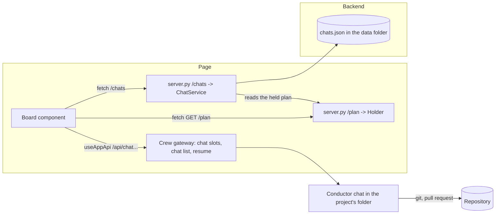
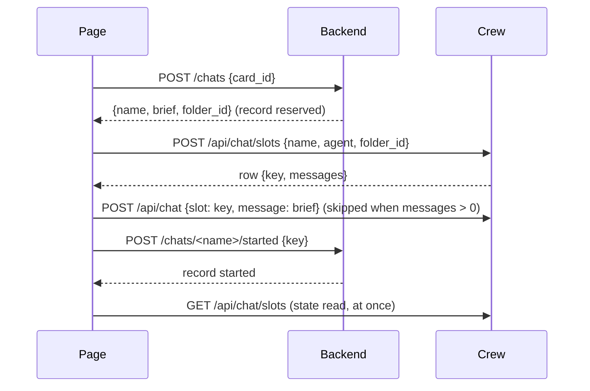

# Design Document

## Overview

This story lets the person start a Crew conductor from a card, shows the state of its chat on the card, and links to the chat. It builds on "Read the plan from main" (`.kiro/specs/read-the-plan-from-main/`, "the first design") and "Show the board" (`.kiro/specs/show-the-board/`, "the board design") and does not repeat them. Plan building, the git runner, the holder and the plan poller stay as they are, except where "Edits to earlier specs and checks" says otherwise.

Facts about Crew that this design relies on come from `docs/spike/` (which worked on a real crew) and from the Kiro Crew source at commit `1d08e94` (main, 2026-11-13), read in `src/kiro_crew/dashboard/` and `docs/app-kit/`. Each is named where it is used, and anything not seen working is in "Open Questions" and in the manual check of the last task group.

The work splits in two:

- **The backend** gains a small file-backed store of "which chat belongs to which card", the brief builder, four routes under `/chats`, a folder setting, and a signature check on those routes. It never calls Crew.
- **The page** gains the card controls, the start sequence, a second poller that reads chat states, and the restoring and resume flow. It calls Crew's chat endpoints through the host's `useAppApi`, and the backend's own routes with `fetch`, as the plan poller does.

### Why the page calls Crew and not the backend

The spike proved the page's way: `api.post('/api/chat/slots', ...)` then `api.post('/api/chat', ...)` from a page whose `app.json` declares `permissions.api`. A backend would need the app secret to authenticate to Crew, and the host's Python client is source-only. Calling from the page needs no secret and adds no dependency. The price is that a start only happens while the page is open. The reservation (Requirement 4) makes a start that dies half-way safe to repeat.

### Layout

```
app.json                  permissions.api: /api/chat, /api/chat/slots
backend/
  proxyauth.py   NEW   verify the gateway's X-KiroCrew-Proxy signature (stdlib)
  chats.py       NEW   ChatStore (chats.json), slugify, build_brief, reserve
  plan.py              cards gain id (add_ids)
  server.py            load_folder, ChatService, /chats routes, POST and DELETE
ui/
  index.mjs      CHANGED  chat state functions, start flow, chat read, card views,
                          second poller; createPoller gains two optional dependencies
tests/
  test_proxyauth.py  NEW   test_chats.py  NEW   test_chats_properties.py  NEW
  ui/chats.test.mjs  NEW   ui/start.test.mjs NEW   (others updated, see below)
```

`ui/index.mjs` stays one module with no imports, because the board design could not confirm that the host resolves a sibling module.

## Architecture



The board never touches `R`. The conductor does, under Crew's own tool approvals.

### The start sequence



A failure at any arrow leaves the record `reserved`. A repeat of the whole sequence reserves the same name, finds the chat already created (Crew answers a create for a name the app already owns with the existing row), skips the send when the chat already holds a message, and saves.

## Components and Interfaces

### `plan.py`: card `id` (first spec, 8.4)

`add_ids(groups)` runs last in `build_plan` and sets `card["id"]` to `f"{epic['file']}#{card['name']}"` for a group with an epic and `f"#{card['name']}"` for the "No epic" group. `card()`, `story_card()` and their callers do not change, so no existing test breaks. Known limit: two "No epic" cards with the same name (a `standalone.md` line named like another spec's folder) share an `id`; the store keeps one record per `id`, so they would share a chat. This is rare and not handled.

### `proxyauth.py` (Requirement 5, criterion 7)

```python
def verify(header: str, *, method: str, target: str, body: bytes, secret: str, now: float) -> bool
```

The host's documentation gives the rule, and the host's own `kiro_crew.apps.proxy_auth.verify_proxy_request` implements it. This is the same rule in the standard library, because the project adds no dependency and the backend may not be able to import `kiro_crew`:

- `header` is `<timestamp>:<hex signature>`. The timestamp is whole digits (seconds), and `abs(now - timestamp) <= 60`.
- The message is `f"{timestamp}:{method}:{target}:{sha256(body).hexdigest()}"`, signed with HMAC-SHA256 using `secret`. `target` is `self.path` exactly as received, query included, because the gateway signs the raw request target.
- The signatures are compared as bytes with `hmac.compare_digest`, encoding with `surrogatepass`, so that a hostile header value gives `False` and not an exception.
- An empty secret, an empty header, no colon, a non-digit timestamp or an empty signature gives `False`.

### Settings in `server.py` (Requirement 1)

`load_folder(environ, app_dir)` returns `(folder_id or None, reason or None)`. It applies the same first-source-wins rule as `load_repository`: `EPIC_BOARD_FOLDER` if set and not empty, else the `folder_id` of `config.json`. A `config.json` that cannot be read is already reported by `load_repository`, so `load_folder` returns no folder and the reason "config.json cannot be read". A `folder_id` that is not text, or only whitespace, returns no folder and a reason. It never raises and never affects `load_repository`. `ChatService` reads the data folder from `KIROCREW_HOME` and `KIROCREW_APP_NAME` through one function, `data_dir(environ)`, so tests pass a temporary folder.

### `chats.py` (Requirements 3 and 5)

```python
class ChatError(Exception):   # code, status, message
class ChatStore:
    def __init__(self, data_dir, new_name=default_new_name, clock=utc_now): ...
    def started(self) -> list[dict]                  # raises ChatError(chats_unreadable)
    def reserve(self, card_id) -> dict               # existing reserved: same record; started: ChatError(chat_exists)
    def mark_started(self, name, key) -> dict
    def remove(self, name) -> None                   # ChatError(chat_not_found)
def slugify(name, taken) -> str
def build_brief(card, epic_file, branch) -> str
def find_card(plan, card_id) -> tuple[str | None, dict] | None    # (epic file, card)
```

**The store.** One `threading.Lock` serializes every call. Each call loads the file (or finds none), changes the list in memory, and writes it with `tempfile.NamedTemporaryFile(dir=data_dir, delete=False)`, `flush`, `os.fsync` and `os.replace`. Loading validates the form of Requirement 5.1: a JSON object with a `chats` list of objects with text `card_id`, `name` and `created`, a `state` of `reserved` or `started`, and a text `key` when started and `null` otherwise. Anything else, including a duplicate `card_id` or `name`, is `chats_unreadable`, and the file is not touched. The folder is created with `os.makedirs(exist_ok=True)` on the first write only. Reading each time means an edit of the file by hand shows at the next request, and the file is small.

`default_new_name()` returns `"epic-board-" + secrets.token_hex(4)`. `reserve` draws again while the name is in the file.

**The brief.** `build_brief` is a pure function. Its two templates follow. `{…}` is replaced as the requirement says; the story's name is `json.dumps(name[:200], ensure_ascii=False)`, so quotes and line breaks in it cannot end the line.

With no spec (Requirement 3, criterion 2):

```
You are the conductor for one story of this project. Work in the checkout you were opened in.

Story: {name}
Epic page: docs/epics/{file}            (or: Epic page: none, this story has no epic)
Main branch: {branch}
Your job: write this story's spec. It has none yet.

1. Read the story's entry in the epic page, and the project's AGENTS.md and steering files. Follow them for how specs, branches and checks work.
2. Create a branch named story/{folder} from origin/{branch}. If the project names branches another way, follow the project.
3. Write requirements.md, design.md and tasks.md in .kiro/specs/{folder}/, in the project's usual spec format.
4. If the story has an epic page, change the story's line in it to link to .kiro/specs/{folder}/. Keep its status.
5. Commit, push the branch, and open one pull request into {branch}.

Rules:
- Never merge a pull request, never push to {branch}, never turn on auto-merge. The person reviews and merges.
- Open exactly one pull request. When it is open, write its address in this chat and stop.
- If you are blocked or unsure, ask in this chat. Do not guess.
```

With a spec (criterion 3):

```
You are the conductor for one story of this project. Work in the checkout you were opened in.

Story: {name}
Epic page: docs/epics/{file}            (or: none)
Spec: .kiro/specs/{spec}/
Main branch: {branch}
Your job: build the next task group of this story's spec.

1. Read the project's AGENTS.md and steering files, then requirements.md, design.md and tasks.md in the spec folder, and the epic page.
2. Find the first top-level task group that has a task not ticked yet. Build only that group. If every task is ticked, change nothing and say so in this chat.
3. If the spec has no tasks, write tasks.md as the only change of your pull request and build nothing.
4. Create a branch named story/{spec}-g<N> from origin/{branch}, where <N> is the number of that group. If the project names branches another way, follow the project.
5. Tick each task you finish in tasks.md, in the same branch. Run the checks the project names and fix what fails.
6. Commit, push the branch, and open one pull request into {branch}.

Rules: (the same three lines)
```

The branch name is spelled in the brief because the board knows the group number only as "first unticked"; the conductor counts it. Both templates are about 1,500 characters before the names go in (the tests measure it). With every inserted name at 255 characters, a brief stays under 5,000, below the 6,000 limit.

**`slugify(name, taken)`**: `re.sub(r"[^a-z0-9]+", "-", name.casefold())` after `casefold` and ASCII-only matching, `strip("-")`, cut to 60, `rstrip("-")`, `"story"` when empty, then `-2`, `-3`… while the result is in `taken`. `taken` is the set of spec folders in the plan.

**`find_card(plan, card_id)`** walks `plan["groups"]` and returns the epic file (or none) and the card whose `id` matches.

### `ChatService` and the routes (Requirement 5)

`ChatService(store, folder, reason, secret, holder, clock=time.time)` has one method, `handle(method, path, headers, body_bytes) -> (status, body)`, and `server.py` calls it from `do_GET`, `do_POST` and `do_DELETE` for any path that matches `/chats(/<name>(/started)?)?$` (matched on the end of the path, like the other routes). `plan` and `health` stay GET-only and unsigned.

Order inside `handle`, which keeps each refusal from leaking more than it needs to: (1) no secret → 503; (2) bad signature → 401; (3) body size and form → 400; (4) the route. The signature is checked against the raw body before it is parsed.

| Route | Does | Answers |
|---|---|---|
| `GET /chats` | `store.started()` | 200 `{folder_id, folder_reason, chats: [{card_id, name, key, created}]}` |
| `POST /chats` `{card_id}` | folder set? plan held? card found? card not done? → `store.reserve` → `build_brief` | 200 `{card_id, name, brief, folder_id}` |
| `POST /chats/<name>/started` `{key}` | `store.mark_started` | 200 `{card_id, name, key}` |
| `DELETE /chats/<name>` | `store.remove` | 200 `{"removed": true}` |

`POST /chats` gets the plan from `holder.request()`. A due refresh may start as a side effect, which is harmless. `("pending", _)` and `("error", _)` give `plan_not_ready`. The check order is: folder (`folder_not_set`), store readable (`chats_unreadable`), plan (`plan_not_ready`), card (`card_not_found`), status (`card_done`), then the reservation (`chat_exists`).

| Code | HTTP |
|---|---|
| `unauthorized` | 401 |
| `invalid_request` | 400 |
| `chat_not_found` | 404 |
| `card_not_found`, `card_done`, `chat_exists`, `folder_not_set`, `plan_not_ready` | 409 |
| `chats_unreadable`, `internal` | 500 |
| `proxy_secret_missing` | 503 |

Bodies are `{"error": {"code", "message"}}`. A message never contains the repository path. An unexpected exception answers 500 `internal`.

`do_POST` reads at most 4,096 bytes: it answers 400 at once when `Content-Length` is missing, not a number or above the limit, and reads nothing else.

### The page: `ui/index.mjs`

New pure exports, each tested under Node with no `window` and no React:

```js
export function stateOf(row, lastRole)             // 'needs-you' | 'working' | 'interrupted' | 'idle'
export const STATE_WORDS                           // {'needs-you': 'Needs you', ...}
export function chatHref(key)                      // '/chat?sid=' + encodeURIComponent(key)
export function classifyChats(status, body)        // {kind: 'chats', read} | {kind: 'failure'}
export function chatDelay(result)                  // 5000 | 15000
export const initialChats, chatsReduce(state, action)
export function cardViewOf(card, chats, ui, nowMs) // what one card shows, see below
export async function readChats(deps)              // one read cycle
export async function startStory(deps)             // the start sequence
export async function resumeChat(deps)             // resume
export function renderBoard(h, view, actions)      // gains actions, defaults to no-ops
```

`createPoller` gains two optional dependencies, `classifyAnswer` (default `classify`) and `delay` (default `nextDelay`). With neither given it behaves as before, and its tests do not change. The chat poller passes `classifyChats` and `chatDelay`.

#### State of one chat (Requirement 6)

```js
function stateOf(row, lastRole) {
  if (row.pending_approval === true || row.needs_input === true) return 'needs-you'
  if (row.running === true || row.admission_queued === true) return 'working'
  if (row.interrupted === true || lastRole === 'error') return 'interrupted'
  return 'idle'
}
```

Needs you comes before Working because a turn that waits for an approval or an answer is still in flight, so `running` is true then. This is an inference from `slot_projection.py`, which sets `running` from the turn being in flight and `pending_approval` from an unresolved approval future; the manual check confirms it on a real conductor. `interrupted` is only ever true when no turn is in flight (`not turn_in_flight and is_turn_interrupted(rows)`), so it cannot overlap Working.

The chat list row has no field for the last row's role. Its `last_message` is a redacted text preview, and the page must not read or show it (Requirement 6, criterion 6). The role comes from the slot detail, `GET /api/chat/slots/<key>?limit=1`, whose `messages` hold the newest rows with their `role`. A row with role `error` is the error card Crew writes when a turn dies after streaming (`is_turn_interrupted` documents that shape). The page reads it only for a chat that is not Needs you or Working and not `interrupted`, and reuses the earlier answer while the row's `last_ts` and `messages` are the same, so a quiet chat costs one request, not one per poll.

#### The read cycle (Requirements 6 and 8)

`readChats({backend, gateway, previous, now, signal})`:

1. `backend.get('/chats')`. An error body with `chats_unreadable` returns `{recordsError}` and ends the cycle with no gateway request. Any other failure rejects, and the poller counts it as a failure.
2. With no `chats`, return the folder and an empty read. No gateway request.
3. `gateway.get('/api/chat/slots', {signal})` must be an array, else the read rejects. Keep only rows whose `key` is a record's key (Requirement 6.1).
4. For each record: a row gives its state (reading the last role when due, as above). No row: `gateway.get('/api/chat/slots/<key>?limit=1', {signal})`. A rejection with `status === 404` is `missing`. A chat answer gives the state of Requirement 8.1 (`running` or `admission_queued` for Working, a last row with role `error` for Interrupted, else Idle). Any other rejection rejects the whole read.
5. Return `{folder, chats, byKey: {key: {state | 'missing', lastTs, messages, role}}, at: now()}`.

The whole read shares one `AbortSignal`, which the poller aborts after 10 seconds, so the limit covers however many requests the cycle makes. At most one request per chat is made, and none when the list holds the chat and its `last_ts` is unchanged.

`chatsReduce` keeps `missingSince[key]`, set to `at` the first time a read finds the key missing and cleared when a read finds it present (Requirement 8.2). It also keeps the last `byKey` and `lastRead` marks so the next cycle can reuse them, and a flag `failed` that the notice follows. A failed read keeps `byKey` and `missingSince` as they were.

`cardViewOf(card, chats, ui, nowMs)` decides one card from the plan card, the latest chat read, the page's own UI state and the time the read ended. It returns a `mode`:

| Condition | `mode` | Shown |
|---|---|---|
| card has a started record, key missing, under 60 s | `restoring` | name as plain text, "Restoring chat…" (status) |
| missing 60 s or more, no resume under way | `not-open` | name as plain text, "This chat is not open.", "Resume chat" |
| resume under way, or failed | `resuming`, `resume-failed` | "Resuming…", or "The chat could not be resumed." with reason and "Start again" |
| card has a started record otherwise | `chat` | name as a link, the state word once read |
| no started record, column Done | `plain` | name as text, nothing else |
| no started record, question open on this card | `question` | the question, or the start's progress or failure text |
| no started record, folder not set or records unreadable, and the person opened it | `blocked` | the text of Requirement 2, criterion 6 |
| otherwise | `startable` | name as a button |

The time is the end of the latest read and not the current clock, so rendering stays pure and a chat can show "This chat is not open." up to one poll late. The poll runs every 5 seconds while any chat is restoring (Requirement 6.7), so the lag is under 5 seconds.

#### The start sequence (Requirement 4)

```js
async function startStory({cardId, backend, gateway, onStep}) {
  // each step names itself first: onStep('reserve'), 'create', 'send', 'save'
  const reservation = await backend.post('/chats', {card_id: cardId})
  const row = await gateway.post('/api/chat/slots',
    {name: reservation.name, agent: 'kirocrew-conductor', folder_id: reservation.folder_id})
  const key = row.key                       // text, else the step fails
  if (!(row.messages > 0)) {
    try { await gateway.post('/api/chat', {slot: key, message: reservation.brief}) }
    catch (error) { if (!/accepted the request/.test(String(error?.message ?? error))) throw error }
  }
  await backend.post(`/chats/${reservation.name}/started`, {key})
  return {key}
}
```

A failure is wrapped in `{step, reason}` where `reason` is the error's message cut to 300 characters. The `accepted the request` case is the spike's finding: Crew accepts the message and may not answer with JSON, which the host's client reports as an error. The host's client adds its own `embed_app` field to the create body, which records the chat as begun on this app's page; the page adds nothing else (Requirement 4.3). The page holds at most one running sequence per card id in its UI state, so a second activation is ignored (Requirement 4.6).

`backend.post` and `backend.get` are `fetch` of `/apps/epic-board/api/chats…` with `credentials: 'same-origin'`, the abort signal, and a JSON body, like the plan request. They resolve with the parsed body, and reject with an error carrying `status` and the body's `error` when the status is not 2xx. `gateway` is the host's `useAppApi()` client, which rejects with `status` and `body`.

#### Resume and Start again (Requirement 8)

`resumeChat` sends `gateway.post('/api/chat/slots/<key>/resume')` with no body. Success ends it and the component calls the chat poller's `visible()` to read at once. A rejection becomes `resume-failed` with its message. "Start again" calls `backend.del('/chats/<name>')`, and on success the card shows the question. The page never calls `DELETE /api/chat/slots/…`, `…/stop` or `…/close`.

#### Rendering and style

`renderBoard(h, view, actions)` takes `actions = {ask, cancel, start, close, resume, startAgain}`, each called with the card's id or key, and defaults every action to a no-op so the board design's tests can call it as before. The plan view gains `view.chats` (the notice flag and `cardViewOf` inputs) and `view.ui`. A card is still one `li`. Its name is the label of the card's one main control: a `button` for `startable`, an `a` for `chat`, and plain text otherwise. The question is a `div` with `role="group"` and an `aria-label`, holding a `p` and two buttons. The state word is a `span` with the class `eb-chat-state`. No heading is added.

The "click anywhere on the card" behaviour needs no script. The card is `position: relative`, and the main control's `::after` covers the card (`position: absolute; inset: 0`). The question and the resume controls are `position: relative` with a higher `z-index`, so they take their own clicks. This keeps the card one tab stop for its main control, and Enter and Space work as on any button or link. Escape in the question calls `cancel`. After Cancel, an effect puts focus back on the card's button, found by a `data-card-id` attribute.

`STYLE` gains rules for the pointer cursor, the hover and focus-within tint (`rgba(128, 128, 128, 0.12)`), the state word, the question and the notice, all with `currentColor` or a grey with an alpha between 0 and 1. No rule removes the focus outline.

#### The component

`createBoard(React, env)` gains a second reducer for `chats` and `ui`, and a second effect that builds the chat poller. `env.useAppApi` defaults to the host's `window.__kirocrew_modules['@kirocrew/app-sdk'].useAppApi`, looked up inside the component on first render; the page tests pass a fake. The chat poller's `request(signal)` is `readChats` with the page's two clients, `hidden`, the timers, `visible()` on `visibilitychange` and `stop()` on unmount are wired exactly as the plan poller's are. When a start succeeds the component calls the chat poller's `visible()`, which reads at once unless a read is in flight; a read in flight began before the new record was saved, and the next one is at most 15 seconds later (5 seconds if any chat is restoring, Requirement 6.7). Hence a started card shows its link at once from the start's result and its state after the next read.

The link is not rendered by `cardViewOf` from the read alone. The start's result adds the new record to the chat state at once (`started` action), so the link appears without waiting.

### `app.json`

```json
"permissions": { "api": ["/api/chat", "/api/chat/slots"] }
```

`/api/chat` is a path prefix: it covers `POST /api/chat`, and `/api/chat/slots` covers the create, list, detail and resume routes. The spike declared both and worked. The app declares no `sessionApproval`, so the approve and answer routes answer 403 to it, which is what Requirement 6, criterion 6 wants.

## Data Models

`chats.json` in `<KIROCREW_HOME>/apps/<KIROCREW_APP_NAME>/data/`:

```json
{
  "chats": [
    { "card_id": "epic-board.md#Start a story", "name": "epic-board-3fa91c0e",
      "key": "epic-board-3fa91c0e", "state": "started", "created": "2026-11-14T09:30:12Z" },
    { "card_id": "epic-board.md#Filter by epic", "name": "epic-board-b7720a41",
      "key": null, "state": "reserved", "created": "2026-11-14T09:41:03Z" }
  ]
}
```

`GET /chats`:

```json
{ "folder_id": "f_8c1…", "folder_reason": null,
  "chats": [ { "card_id": "epic-board.md#Start a story", "name": "epic-board-3fa91c0e",
               "key": "epic-board-3fa91c0e", "created": "2026-11-14T09:30:12Z" } ] }
```

The plan response gains `id` on every card (first spec, 8.4). The Crew rows the page reads are used only for these fields: `key`, `running`, `admission_queued`, `pending_approval`, `needs_input`, `interrupted`, `last_ts`, `messages`, and from the detail, the `role` of the last row in `messages`.

## Correctness Properties

*A property is a characteristic or behavior that should hold true across all valid executions of a system-essentially, a formal statement about what the system should do. Properties serve as the bridge between human-readable specifications and machine-verifiable correctness guarantees.*

As in the board design, these are checked with seeded generators written in the tests (Python's `random.Random(seed)` and the generator in `tests/ui/support.mjs`), at least 100 iterations each, printing the seed on failure.

### Property 1: One state, by precedence

*For any* chat row and last role, `stateOf` returns exactly one of the four states, Needs you when `pending_approval` or `needs_input`, else Working when `running` or `admission_queued`, else Interrupted when `interrupted` or the last role is `error`, else Idle, and a missing field counts as false.

**Validates: Requirements 6.2**

### Property 2: Only our own keys count

*For any* chat list and any set of started keys, the read's result holds a state for exactly the started keys that are in the list or found by a detail read, and adding, removing or changing rows with other keys changes nothing in it.

**Validates: Requirements 6.1**

### Property 3: The store never holds two records for a card or a name, and survives a reload

*For any* sequence of `reserve`, `mark_started`, `remove` and a restart (a new `ChatStore` on the same folder), no `card_id` and no `name` appears twice, a `started` record has a key and a `reserved` one has none, a `started` record exists only for a name that was reserved, and the records after a restart equal the records before it. A file left behind by an interrupted write never replaces the file.

**Validates: Requirements 5.1, 5.2, 5.3**

### Property 4: The brief depends only on its inputs and always says never to merge

*For any* card, epic file and branch, `build_brief` gives the same text for the same inputs; the text is the no-spec template exactly when `spec` is none; it holds the never-merge, one-pull-request and ask-when-blocked rules; it is at most 6,000 characters; and it contains no text from the card's `description`.

**Validates: Requirements 3.1, 3.2, 3.3, 3.4**

### Property 5: A spec folder name is well formed and unused

*For any* story name and set of taken names, `slugify` gives a name of lower-case ASCII letters and digits joined by single hyphens, with no hyphen at either end, of at most 60 characters, or such a name followed by `-` and a number of 2 or more, and the result is not in the taken set. A name with no ASCII letter or digit gives `story`, or `story-` and a number when `story` is taken.

**Validates: Requirements 3.5**

### Property 6: The restoring clock

*For any* sequence of reads, each finding a chat present or missing at a given time, the chat is shown as restoring while the time since the first read of the current run of "missing" is under 60 seconds, as not open from 60 seconds on, and neither after a read that finds it present, which also restarts the count.

**Validates: Requirements 8.2, 8.3**

### Property 7: A repeated start never sends the brief twice and never makes a second chat

*For any* schedule of failures at each step of `startStory` across repeated attempts, against a fake backend and a fake Crew that behave as described (a reservation is stable, a create of a known name returns the same row with its message count, a send adds one message), at most one message is sent, at most one chat exists for the card, and an attempt in which every step succeeds ends with the record `started` with the chat's key.

**Validates: Requirements 4.3, 4.4, 4.5, 4.6**

## Error Handling

| Where | Failure | Result |
|---|---|---|
| Backend | No `KIROCREW_PROXY_SECRET` | 503 `proxy_secret_missing` on every `/chats` route; `plan` unaffected |
| Backend | Missing or wrong signature | 401 `unauthorized`; nothing read or changed |
| Backend | Body too large, not a JSON object, wrong fields | 400 `invalid_request` |
| Backend | `chats.json` unreadable | 500 `chats_unreadable` naming the file; the file is left as it is; the page shows the message on a card that is asked to start, and the cards that have chats show no chats |
| Backend | Data folder not writable | 500 `internal` on a reserve, started or delete; reads still work |
| Backend | Reserve on a Done card, an unknown card, a card with a chat, no plan, no folder | 409 with the codes of Requirement 4.2 |
| Page | A start step fails | The card says which step and why, and offers the question again; the record stays `reserved` |
| Page | Crew's chat list or a detail read fails, or the backend's `/chats` fails | The shown states stay and the notice appears; retry after 15 s |
| Page | A started chat is missing | Restoring for 60 s, then Resume |
| Page | Resume fails | The reason and "Start again", which removes only the board's record |
| Page | `useAppApi` is absent from the host | The chat reads fail; the board and its plan still work; manual check item |

## Edits to earlier specs and checks

Edited in place, as the board spec did, because the behaviour moved:

| Where | Change |
|---|---|
| First spec, requirement 8.4 | A card also has `id` |
| Board spec, requirement 1.2 | The page may also send the requests of `start-a-story` Requirements 4, 5, 6 and 8 |
| Board spec, requirement 1.3 | The page may also have the card controls of `start-a-story` Requirements 2, 7 and 8 |
| Board spec, introduction | The next story is described as it now is |
| Epic page | The "Started" mark became the four states; "Live tracking" in "Not in this epic" became "Following a conductor's work inside its chat" |

Checks that the board story wrote and that stop being true (the tasks bring them in line):

| File | Assumes | Change |
|---|---|---|
| `tests/test_ui.py` (the `app.json` check, lines 77 to 79) | no `permissions.api` | exactly the two entries, and none of the permissions Requirement 1.3 forbids |
| `tests/ui/render.test.mjs` (the interactive-element check, from line 183) | the `summary` is the only interactive element | the only interactive elements are the `summary` and the controls of Requirements 2, 7 and 8 |
| `tests/ui/board.test.mjs` ("opening the page sends one GET of the plan route and nothing else", line 195) | one request on open | the plan request plus one `GET .../chats`, and no gateway request while there are no chats |
| `tests/ui/poller.test.mjs`, `state.test.mjs`, `columns.test.mjs` | none | unchanged |
| `tests/test_plan.py`, `test_server.py`, `test_held.py`, `test_gitsource.py` | none | unchanged except new cases for `id`; `make_server` takes an optional `chats` argument |

## Testing Strategy

The backend and pure page functions are tested with the tools the project has. Python tests run with `python3 -m unittest discover -s tests -t .`, and the page tests with Node through `tests/test_ui.py`, as `AGENTS.md` says.

- **Backend.** `test_proxyauth.py` checks `verify` against signatures computed in the test, and against the host's own worked cases where the documentation gives them: stale, future, non-digit, empty, non-ASCII and altered body. `test_chats.py` covers the brief templates, `slugify`, `find_card`, the store on a temporary folder (including an unreadable file left untouched and a leftover temporary file), and `ChatService.handle` with a fake holder, a signing helper and a temporary folder: every code of the table, the order of the checks, the body limit, and the routes' answers. A small HTTP test on port 0 checks that `GET`, `POST` and `DELETE` reach `ChatService` through `make_server`, that `plan` and `health` are unchanged and unsigned, and that no git command runs. `test_chats_properties.py` holds Properties 3 to 5.
- **Page.** `tests/ui/chats.test.mjs` covers Properties 1, 2 and 6, `readChats` with a fake backend and a fake gateway (the requests made, none for an unchanged `last_ts`, a 404 as missing, other rejections as failures), `classifyChats`, `chatDelay`, and `cardViewOf` for each mode of its table. `tests/ui/start.test.mjs` covers `startStory`, `resumeChat` and Property 7 with fakes, including the `accepted the request` case, a create that answers an existing chat, and a second activation ignored. `render.test.mjs` is extended: each card mode's markup and roles, the question's buttons, the focus-related attributes, the one `a` or `button` per card main control, no heading added, literal text for chat messages and reasons, `STYLE` colour and outline scans with the new rules. `board.test.mjs` is extended: the chat poller starts with the page, sends nothing while hidden, reads at once on becoming visible and after a start, and stops on unmount.
- **Properties 1 to 7** are in the files above.

| Req | Backend tests | Page tests | Manual, on the host |
|---|---|---|---|
| 1 | `load_folder` cases; `data_dir` | `app.json` permissions in `test_ui.py` | The data folder is writable by the backend; the folder id set |
| 2 | | Card modes; question; Cancel and Escape; Done card inert; blocked texts | Click anywhere on a card; keyboard; focus returns |
| 3 | Brief and slug tests; Properties 4, 5 | | Read one brief of each kind in a started chat |
| 4 | Reserve refusals; `started` answers | `startStory`; Property 7 | Start on a throwaway project; the chat opens in the project's folder and sends the brief once |
| 5 | Store; Property 3; routes; signature; limits | | A signed request from the page reaches `chats`; restart keeps the records |
| 6 | | Properties 1, 2; `readChats`; polling; notice | **Check that the chat list is limited to our own chats**; states change as the conductor works |
| 7 | | `chatHref`; link markup | **Check that `/chat?sid=` opens our chat** |
| 8 | | Property 6; resume flow | Restart Crew with a started chat; Restoring, then back; Resume on a chat that is not open |
| 9 | | Roles; colours; keyboard; literal text | Light and dark theme; focus ring |

## Decisions

- **Card identity.** The `id` is the epic file and the card's name, not the spec folder, so a story's chat stays with its card when the conductor's pull request is merged and the card gains a spec. The cost is that renaming a story in its epic page, or moving it to another epic, loses its chat link. The record stays in the file, and "Start again" does not apply because the card no longer matches; this is accepted.
- **Needs you before Working.** The four states are given as fields. Their order matters because a turn waiting for an approval is also running. The order is Needs you, Working, Interrupted, Idle.
- **The brief is built by the backend.** It is plain text built from the plan on main, so the same code can be tested in Python and the page holds no prompt text.
- **No new dependency.** The signature check, the store and the page's flows use the standard library and the host's React. The page's server calls use `fetch` as the plan poller does.
- **The folder is a setting, as the repository is.** The person puts a Crew folder id in `EPIC_BOARD_FOLDER` or `config.json`. A folder picker would need `GET /api/chat/folders` and a place to keep the choice, and can be added later without changing the records.
- **The link is a URL.** `/chat?sid=<key>` is the shape the host's own links use (`session_deep_link`). The SDK's `useChatLauncher().openChat({slotKey})` is the other way and would keep the person inside the app's frame; the requirement asks for a link, and the manual check confirms it opens the chat.
- **Polling the list.** `GET /api/chat/slots` returns every chat Crew has open, and an RFC in Crew's repository (`docs/request-for-change/rfc-python-rust-hybrid-backend.md`) reports loop stalls inside that endpoint on a large list. The page reads it every 15 seconds, and every 5 seconds only while a chat is working, needs the person or is restoring, and never while hidden or while there are no started chats.
- **Signatures on `/chats`.** The backend listens on loopback with no login, and the new routes write. Checking the host's signature keeps another local process or a web page from reserving or removing records. The cost is that the backend needs `KIROCREW_PROXY_SECRET`; without it the routes answer 503 and starting is unavailable, which the manual check confirms is not the case on the host.

## Open Questions

1. **Folder.** Is a folder id in a setting acceptable for the first version, or should the board offer a picker of the folders Crew lists?
2. **The chat list for an app.** A code comment in `dashboard/chat_api/slot_detail.py` says an app's rows are "already app-scoped downstream", but I did not find the filter, and the per-slot routes are the ones the documentation says are ownership-checked. The page ignores other rows either way. If the list is not limited, the page still receives other chats' previews, and the right fix is in Crew. The manual check decides this.
3. **`useAppApi` details.** Does `api.get('/api/chat/slots/<key>?limit=1')` accept a query string, and does `get`'s second argument take `{signal}`? The documentation says the path check applies to the initial URL and that `request`, `get` and `post` accept `RequestInit`; this has not been run.
4. **`limit=1` returns the newest row.** The handler reads the whole window when `limit` is absent and pages by `before`; I did not confirm which end a bare `limit` returns.
5. **Does uninstalling the app reset its chats?** The documentation says a chat begun by `post('/api/chat/slots', ...)` is recorded as begun on the app's page and that uninstalling gives it a fresh start. The records in the data folder would then name chats that are gone.
6. **Does the host pass the signature and the secret?** The backend relies on `KIROCREW_PROXY_SECRET` and on `X-KiroCrew-Proxy` on every proxied request, as the documentation says; the spike did not use them.
7. **What if the brief's `agent` is unavailable?** The spike created chats with `kirocrew-conductor`; a Crew without that agent would fail at the create step with the reason shown.
