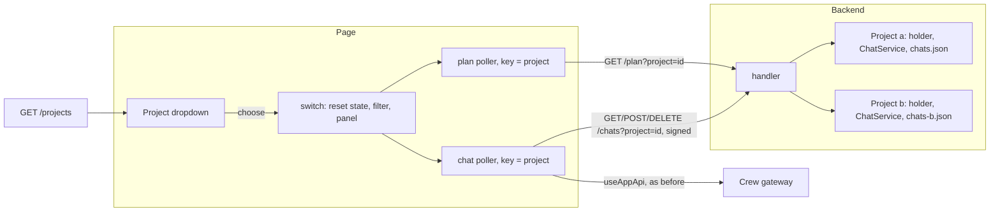

# Design Document

## Overview

This story lets one board show several projects. It builds on "Read the plan from main" (`.kiro/specs/read-the-plan-from-main/`, "the first design"), "Show the board" (`.kiro/specs/show-the-board/`, "the board design"), "Start a story" (`.kiro/specs/start-a-story/`, "the start design") and "Filter by epic" (`.kiro/specs/filter-by-epic/`), and does not repeat them.

**Build order.** Build this story after "Work in the chat" (`.kiro/specs/work-in-the-chat/`, pull request 29) and after the chat state change (branch `story/chat-state`, being built by another worker). The page code of both is the code this story changes: the panel, the chat poller and the card's chat view. This design reads their specs and does not edit them. At the time of writing the chat state change is not merged, so this design names its parts by the start spec's words ("the chat poller", "the chats state") and not by a function name that the change may rename. The first task of group 3 is to read what landed and to adjust the names, not the behaviour.

The work splits in two:

- **The backend** gains a project list read from `config.json`, one plan holder and one chat service per project, a `project` query value on the `plan` and `chats` routes, and a `projects` route. It changes the name of a Records_File for every project but one, and moves nothing. It runs on the standard library.
- **The page** gains a project dropdown, a saved choice, and a switch that resets the board and restarts both pollers for the new project.

`app.json` does not change.

### Facts about Crew this design relies on

From the Kiro Crew source at tag `v0.12.2` (`kirodotdev/KiroCrew`), read in `website/src/kirocrew-ui/Select.tsx` and `website/src/app-sdk/`.

- **`Select`.** `website/src/kirocrew-ui/Select.tsx` defines `SelectProps`: `options: string[]` (option values, in display order), `optionLabels?: string[]` (labels in option order; an option with none shows its value), `value: string`, `onChange: (value: string) => void`, `clearLabel?`, `disabled?`, `'aria-label'?`, `title?` and `className?`. It is a thin wrapper of the host's `SimpleSelect`. The filter spec's dropdown already passes exactly `aria-label`, `value`, `options`, `optionLabels` and `onChange` (the fix on main, pull request 27, passed the options as strings after an earlier build passed objects). The project dropdown passes the same five props and no other. `clearLabel` is not used: a project is always chosen. `title` is not used: the label is the visible text.
- **`app-sdk`.** `index.ts` and `shared-modules.ts` put the SDK at `window.__kirocrew_modules['@kirocrew/app-sdk']`, which holds `useAppApi` and `ChatPanel`. It does not hold `Select`. The page finds `Select` at `window.__kirocrew_modules['@kirocrew/ui']`, as `hostSelect()` of `ui/index.mjs` does.
- **The signed target.** The gateway signs `timestamp:method:target:sha256(body)`, where `target` is the request target as the backend receives it, and the backend's `proxyauth.verify` already takes the whole path with its query (`ChatService.handle` passes `self.path`). Whether the gateway forwards a query string unchanged on an app route is not something the source read here shows. It is in "Open Questions" and in the manual check.

Nothing here was run on a host. What only a host can show is in "Open Questions" and in the manual check of the last task group.

### Layout of the change

```
backend/projects.py        NEW      load_projects, project ids, which project owns chats.json
backend/server.py          CHANGED  a Project holds its holder and its ChatService; the handler picks one by
                                    ?project; GET /projects; the route table
backend/chats.py                    NOT CHANGED  ChatStore already takes a file path through its data folder (see below)
ui/index.mjs               CHANGED  pure: projectOptions, resolveProject, loadProject/saveProject, projectQuery;
                                    uiReduce/chats/plan state reset; renderProjects; createBoard keys both
                                    pollers by project
tests/test_projects.py     NEW      config, ids, file names, properties 1 to 3
tests/test_server.py, test_chats*.py   updated: the handler's new shape
tests/ui/projects.test.mjs NEW      the pure parts, the switch, properties 4 to 6
tests/ui/render.test.mjs, board.test.mjs   updated
```

`ChatStore` builds its path as `os.path.join(data_dir, CHATS_FILE)`. The only change it needs is that the file name is an argument with the default `chats.json`, so `ChatStore(data_dir, filename=...)`. Task 1.2 makes that change and leaves its behaviour as it is.

## Architecture



The page's calls to Crew are the start design's, and carry no project: a chat key names one chat in Crew whatever the project.

## Components and Interfaces

### Backend: reading the projects

```python
# backend/projects.py
Project = namedtuple("Project", ["id", "name", "repository", "folder", "folder_reason", "records_file"])

def load_projects(environ=None, app_dir=None):
    """Return (projects, error). `projects` is a list of Project; `error` is None, or an error body of the
    first spec's form ({code: 'repository_not_configured', ...}) and `projects` is []. Never raises."""
```

How it reads, in order:

1. Read `config.json` as `load_repository` and `load_folder` read it today. A file that cannot be read, or is not an object, is `repository_not_configured` when there is no repository from the environment either (the same message as today).
2. **`projects` is present.** Check it against Requirement 1, criterion 3, entry by entry, and stop at the first fault, naming it: `config.json: projects[2].repository must be text.`. The messages hold the file's path and the entry's number, never a repository path. Make each Project: `repository` is `os.path.abspath(os.path.expanduser(value.strip()))`, `name` is the stripped text, and the folder comes from `folder_id` with the checks of `load_folder` (a function `check_folder(value, source)` is cut out of `load_folder` for it, so that both use one set of rules). Duplicate repositories are found after expansion.
3. **`projects` is absent.** Call `load_repository` and `load_folder` as today. If the repository is wrong, `projects` is `[]` and the error is today's error. Otherwise there is one Project named after `os.path.basename(repository)`.
4. **Ids.** `slugify(name, taken=ids_so_far)` from `backend/chats.py`, in list order. `slugify` is reused and not copied. It already gives the pattern `[a-z0-9-]`, at most 60 characters, and `-2`, `-3` for repeats, so the Id is at most 64 characters (Requirement 1, criterion 6).
5. **The Records_File.** `legacy = abspath(expanduser(EPIC_BOARD_REPOSITORY or config["repository"]))` when either is set and is text. The Project whose `repository == legacy` gets `chats.json`. Every other Project gets `chats-<id>.json`. When the single-Project form applies, its repository is the legacy by definition. Two Projects cannot match, because duplicate repositories are refused.

### Backend: the server

```python
class Project:   # in server.py; the namedtuple above holds the settings, this holds the running parts
    settings, holder, chats    # holder: Holder or None; chats: ChatService
```

At start, for each Project from `load_projects`: one `Holder(repository, ...)`, one `ChatStore(data_dir(), filename=records_file)` and one `ChatService(store, folder, folder_reason, secret, holder)`. All holders start (`holder.start()` runs the first read and the first refresh in a thread, and starts no timer). After that, each refreshes only when its plan is asked for (the first design), so a project nobody looks at costs one fetch at start.

`make_handler(projects, error, config_path)` takes the list of running Projects and the config error (or none). Per request:

| Request | Steps |
|---|---|
| `GET …/health` | `{ok: true}` |
| `GET …/projects` | `[{id, name}]` for each Project, `[]` when none. No signature, no git |
| `GET …/plan[?project=]` | resolve the Project (below), then `plan_response(project.holder, error, config_path)` as today |
| `…/chats…[?project=]` | `ChatService.handle` of the resolved Project: secret, signature, then the route (below) |

Resolving a Project is a pure function, `pick_project(projects, query)`:

- no `project` key → the first Project, or none when the list is empty;
- one value → the Project with that Id, or a 404 `project_not_found`;
- more than one → 400 `invalid_request`.

When the list is empty, the `plan` route answers the config error (409 `repository_not_configured`), as it does today for a bad repository, and the `chats` routes answer 409 `repository_not_configured` after the signature check.

**Where the Project is looked up in `chats` requests.** The signature is checked first (Requirement 3, criterion 6), then the Project is resolved. So the handler cannot hand the request straight to one `ChatService`. The handler holds a `ChatRouter` with the secret and the clock, which does: secret check, `verify` on the full target, `pick_project`, and then `project.chats.handle_verified(method, path, body)`, which is the body of today's `ChatService.handle` after its signature check. The signature code does not change. The per-project `ChatService` keeps the store, the folder and the holder, and nothing else.

The signature covers `self.path`, which holds the query as received. `target=path` is what `verify` gets today, so a changed `project=` changes the message and the check fails: nothing new is needed for Requirement 3, criterion 6, and a test proves it.

### Page: pure parts

```js
// The Project_List the backend answered, or null when the answer is not a list of {id, name} text pairs.
// Ids must be unique and match ^[a-z0-9-]{1,64}$; names are kept as text.
export function readProjects(body)

// The Project_Id the page shows: the saved one when the list holds it, else the first, else null (no list).
export function resolveProject(projects, savedId)

// What the dropdown shows, or null when there are fewer than two Projects:
// {key, options: [id, ...], labels: [name, ...]}
export function projectOptions(projects, currentId)

export function loadProject(storage)        // text or null; never throws, never touches `window`
export function saveProject(storage, id)    // never throws

// `?project=<encoded id>` or '' when the id is null. Used on every backend path (Requirement 6, criterion 1).
export function projectQuery(id)
```

`loadProject` and `saveProject` are `loadChoice` and `saveChoice` of the filter with another key (`epic-board.project`), and share their try/catch by taking the key as an argument. The two filter functions keep their names and their tests.

### Page: state

The page gets one more piece of state, `projects`, kept with `useReducer`:

```
projects: {phase: 'loading' | 'ready' | 'failed', list: [{id, name}] | null, currentId: string | null}
```

- **`loading`**: before the first answer of `GET /projects`. The page draws the board spec's loading state and runs no poller.
- **`ready`**: `list` is the Project_List (possibly empty) and `currentId` is `resolveProject(list, loadProject(storage))`, or `null` for an empty list.
- **`failed`**: the read failed. `list` is `null`, `currentId` is `null`, the pollers run with no `project` value, and the notice shows (Requirement 7, criterion 4).

Actions: `{kind: 'projects-read', list}`, `{kind: 'projects-failed'}` and `{kind: 'switch', id}`. `switch` for the id already current returns the same state (Requirement 5, criterion 2).

`currentId` is what both pollers are keyed by. Everything the page holds about the old Project is dropped on a switch by one function, `switchTo(id)`, in `createBoard`:

```js
const switchTo = (id) => {
  if (id === projectsState.currentId) return
  saveProject(storage, id)
  projectsDispatch({ kind: 'switch', id })
  dispatch({ kind: 'reset' })           // the plan state back to its initial (loading) state
  chatsDispatch({ kind: 'reset' })      // the chats state back to initialChats
  uiDispatch({ kind: 'reset' })         // initialUi: no question, no flows, no panel, no focus request
  setFilterKey('all'); saveChoice(storage, 'all')
}
```

The four dispatches and the filter change run in one event handler, so React batches them into one render (Requirement 5, criterion 1, "in one update"). `reset` is added to the three reducers and returns their initial value. The panel's `open` is part of `ui`, so it closes with `reset`, and focus is not asked for because `focus` is `null` in `initialUi`.

### Page: the pollers

Both effects take `[currentId, phase]` as dependencies instead of `[]`, and do nothing while `phase` is `loading`. A change of `currentId` runs the cleanup of the old effect (which stops the poller, aborts its request, clears the timers and removes the visibility listener, as the start design's cleanup does) and then the new effect, which starts a new poller. Each effect run closes over its own `projectId` and the `request` it builds uses it:

```js
const PLAN_PATH = '/apps/epic-board/api/plan'
const request = (signal) => fetchFn(PLAN_PATH + projectQuery(projectId), {...})
```

and the chat poller's `makeBackend(fetchFn)` becomes `makeBackend(fetchFn, projectId)`, which appends `projectQuery(projectId)` to the path of every call it makes: `/chats?project=a`, `/chats/<name>/started?project=a`, `/chats/<name>?project=a`. Query goes after the path and the name is already encoded by `encodeURIComponent`, so the path stays one segment.

**No stale answers.** A poller that was stopped can still have an answer on its way: an aborted `fetch` normally rejects, but a response already read, or a read of Crew in flight, can still end. So every dispatch from an effect run goes through a guard made for that run:

```js
const live = () => latest.current.projectId === projectId && latest.current.alive
// onResult: (result) => { if (live()) dispatch(result) }
```

`latest.current.projectId` is set on every render from `currentId`. The same guard wraps `onRecords`, the gateway reads in `readChats`, and the dispatches of a start (below). `readChats` already takes `previous` (the chats state) for its caches; after `reset` that state is `initialChats`, and the new poller reads `latest.current.chats`, so no cache crosses over (Requirement 5, criterion 5).

**Starts.** A start captures `projectId` when it begins and uses `makeBackend(fetchFn, projectId)` for its calls, so a reservation, `started` call and removal always go to the Project of the card. Its dispatches to `ui` and `chats` go through the guard. A start that is running when the person switches keeps going (its Crew calls and its `started` call finish) and shows nothing (Requirement 5, criterion 6). Whether the brief is sent after a switch is in "Open Questions".

### Page: the dropdown

`renderBody` of the board gets a `renderFilters(h, view, actions, parts)` row in place of the one `renderFilter` call. The row is `div.eb-filters` and holds, in order, the project dropdown when `view.projects` is not null, then the epic dropdown when there is one. `renderFilter` is not changed. The row is drawn when either of them is, so with one project the page is what the filter spec draws, but for the extra wrapper (the filter spec's `div.eb-filter` stays inside).

```js
function renderProjects(h, projects, actions, Select) {
  const control = Select
    ? h(Select, {
      'aria-label': 'Project',
      value: projects.key,
      options: projects.options,          // strings: the Project_Ids
      optionLabels: projects.labels,      // the names, same order
      onChange: (value) => actions.switchProject(value),
    })
    : h('select', {
      'aria-label': 'Project',
      value: projects.key,
      onChange: (event) => actions.switchProject(event.target.value),
    }, projects.options.map((id, i) => h('option', { key: id, value: id }, projects.labels[i])))
  return h('div', { className: 'eb-filter eb-project', key: 'project' }, control)
}
```

`actions.switchProject(value)` ignores a value that is not an Id of the list (a `Select` can only send one it was given, but the check costs one line and keeps the reset from running on junk). The loading state, an error body and an empty board all go through the same `renderBody`, so Requirement 4, criterion 3 needs only that `renderFilters` is called in the error branch when `view.projects` is not null. The epic dropdown stays hidden there, as the filter spec says (its Requirement 1, criterion 4).

Style: `.eb-filters { display: flex; flex-wrap: wrap; gap: 8px; align-items: center; }`. No colour, no outline rule.

Names are children of `option` and values of `optionLabels`, never markup.

### Page: the notice

When `phase` is `failed`, the page draws `div.eb-notice[role=status]` with "Could not read the list of projects.", where the board spec's other notices are. A small timer (the same injected `setTimeout` and `clearTimeout`) runs the read again after 15 seconds, pauses while `document.hidden`, and reads at once when the page becomes visible. It is the plan poller's own `createPoller`, with the project list request and a fixed delay. It stops when a read succeeds.

## Data Models

**Config.**

```json
{"projects": [
  {"name": "Dead Reckoning", "repository": "~/dead-reckoning", "folder_id": "f-1"},
  {"name": "Epic Board",     "repository": "~/epic-board"}
]}
```

`projects` replaces the single `repository` and `folder_id` as the list. A `config.json` of `{"repository": "~/epic-board", "folder_id": "f-1"}` is one Project and nothing changes.

**`GET /projects`** answers `[{"id": "dead-reckoning", "name": "Dead Reckoning"}, {"id": "epic-board", "name": "Epic Board"}]`.

**Files in the Data_Folder.** `chats.json` for the Project whose repository is the Legacy_Repository, `chats-<id>.json` for each other. The form of the records and the files does not change.

**Browser.** `localStorage` key `epic-board.project`, plain text, a Project_Id. The epic filter's key `epic-board.filter` is set to `all` on a switch.

## Correctness Properties

As in the start design, these are checked with seeded generators written in the project's own test helpers (Python: a small generator in `tests/test_projects.py`, as `test_chats_properties.py` does; page: `tests/ui/support.mjs`), at least 100 iterations, with the seed printed on failure.

### Property 1: A project's answers come from that project only

*For any* Project_List of up to 20 Projects with distinct repositories, any sequence of `plan` and `chats` requests (reserve, started, remove, list) with `project=<id>` or none, the answer to a request is built from the holder, the folder and the Records_File of the named Project (the Default_Project when none is named), a request for an Id not in the list is a 404 `project_not_found` that changes nothing, and the records of one Project, read after any sequence of requests for the others, are exactly what they were.

**Validates: Requirements 2.1, 2.2, 2.3, 3.1, 3.7**

### Property 2: Ids and files are unique and stable

*For any* list of names (including empty text after slugging, equal names, names that differ only by case or punctuation, and very long names), `load_projects` gives Project_Ids that are all different and match `^[a-z0-9-]{1,64}$`, gives Records_Files that are all different and none of which is `chats.json` except the Project whose repository is the Legacy_Repository, and gives the same Ids and files when it is called again with the same config.

**Validates: Requirements 1.6, 3.2, 3.3**

### Property 3: A single repository behaves as it did

*For any* config of today's form (a `repository`, with or without a `folder_id`, or the environment variables), `load_projects` gives one Project, its repository and folder are what `load_repository` and `load_folder` give, its Records_File is `chats.json`, and every `plan` and `chats` request (with no `project`, or with its own Id) is answered as it was before this story, by the same bodies and status codes.

**Validates: Requirements 1.5, 2.2, 2.6, 3.3**

### Property 4: The signature covers the project

*For any* signed `chats` request and any change to its `project` query value (another Id, an empty value, a repeated key, a removed key), the signature check fails with 401 `unauthorized` and the request reads and changes nothing, and for any unsigned request the answer is the same whatever `project` names (an Id that exists or not).

**Validates: Requirements 3.6**

### Property 5: The page never shows another project's answer

*For any* sequence of switches, plan answers, chats answers, Crew reads and start steps, each tagged with the Project it was asked for, and delivered in any order, the plan, the chats, the notices and the flows the page holds were all made from answers tagged with the Current_Project, and a switch to the Current_Project changes nothing.

**Validates: Requirements 5.2, 5.4, 5.5, 5.6, 6.1, 6.3**

### Property 6: A switch resets exactly what it should

*For any* page state (a plan, chats, a question open, a start running, a panel open, a filter chosen), after `switchTo` another Project the plan is the loading state, the chats state, `ui` and the panel are their initial values, the Filter_Key and the saved filter are `all`, the Saved_Project is the new Id, and nothing else has changed; and `resolveProject` gives the Saved_Project only when the list holds it, the Default_Project otherwise, and `null` for an empty list.

**Validates: Requirements 4.5, 4.6, 5.1, 5.7**

## Error Handling

| Where | Failure | What the person sees |
|---|---|---|
| Config | `projects` is bad (Requirement 1, criterion 3) | The plan error `repository_not_configured` naming `config.json` and the entry; no dropdown (the list is `[]`) |
| Config | One Project's repository is not a checkout | That Project's plan error as today; the dropdown stays so another Project can be chosen |
| Config | One Project's `folder_id` is bad | That Project's Start shows "No Crew folder is set for this project." with the reason (the start spec's Requirement 2, criterion 6); other Projects work |
| Backend | `?project=` names nothing | 404 `project_not_found`. The page never sends one it did not read from the list, so it shows only for a stale link |
| Backend | A Records_File is unreadable | That Project's chats show the start spec's notice; the others do not |
| Page | `GET /projects` fails | "Could not read the list of projects."; the board works for the Default_Project; a retry every 15 seconds |
| Page | `GET /projects` answers something that is not a list | The same as a failure |
| Page | The saved Project is gone from the list | The Default_Project is shown and saved; no message |
| Page | A switch while a start runs | The start finishes its requests; its result is not shown |
| Page | `localStorage` fails | The choice is held in memory for the visit |

## Edits to earlier specs and checks

A requirement lives in one spec, so the rules that this story changes are edited where they stand, by the tasks that build the change. This story does not edit "Work in the chat" or the chat state change, and the table says which of their code it changes.

| Where | Change |
|---|---|
| First spec, Requirement 1, criteria 1 to 4 | The repository setting is one project, and `projects` may list several. A pointer to this spec's Requirement 1 |
| Board spec, Requirement 1 and the `plan` route | The route takes `project`, and a missing value means the first project. A pointer to Requirement 2 |
| Start spec, Requirement 1, criteria 1 and 4 | The folder and the Records_File are those of a project; `chats.json` is the legacy project's file |
| Start spec, Requirement 5, criteria 4 to 7 | The `chats` routes take `project`; the signature covers it |
| Start spec, Requirement 6, criterion 7 | The chat poller belongs to a project and is restarted by a switch |
| Filter spec, Requirement 3 | A switch of project sets the filter to `all` and saves it (a pointer to Requirement 5, criterion 1) |
| Epic page | The story's line, the epic's first paragraph and "Not in this epic" (done by this spec's own pull request) |

| File | Assumes | Change |
|---|---|---|
| `tests/test_server.py`, `tests/test_chats*.py` | `make_handler(holder, error, config_path, chats)` and one `ChatService.handle` | `make_handler(projects, error, config_path)`, `ChatRouter`; the old cases are kept as the single-project cases (Property 3) |
| `tests/ui/board.test.mjs`, `chats.test.mjs`, `poller.test.mjs` | the pollers start once with `[]` and the paths have no query | they start when the Project_List has been read; a fake `GET /projects` is added to the fake `fetch` of `tests/ui/support.mjs`; the paths carry the query |
| `tests/ui/render.test.mjs` (the interactive-element check) | the epic dropdown is the only dropdown | also the project dropdown, which is not drawn with one project |
| `tests/test_ui.py` | `permissions.api` is the two entries | unchanged, and one more assertion for this story |

The plan and chats pollers of the start design and the panel of "Work in the chat" keep their behaviour. A project switch calls the cleanup they already have.

## Testing Strategy

Backend tests are `unittest`, standard library only, in `tests/`. Page tests run with Node through `tests/test_ui.py`, as `AGENTS.md` says, with a fake React, a fake document and a fake `fetch` like the start design's.

- **`tests/test_projects.py`** (new): the config cases of Requirement 1 (every fault of criterion 3 has a test, the messages hold no repository path), the single form with and without the environment variables, the ids, the file names, the Legacy_Repository rules (no match, no legacy, both given), and Properties 2 and 3.
- **`tests/test_server.py`**: `pick_project` (none, one, many, unknown, empty), `GET /projects` (list, empty list, no signature, no git), `plan` for two projects with two fake holders (the right holder answers; one's error does not touch the other), the `chats` routes with two stores in a temporary folder (Property 1), the 404 and 400 answers, and Property 4 (a changed, removed, repeated or empty `project=` in a signed target fails the check; an unsigned request gets the same 401 whatever the Id).
- **`tests/ui/projects.test.mjs`** (new): `readProjects`, `resolveProject`, `projectOptions`, `loadProject`/`saveProject` (including a storage that throws), `projectQuery`, the three reducer actions, `switchTo` (what it dispatches and in which order), and Properties 5 and 6 with a model of the page: fake pollers that deliver answers late and out of order, tagged by project.
- **`tests/ui/render.test.mjs`**: the dropdown's props (exactly the five, strings for `options`, names in `optionLabels`), the native fallback, no dropdown for one or no Project, the dropdown in the error branch, the row's order (project, then epic), literal text for a name that holds markup, and the `STYLE` scans.
- **`tests/ui/board.test.mjs`**: with a fake backend of two projects: the list is read first and no plan before it; every plan and chats path carries `project=`; a switch resets and restarts both pollers (the old poller's timers are cleared and its request is aborted); an answer from the old project that arrives late changes nothing; a start in flight during a switch finishes its calls with the old `project=` and shows nothing; the panel closes; the filter is `all` and saved; the choice is saved; a saved Id not in the list falls back to the first; the failed read shows the notice and retries; and the requests with one project are the same as before but for the query.

| Req | Page tests | Backend tests | Manual, on the host |
|---|---|---|---|
| 1 | | config cases; Properties 2, 3 | A config with two projects and one with a bad entry |
| 2 | | routes; Properties 1, 3 | |
| 3 | | files; Properties 1, 4 | **The existing `chats.json` keeps its chats on the right project; the signature check passes with `?project=` through the gateway** |
| 4 | dropdown; saved choice | | The Select looks like Crew's own; it is shown for two projects and not for one |
| 5 | Properties 5, 6; the switch | | Switch with a chat open and a start running |
| 6 | paths with `project=`; Start in a project | Property 1 | **Start a story in the second project: the conductor opens in that project's folder** |
| 7 | roles, labels, scans, the notice | | Light and dark themes; keyboard |

## Design Decisions

- **The Project_Id is made from the name.** The config has three fields and the request named them, so there is no `id` field. A slug of the name is readable in a URL and stable while the name is. The cost is that renaming a project changes its Id and, unless its repository is the Legacy_Repository, detaches its records file (Open Questions, 1).
- **One holder per project, all started at launch.** A holder does nothing until it is started, and after the first refresh it refreshes only when it is asked. The cost of starting twenty is twenty first reads and fetches at launch, in threads. Starting a holder on its first request would make the first view of each project wait on git, which the first design avoids.
- **A file for each project, and the old file stays.** One file with a project field in each record would change the Chat_Record's form and need a migration. A file per project changes nothing in the form, needs no migration and keeps one lock per project. The legacy file belongs to the project whose repository matches today's, so existing links stay with no copy, rename or write.
- **The query, not the path.** The routes are matched on the end of the path (`/plan`, `/chats`), so a path segment for the project would need a new match rule and would break a request of today's form. A query value is ignored by today's matching, and a request without it means the default project.
- **`/projects` needs no signature.** It returns names and Ids that the plan route's answer already shows the page, never a path or a folder. The `plan` route is unsigned for the same reason.
- **A switch resets by `reset` actions, and the pollers are keyed by project.** The alternative is to remount the whole board with a `key`. That would also reset the panel, the pollers and the state, but it would remount Crew's `ChatPanel`, which the panel design keeps as one instance, and it would lose the stale-answer guard that a keyed effect gives for free. A keyed effect and three `reset` actions are all the page needs.
- **A start keeps going after a switch.** Cancelling it would leave a reservation or a chat with no brief. The start design's reservation makes a half-done start safe to repeat, but stopping it is a decision the person did not make.
- **Reset the filter and close the panel.** The epic filter's keys belong to one project's plan, and a chat belongs to one project's folder. Keeping either would show something about a project the person left.
- **The dropdown is hidden for one project.** The request says so. With one project the dropdown has nothing to offer, and the page stays the page of today.

## Open Questions

1. **A renamed project loses its records file.** The Id comes from the name, so renaming a project in `config.json` (other than the project that owns `chats.json`) points it at a new empty `chats-<new-id>.json`, and the old file stays unread. An optional `id` field would fix that. The request lists three fields only, so it is not added. Is this acceptable, or should `id` be allowed?
2. **A project that has the legacy repository, once the top-level `repository` is removed.** `chats.json` then belongs to no project and its chats do not show. The story does not move files. Should the person be told, for example in the `GET /chats` answer?
3. **Do the environment variables still mean anything when `projects` is listed?** This design ignores `EPIC_BOARD_FOLDER` and uses `EPIC_BOARD_REPOSITORY` only to find the legacy file. Is that what the owner expects, or should `projects` and the variables not be allowed together?
4. **Does the gateway forward the query?** The backend checks the signature over the whole target, and the page puts `project=` in the target. If the gateway drops or re-orders the query before signing, every `chats` call of a second project would answer 401 or reach the wrong project. The manual check settles it. If it fails, the fallback is a path segment for the project and a change to the routes' matching.
5. **A start during a switch.** The brief may be sent to a chat the page no longer shows, and a "The brief was not sent" note is dropped with the switch. The chat is saved and shows when the person comes back, but the note does not. Is that acceptable?
6. **The chat state change may rename the parts this design names.** `story/chat-state` is in progress. If it changes the chats state or the poller's shape, group 3 adjusts the names and checks the properties again.
7. **Where the panel's open chat is kept.** The design assumes the panel's `open` lives in `ui`, as "Work in the chat" has it. If it moves, the reset of Requirement 5, criterion 1 must still close the panel.
8. **How many projects.** The limit of 20 and the name limit of 100 characters are judgements to bound the threads and the dropdown. Change them in Requirement 1 if they are wrong.
9. **Which project opens on a first visit.** The first in the config. There is no "last used" across browsers, only the saved choice of this browser.
