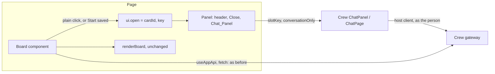

# Design Document

## Overview

This story opens a started story's chat beside the board, using Crew's own `ChatPanel`. It builds on "Show the board" (`.kiro/specs/show-the-board/`, "the board design") and "Start a story" (`.kiro/specs/start-a-story/`, "the start design"), and does not repeat them. It changes no backend file and no route. It changes `ui/index.mjs`, its tests, and the specs named in "Edits to earlier specs and checks".

Facts about Crew come from the Kiro Crew source at tag `v0.12.2` (`kirodotdev/KiroCrew`), read in `website/src/app-sdk/` and `docs/app-kit/api-reference.md`. Each is named where it is used. Nothing here was run on a host: what only a host can show is in "Open Questions" and in the manual check of the last task group.

### What `ChatPanel` is, and what it needs

- `website/src/app-sdk/index.ts` exports `ChatPanel`, and `shared-modules.ts` puts the whole SDK namespace at `window.__kirocrew_modules['@kirocrew/app-sdk']`, so the page reads it the way it reads `useAppApi`.
- `ChatPanel({slotKey, conversationOnly})` mounts the host's `ChatPage` with `embedded`. With `conversationOnly` it hides the sessions rail and turns off the page's URL synchronisation. The API reference says to mount one `conversationOnly` panel at a time, because the panel keeps its `slotKey` session active and switches back when another session becomes active.
- It makes the `slotKey` session the host's active slot (`useOwnSlotChat`, which `switchSlot`s to it). It accepts a session that was created a moment ago and is not in the host's list yet (it adds a placeholder row and refreshes the list), so a chat the page has just saved can be shown at once. It handles a changed `slotKey` on the same mounted component: the hook's switch effect depends on `slotKey`, hides the chat until the switch settles, and then shows the new one. A session that no longer exists shows "session gone", and any other failure shows the error with "Try again".
- **Permissions.** `ChatPage` talks to the gateway through the host's own `api` client (`import { api } from '../api/client'`), not through the app's scoped `useAppApi` client, which is the one that checks `permissions.api`. `ChatPanel.tsx` and `useOwnSlotChat.ts` use no `useAppApi` either. The API reference lists `permissions.api` and `permissions.sessionApproval` as the requirements of `ChatEmbed`, which does use the scoped client, and says nothing of the kind for `ChatPanel`. So the panel needs no `permissions.api` entry, and this story adds none. The entries the app already has (`/api/chat` and `/api/chat/slots`) are the ones the board's own start and read use.
- **Why not `ChatEmbed`.** It would work through the scoped client, so it needs `/api/chat` (which the app has), and for approvals and questions it needs `permissions.sessionApproval`, which the start spec's Requirement 1, criterion 3 forbids, and it reaches questions only in sessions the app owns. The board's chats are created by the page as the person (`app` empty, `origin` `user`, start design), so a question in them would be `404 slot_not_found` even with the grant. `ChatPanel` shows the person's own session as the person does.

### Layout of the change

```
ui/index.mjs     CHANGED  isChatPanel, panelViewOf, isPlainClick (pure); uiReduce gains `open`;
                          cardViewOf gains `open`; renderPanel, renderShell (pure); STYLE gains
                          the panel rules; createBoard mounts the panel and handles focus
tests/ui/panel.test.mjs   NEW      the pure parts and Properties 1 and 2
tests/ui/render.test.mjs, board.test.mjs, controls.test.mjs, chats.test.mjs   updated
```

`renderBoard` and its tree do not change: a view with no panel draws what the start design draws, inside two new wrapper elements. `app.json` and the backend do not change.

## Architecture



The board's own requests (plan, records, chat states, start, resume) are the start design's. The Chat_Panel's requests are Crew's, made by Crew's component with the host's client.

### The state

`ui` (the start design's `uiReduce` state) gains one field:

- `open`: `null`, or `{cardId, key}`, the Open_Card and the chat the Panel shows.

and two actions:

- `{kind: 'open-chat', cardId, key}` sets `open` to that pair, unless `open.key` is already `key`, which returns the same state (Requirement 2, criterion 3).
- `{kind: 'close-chat', key?, focus?}` sets `open` to `null`. With `key`, it does nothing unless `open.key` is that key. With `focus: true` it also sets `focus: {cardId}`, which the start design's existing focus effect turns into a `focus()` on the card's link.

Nothing else touches `open`: a read of the records, a failed read, a missing chat and a plan refresh leave it alone (Requirement 2, criterion 6). `open` is kept by key and not derived from the records because a read of the records that began before a start was saved can come back without the new record, and the panel must not close for that. The start design has the same race for the link, and it heals on the next read.

### Pure functions

```js
// Whether the host's value is something React can mount as a component.
export function isChatPanel(value) {
  return typeof value === 'function' || (typeof value === 'object' && value !== null && '$$typeof' in value)
}

// What the Panel shows, or null: {cardId, key, title}. `title` is the plan card's name, found by id in
// the columns of `view`, or 'Chat' when the plan has no such card now. Null when no chat is open or the
// host has no chat panel.
export function panelViewOf(view, ui, hasPanel)

// A click the page takes over: the primary button with no modifier key, and not already handled.
export function isPlainClick(event) {
  return event.button === 0 && !event.ctrlKey && !event.metaKey && !event.shiftKey && !event.altKey && !event.defaultPrevented
}
```

`cardViewOf` gives a `chat` view one more field, `open`, true when `ui.open?.key === key`. The mark is drawn from it.

### Drawing

`renderBoard(h, view, actions)` gains one action, `openChat({cardId, key})`, and one view field, `view.panelAvailable` (true when the host has a chat panel). The card's `a` gets an `onClick`:

```js
onClick: (event) => {
  if (!view.panelAvailable || !isPlainClick(event)) return   // the browser follows the link
  event.preventDefault()
  actions.openChat({ cardId: card.id, key: chat.key })
}
```

The `a`'s stretched `::after` makes every click on the card reach it, and Enter on the link produces a click with `button` 0 and no modifier. A chat that is restoring or not open has no link (the start design), so it cannot be opened.

An Open_Card's chat line gains `span.eb-chat-open` with the text "Chat open", its `li` gets `data-open="true"`, and its link gets `aria-current="true"`. The border rule is `.eb-card[data-open='true'] { border: 2px solid currentColor }`, and the card's padding is reduced by 1px in the same rule so the card does not grow.

Two new pure functions draw the rest, and `createBoard` composes them:

```js
renderPanel(h, panel, content, actions)   // panel = {title, key}; content = the element to put inside
// <aside class="eb-panel" data-eb-panel tabindex="-1" aria-label="Chat: {title}">
//   <div class="eb-panel-head"><span class="eb-panel-title">{title}</span><button type="button">Close</button></div>
//   <div class="eb-panel-body">{content}</div>
// </aside>

renderShell(h, board, panelTree)
// <div class="eb-shell" data-panel="open|closed"><div class="eb-split">{board}{panelTree}</div></div>
```

`panelTree` is `null` when nothing is open, so the board's element keeps its place and type in the tree whether or not a panel is open. That is what keeps it mounted, and keeps its polling, its `details` and its scroll position (Requirement 3, criterion 2). The Panel's `aria-label` is a text attribute, so a name from the plan cannot be markup. No heading is added.

### Styles

All new rules use `currentColor` or no colour, and none removes an outline.

```css
.eb-shell { container: eb-shell / inline-size; height: 100%; }
.eb-split { position: relative; height: 100%; }
.eb-panel { display: flex; flex-direction: column; min-width: 0; min-height: 0; height: 100%; }
.eb-panel-head { display: flex; align-items: center; justify-content: space-between; gap: 8px; padding: 8px 12px; border-bottom: 1px solid currentColor; }
.eb-panel-title { font-weight: 600; overflow-wrap: anywhere; }
.eb-panel-head button { font: inherit; cursor: pointer; }
.eb-panel-body { flex: 1 1 0; min-height: 0; }
.eb-card[data-open='true'] { border: 2px solid currentColor; padding: 7px 11px; }
.eb-chat-open { margin-left: 8px; font-size: 0.85em; font-weight: 600; }

/* Narrow: the panel covers the board. The board keeps its box, so its scroll position survives. */
.eb-shell[data-panel='open'] .eb-panel { position: absolute; inset: 0; }
.eb-shell[data-panel='open'] .eb-root { visibility: hidden; }

/* Wide: the panel is to the right of the columns. */
@container eb-shell (min-width: 1000px) {
  .eb-shell[data-panel='open'] .eb-split { display: flex; }
  .eb-shell[data-panel='open'] .eb-root { visibility: visible; flex: 1 1 0; min-width: 0; }
  .eb-shell[data-panel='open'] .eb-panel { position: static; flex: 0 0 clamp(380px, 40%, 640px); border-left: 1px solid currentColor; }
}
@supports not (container-type: inline-size) {
  @media (min-width: 1000px) { /* the same three rules */ }
}
```

`visibility: hidden` is chosen over `display: none` because the box stays laid out and keeps its scroll offset, and the content is still removed from the tab order and from the accessibility tree (Requirement 3, criterion 2). A Narrow panel is `position: absolute; inset: 0` over a board that still takes its space, so the Area's height does not jump.

The 1,000 pixels is a judgement: the Panel is 40% of the Area, between 380 and 640 pixels, so at 1,000 the board keeps 600, which is room for one column of cards with their text. From 1,000 to 1,200 the board keeps its single-column layout, and its own three-column rule (720 pixels of the board's width) applies again once the Area is 1,200, where the board has 720. The number is in the requirements, so a change is an edit there.

### The component

`createBoard(React, env)` changes as follows.

- **The host's panel.** `env.ChatPanel ?? hostChatPanel()` is read in the component on every render, where `hostChatPanel()` returns `window.__kirocrew_modules?.['@kirocrew/app-sdk']?.ChatPanel`, so importing the module needs no `window`. `hasPanel = isChatPanel(value)`. The page tests pass a fake.
- **One panel.** The component renders at most one `Panel`. The Chat_Panel element is `h(ChatPanel, {slotKey: key, conversationOnly: true})` and has no React `key`, so React gives the same instance a new `slotKey` and does not remount it. This is what `useOwnSlotChat` is written for, and it never leaves two mounted. It is wrapped in `PanelBoundary`.
- **`PanelBoundary`** is a class component made from `React.Component` inside `createBoard`: `getDerivedStateFromError` sets `failed`, and `componentDidUpdate` clears it when the `slotKey` prop changed. In the failed state it draws `p[role=status]` "The chat could not be shown here." and `a[href=chatHref(key)]` "Open the chat in Crew". The Panel's header and "Close" stay outside the boundary.
- **Opening.** `actions.openChat({cardId, key})` checks that `latest.current.chats.records` has a record with that `key` and `card_id` (Requirement 1, criterion 4), and then dispatches `open-chat`. A start's `onSaved` dispatches `open-chat` for the saved chat after it adds the record, when `hasPanel` is true. The dispatches of one tick are batched, so the Panel never sees a key without its record.
- **Closing.** The "Close" button calls `actions.closeChat()`, which dispatches `{kind: 'close-chat', focus: true}`. `actions.startAgain`, after the record is removed, dispatches `{kind: 'close-chat', key: record.key}`.
- **Focus.** The start design's focus effect (after Cancel) already finds `[data-card-id]` and focuses it, so Close reuses it. A second effect, keyed on `panel?.key`, finds `[data-eb-panel]` and calls `focus()` on it when a Panel opens or switches (Requirement 4, criterion 1). It does nothing when the key is unchanged, so opening the Open_Card again moves nothing.
- **What does not change.** Both pollers, the start sequence, the brief and its note, resume and the plan view are as the start design has them. The pollers go on while the Panel is open and the page is visible; the board's state word and the Chat_Panel's own view of the chat can differ by up to one read.

### Behaviour with no host panel

`hasPanel` is false, `view.panelAvailable` is false, `renderPanel` is never called, and the `a`'s `onClick` returns before `preventDefault`. The page is the start design's page inside the two wrappers.

## Data Models

`ui.open` is the only new state, and it is not stored anywhere: a reload starts with no Panel (Requirement 2, criterion 7). The backend, `chats.json` and `app.json` do not change.

## Correctness Properties

As in the start design, these are checked with seeded generators written in the project's own test helpers (`tests/ui/support.mjs`), at least 100 iterations, with the seed printed on failure.

### Property 1: At most one chat is open, and it is always one the page started

*For any* sequence of `open-chat` and `close-chat` actions, records added and removed, and reads that drop or keep records, `uiReduce` leaves `open` either `null` or the `{cardId, key}` of the last open action, `panelViewOf` gives at most one Panel, `cardViewOf` marks `open` on at most one card, and an `openChat` for a key with no record in the chats state dispatches nothing.

**Validates: Requirements 1.3, 1.4, 2.1, 2.2, 2.3, 2.6**

### Property 2: The mark, the Panel and the chat agree

*For any* view, chats state and `ui`, the rendered page has a Panel if and only if `panelViewOf` is not null, the Chat_Panel in it has exactly the props `slotKey` (the Open_Card's key) and `conversationOnly: true`, and exactly the Open_Card has the words "Chat open", `aria-current` and `data-open`; with no host panel none of them appears and the card's link is unchanged.

**Validates: Requirements 1.2, 1.5, 2.4, 2.5, 3.5**

## Error Handling

| Where | Failure | What the person sees |
|---|---|---|
| Page | The host has no `ChatPanel`, or it is not a component | No Panel; a click follows the link (start spec, Requirement 7, criterion 6) |
| Chat_Panel | It throws while drawing | "The chat could not be shown here." and a link to the chat; "Close" works; the next open tries again |
| Chat_Panel | The chat no longer exists, or cannot be opened | Crew's own message inside the Panel ("session gone", or the error with "Try again"). The card keeps its own text |
| Page | The chats read fails | The start design's notice; the Panel stays on its chat |
| Page | A plan refresh removes the Open_Card's card | The Panel stays, titled "Chat" |
| Page | A start fails before the chat is saved | The Panel does not change (Requirement 5, criterion 3) |
| Page | A start's send fails after the save | The Panel shows the chat, the card shows the start design's "The brief was not sent" |

## Edits to earlier specs and checks

Edited in place, as the start spec and the board spec did before, because the behaviour moved. A requirement lives in one spec, so the panel's rules are here and the rules that were already in these specs were changed where they stand.

| Where | Change |
|---|---|
| Start spec, Requirement 7, criteria 1, 5, 6 | A click opens the chat in the panel when the host has one, and follows the link when it has not; a click with a modifier key or a secondary button is left to the browser |
| Start spec, Requirement 6, criterion 6 and the introduction | The board's own code never approves or answers; the person may, in the embedded chat |
| Start design | The link's click handler, the `openChat` action, and the note that the source scan reads the board's code and not Crew's component |
| Board spec, Requirement 1, criteria 2 and 3 | The page's own code makes the requests of that list; the panel's "Close" button and the failure link are interactive elements of the page, and the controls inside Crew's component are not |
| Epic page | The embedded chat in the epic's text, "Not in this epic", and the story's line |

Checks that other stories wrote and that stop being true (the tasks bring them in line):

| File | Assumes | Change |
|---|---|---|
| `tests/ui/render.test.mjs` (the interactive-element check) | the only interactive elements are the `summary` and the controls of the start spec's Requirements 2, 4, 7 and 8 | also the Panel's "Close" button and the failure link, and not the elements the fake Chat_Panel draws |
| `tests/ui/board.test.mjs` (the click on a started card) | a click follows the link | with a fake `ChatPanel` a plain click opens the Panel; without it the click is left alone |
| `tests/ui/board.test.mjs` (a start) | the card shows its link when the chat is saved | and the Panel shows the chat |
| `tests/ui/board.test.mjs`, `render.test.mjs` (the root of the page) | the first element is `eb-root` | `eb-shell` > `eb-split` > `eb-root` |
| `tests/test_ui.py` | `permissions.api` is exactly the two entries | unchanged, and now also a check for this story |
| the source scan of `ui/index.mjs` (start spec, task 3.5) | no `approve`, `question` or `approvals` call | unchanged, and it still passes: the board's code adds none |

## Testing Strategy

Python tests are not touched except `tests/test_ui.py`. Page tests run with Node through `tests/test_ui.py`, as `AGENTS.md` says, and use a fake React and a fake document like the start design's.

- **`tests/ui/panel.test.mjs`** (new): `isChatPanel` (function, memo-like object, `null`, string, plain object, missing), `panelViewOf` (title from the plan, `'Chat'` when the card is gone, null with no host panel), `isPlainClick` (each modifier, each button, `defaultPrevented`), `uiReduce` for the two actions, and Properties 1 and 2.
- **`tests/ui/render.test.mjs`**: the Panel's markup, roles and labels (`aside`, `aria-label`, `tabindex="-1"`, the button), the mark, no heading added, literal text for a name containing markup, `STYLE` scans (no opaque colour, no `outline: none`, the wide and narrow rules, `visibility: hidden`, the container name and the 1,000-pixel query in both forms), and the interactive-element check.
- **`tests/ui/board.test.mjs`**: with a fake `ChatPanel` that records its props and its mounts: a plain click opens exactly `{slotKey, conversationOnly: true}`; a second card switches the same instance (one mount, two prop values); the Open_Card again changes nothing; a modifier click and a middle click are not taken; with no fake the link is followed (`preventDefault` not called); a start opens the Panel when the chat is saved while a send that never answers is still open; a start that fails before the save leaves the Panel as it was; Close puts focus on the card's link; opening focuses the Panel's container; Start again closes the Panel; a read of the records without the chat and a missing chat do not close it; the boundary shows its text when the fake throws and recovers on another open; unmounting leaves nothing behind; the board's requests are the same with the Panel open as with it closed.
- **`tests/test_ui.py`**: `permissions.api` is exactly the two entries and no permission is added (already true; one new assertion names this story).

| Req | Page tests | Manual, on the host |
|---|---|---|
| 1 | `isChatPanel`; props; one mount; boundary; no `useAppApi` use for the panel; permissions | **Open a chat with the current `app.json`: the transcript loads, a message sends, a tool approval is approved and a question is answered, with no permission error** |
| 2 | Properties 1, 2; the mark; the click rules | Click, Ctrl-click and middle-click a started card; switch between two |
| 3 | `STYLE` scans; the shell's structure | **Wide and narrow windows: the layout, the Close button, the board's scroll position and polling, and that nothing is lost when the window is resized with a draft typed** |
| 4 | Focus effects | Keyboard: Enter on a card, Tab to Close, Enter, focus on the card |
| 5 | A start opens the Panel; a failure does not | Start a story with a conductor that waits for an approval, and approve it in the Panel |
| 6 | Roles, labels, scans | Light and dark themes; the focus ring on Close |

## Design Decisions

- **`ChatPanel`, not `ChatEmbed`.** See "What `ChatPanel` is": the embed needs `sessionApproval` the board must not have, and cannot reach the person's own sessions' questions.
- **One instance with a changing `slotKey`.** The panel's hook is written to switch when the host changes the key, and the API reference says to mount one `conversationOnly` panel at a time. A remount per card would throw away the panel's own state each time and leave a moment with the old and the new instance both in play; a changing prop is the path the hook's switch effect is written for.
- **The layout is CSS only.** The page cannot know the Area's width without measuring, and a measuring effect would add a resize listener and an extra render for what CSS does. A container query decides, and the board and the Chat_Panel stay mounted either way, which is what keeps the draft (Requirement 3, criterion 4).
- **The board is hidden with `visibility`, not `display`.** It keeps its scroll offset and still leaves the tab order and the accessibility tree.
- **Close in both layouts.** The request asked for it on narrow screens. On wide screens the person also needs a way to give the room back, and one rule is simpler than two.
- **Focus goes into the Panel when it opens.** The person has just chosen to work in that chat, and in the narrow layout the card they clicked is no longer visible, so leaving focus there would lose it.
- **`open` is held by key and is not derived from the records.** A stale read of the records must not close the Panel.
- **Not remembered.** A reload opens the board with no Panel. Remembering would need a store, and the person has one click to get back.
- **The Panel replaces the open chat when a start is saved.** The request says so. The cost is that a person who is typing in another chat when the chat they just started is saved sees the Panel switch. The draft stays in that chat's own composer.

## Open Questions

1. **Does the panel work for an app that declares only `/api/chat` and `/api/chat/slots`?** The source says it does, because `ChatPage` uses the host's client. It was not run. The manual check of the last task group settles it. If the host refuses a call, that check names the path and the entry is added then, and only that one.
2. **The active session.** `ChatPanel` makes the chat the host's active session, so Crew's own chat page opens on that chat afterwards, and the panel switches back to its chat if another session becomes active. Is that acceptable for a board that is open while the person works in other chats? Nothing is done about it here.
3. **A conversation that the board's page and the panel both show.** The card's state word comes from the board's own reads and the panel's view from Crew's push, so for up to 5 seconds they can differ. Accepted.
4. **A records read that races a save.** A read of the records that began before a start was saved can drop the new record from the page's state until the next read, as the start design notes for the link. The Panel does not depend on it, and the card's link can flicker for as long as 15 seconds in that case. Not changed here.
5. **Should an open chat survive a reload?** Not remembered (Requirement 2, criterion 7). It can be added later with a small stored setting.
