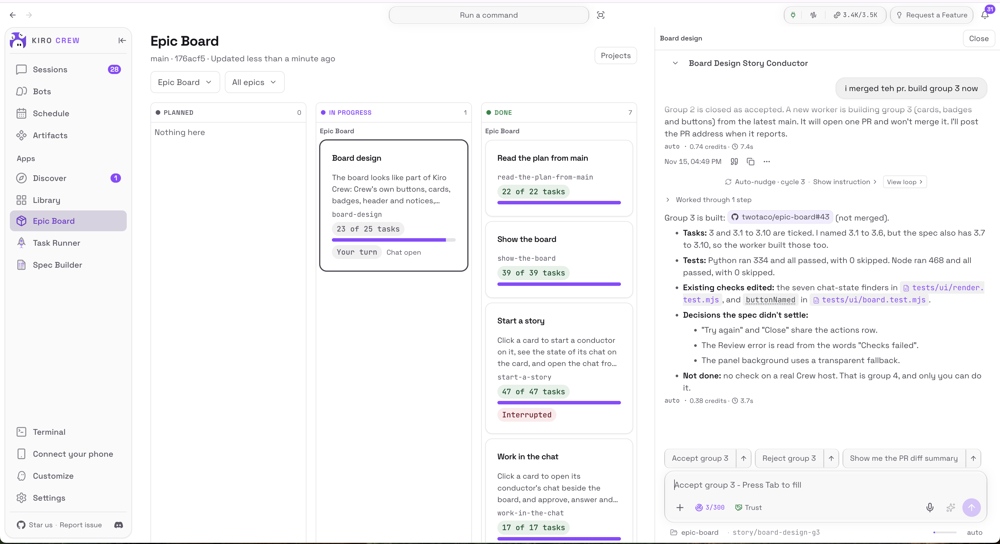

# Epic Board

Your whole Kiro plan on one board, and a crew to build it.



Epic Board is a [Kiro Crew](https://github.com/kirodotdev/KiroCrew) app. Every spec in your project is a card, grouped under its epic, in Planned, In progress and Done. Click a card to start a Crew conductor on that story. It writes the spec or builds the next task group and opens a pull request. Its chat opens right beside the board, so you approve, answer and steer it without leaving the plan.

- **Start work from the plan.** One click hands a story to a conductor, with a brief built from the spec.
- **See every story's state at a glance.** Needs you, Working, Stalled, Review #N with a link to the pull request, or Your turn. The state counts the conductor's workers too.
- **The plan stays true.** Cards come from `main` only, so a card moves when its work lands, and the board always shows what you actually have.
- **Several projects on one board.** Switch between them from a dropdown, and filter any project by epic.

You stay in charge: the board never merges, pushes or edits your plan, and it never approves or answers a chat for you. You do that in the chat beside it.

## Works with the kiro-epics power

Epic Board reads specs from `.kiro/specs/` and epics from `docs/epics/`, the layout of the [kiro-epics](https://github.com/twotaco/dead-reckoning/tree/main/powers/kiro-epics) power. With epics, cards are grouped under them, and stories that have no spec yet show as planned cards. A project without epics works too: every spec is a card under "No epic".

## Install

On the machine that runs Kiro Crew:

1. Clone this repository:

   ```sh
   git clone https://github.com/twotaco/epic-board.git ~/epic-board
   ```

2. Install it:

   ```sh
   kirocrew app install ~/epic-board
   ```

3. Enable **Epic Board** in Crew's App Store, and approve the permissions it asks for. It appears in the sidebar under Apps.

## Choose your projects

Each project needs a clone of its repository on the Crew machine, with an `origin` remote, and a Crew folder whose project directory is that clone. Make the folder in Crew's Sessions view, grouped by folder. The board reads the plan from `origin`'s main branch and checks for changes every minute, and a conductor you start from a card is created in the project's folder, so it works in the right repository.

Then open the board and press **Projects**. Tick the Crew folders you want on the board, give each project a name, and press **Save**. The board switches to them at once, and remembers them.

On a fresh install the board shows "Choose your projects" and takes you to the same place.

## Configure with a file

You can also list projects in a `config.json` in the app's folder. The board uses it until you save from **Projects**; after that, the saved choice wins.

One project:

```json
{
  "repository": "~/my-project",
  "folder_id": "0ce8af6cf9f5"
}
```

Several projects:

```json
{
  "projects": [
    { "name": "My Project", "repository": "~/my-project", "folder_id": "0ce8af6cf9f5" },
    { "name": "Epic Board", "repository": "~/epic-board", "folder_id": "2b6ed5ae811e" }
  ]
}
```

A folder's id is in `~/.kiro/crew/folders.json` on the Crew machine, with its `name` and `project_dir`. After changing `config.json`, apply it:

```sh
kirocrew app update epic-board --source ~/epic-board
```

`config.json` holds paths on your machine, so it is ignored by git and never committed.

## Development

The plan for this app lives in the app: the epic is [`docs/epics/epic-board.md`](docs/epics/epic-board.md) and each story's spec is in `.kiro/specs/`. Contributors and agents start with [`AGENTS.md`](AGENTS.md).

The backend uses the Python standard library only, and the page uses the host's React with no build step. Run the tests with:

```sh
python3 -m unittest discover -s tests -t .
```

The page tests run through it with Node, and are reported as skipped when Node is missing.

## License

[Apache-2.0](LICENSE)
